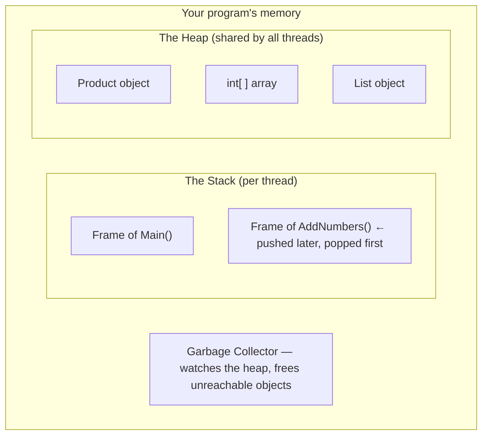
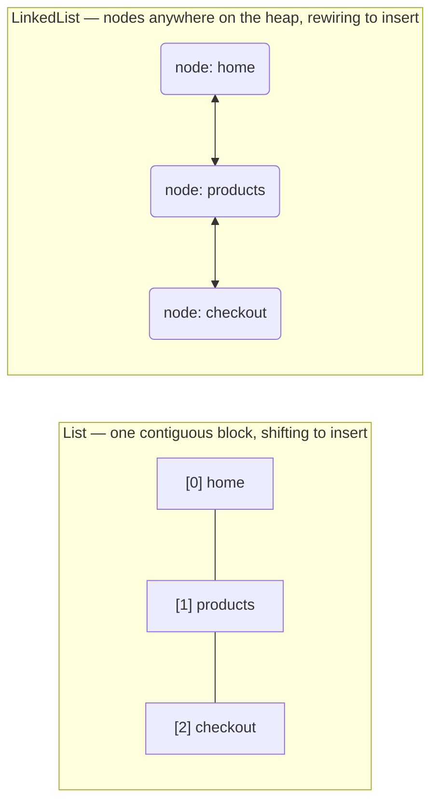
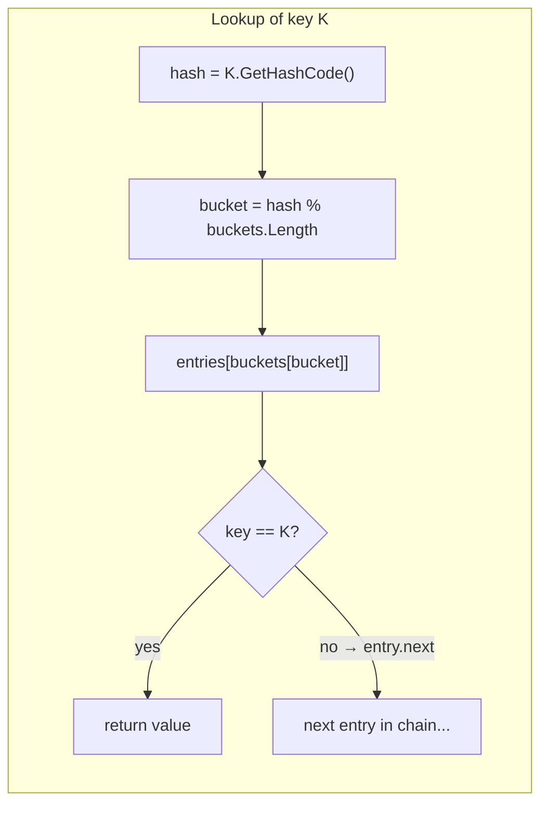
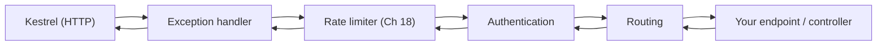

# The Complete C# and .NET Data Structures Master Guide

### From Absolute Zero to Mastery — Built for Web API and MVC Developers

Welcome. This single file is a complete, self-contained course on **data structures in C# / .NET**, written for someone who has **never touched a data structure before** and wants to reach a **mastery level**, with every concept tied to real **Web API and MVC** application scenarios.

Every code block you meet in this guide is explained **line by line**, and every code line is explained **word by word**. Nothing is assumed. Nothing is skipped.

---

## Who This Guide Is For

- Developers starting C# / .NET **from point zero**, who want to understand what a `List<T>` really is, not just press `.` and autocomplete.
- Developers building **Web APIs** (minimal APIs or controllers) who want fast, scalable endpoints.
- Developers building **MVC** web applications who want to understand what the framework itself is doing under the hood.
- Anyone preparing for **technical interviews**, where data structures are the main subject.

**Prerequisites:** knowing how to create and run a C# program helps, but Chapter 0 covers the required fundamentals anyway. No prior data structure knowledge is needed at all.

---

## How Every Chapter Is Written

Every topic in this guide follows the **same fixed narrative order**, so you always know where you are:

1. **Introduction** — what the structure is, in plain English, with a real-world analogy.
2. **A Brief History** — where it came from and why humans invented it.
3. **What It Provides** — the operations it gives you, and the guarantees it makes.
4. **Why Use It** — the concrete reasons, always with API / MVC scenarios.
5. **Implementation** — full code, explained line by line and word by word.

Then every chapter closes with a **complexity cheat sheet**, a list of **common mistakes**, a **short quiz** (click to reveal answers), and a **hands-on mini project**.

---

## The Learning Roadmap

This guide is ordered like a staircase. Each chapter stands on the previous one.

| Stage | Chapters | You will be able to... |
|---|---|---|
| Stage 1 — Foundations | 0 – 1 | Explain what a data structure is, how memory works, and analyze speed with Big-O. |
| Stage 2 — The .NET toolbox | 2 – 8 | Choose and correctly use arrays, lists, linked lists, stacks, queues, dictionaries, and sets. |
| Stage 3 — Build it yourself | 9 – 16 | Rebuild every structure from scratch: dynamic list, hash table, BST, heap, trie, graph. |
| Stage 4 — Real systems | 17 – 21 | Build caching, rate limiting, pagination, search, and a complete mini e-commerce API. |

**Suggested pace:** one chapter every 1–2 days, typing every example yourself. Reading is not learning; **typing the code and breaking it on purpose is learning**.

---

## Table of Contents

**[Part 0: Getting Started](#part-0)**
- [Chapter 0: Zero Point — What Is a Data Structure?](#ch-0)
- [Chapter 1: Big-O Notation From Zero](#ch-1)

**[Part I: The Linear Structures of .NET](#part-1)**
- [Chapter 2: The Array](#ch-2)
- [Chapter 3: List&lt;T&gt; — The Dynamic Array](#ch-3)
- [Chapter 4: LinkedList&lt;T&gt;](#ch-4)
- [Chapter 5: Stack&lt;T&gt;](#ch-5)
- [Chapter 6: Queue&lt;T&gt;](#ch-6)
- [Chapter 7: Dictionary&lt;TKey, TValue&gt;](#ch-7)
- [Chapter 8: HashSet&lt;T&gt; and SortedSet&lt;T&gt;](#ch-8)

**[Part II: Build Your Own (Mastery)](#part-2)**
- [Chapter 9: MyList&lt;T&gt; — Building a Dynamic Array From Scratch](#ch-9)
- [Chapter 10: MyLinkedList&lt;T&gt; — Building a Linked List From Scratch](#ch-10)
- [Chapter 11: MyStack&lt;T&gt; and MyQueue&lt;T&gt; — Building the Classics](#ch-11)
- [Chapter 12: MyHashTable&lt;K, V&gt; — Building a Dictionary From Scratch](#ch-12)
- [Chapter 13: Trees and the Binary Search Tree](#ch-13)
- [Chapter 14: Heaps and PriorityQueue](#ch-14)
- [Chapter 15: The Trie](#ch-15)
- [Chapter 16: Graphs](#ch-16)

**[Part III: Data Structures in Real APIs and MVC](#part-3)**
- [Chapter 17: In-Memory Caching](#ch-17)
- [Chapter 18: Rate Limiting](#ch-18)
- [Chapter 19: Pagination, Filtering, and Sorting](#ch-19)
- [Chapter 20: Inside ASP.NET Core MVC — The Framework Itself](#ch-20)
- [Chapter 21: Capstone — A Complete Mini E-Commerce API](#ch-21)

**[Appendices](#appendix-a)**
- [Appendix A: The Complete Big-O Cheat Sheet](#appendix-a)
- [Appendix B: Which Structure Should I Use?](#appendix-b)
- [Appendix C: Glossary](#appendix-c)

---

## Environment Setup (Do This Once)

Every example in this guide runs on **.NET 8**, the current Long-Term-Support (LTS) version. You need the .NET SDK, a terminal, and any editor.

**Step 1 — Install the .NET 8 SDK.**

Download it from `https://dotnet.microsoft.com/download/dotnet/8.0` (choose the SDK, not the runtime). The SDK includes the compiler, the runtime, and the `dotnet` command-line tool.

**Step 2 — Verify the installation.** Open a terminal (PowerShell, cmd, bash, zsh — anything) and run:

```bash
dotnet --version
```

You should see something like `8.0.xxx`. If you see "command not found", close and reopen your terminal, or reinstall.

**Step 3 — Create a console playground.** Most chapters use a plain console app. Run:

```bash
dotnet new console -n Playground     # creates a folder named Playground with a C# project
cd Playground                        # enter the folder
dotnet run                           # compiles and runs the project
```

- `dotnet new console -n Playground` — `-n` names the project; `console` picks the project template (a simple `Program.cs` with a `Main` entry point).
- `dotnet run` — restores packages, compiles, and runs in one command. You will use it hundreds of times in this guide.

**Step 4 — Create a web API playground.** For Part III (real API chapters) we use minimal APIs:

```bash
dotnet new webapi -n ShopApi   # creates a minimal-API web project (no controllers)
cd ShopApi
dotnet run
```

Then open the printed URL (something like `http://localhost:xxxx`) in a browser, or call endpoints with `curl`:

```bash
curl http://localhost:5xxx/products
```

**Step 5 — Pick an editor.** Any of these work, in increasing order of weight:
- **VS Code** + the "C# Dev Kit" extension (free, lightweight).
- **Visual Studio 2022** (Windows; full IDE).
- **JetBrains Rider** (cross-platform, paid).

All examples here are editor-agnostic: they are plain `.cs` files compiled by `dotnet run`.

**A habit that will carry you through this guide:** after every example, *change something* — remove a line, swap two lines, make the loop count to a million — and observe what happens. That experimentation loop is where real understanding forms.

---

<a id="part-0"></a>
# Part 0: Getting Started

Part 0 gives you the two tools everything else depends on: a mental model of **memory** (Chapter 0) and the language of **speed analysis** (Chapter 1). Do not skip these two chapters — every later sentence leans on them.

<a id="ch-0"></a>
## Chapter 0: Zero Point — What Is a Data Structure?

### 0.1 Introduction

Imagine you run a warehouse. You can store items in **one giant pile on the floor**, or you can install **shelves, bins, and labels**. The items are the same either way — but with shelves, "fetch me product #4127" takes seconds; with a pile, it takes an hour.

A **data structure** is the shelf system for your program's data. Formally:

> A data structure is a specific way of **organizing** data in memory, together with a set of **operations** you can perform on it (add, find, remove, iterate) and a set of **rules** about how those operations behave.

The same data, organized differently, gives wildly different performance. If your API keeps 100,000 product IDs in the wrong structure, a lookup can take **a few operations** or **a hundred thousand operations** — the difference between a 2 ms response and a 5 second timeout.

A few more analogies to anchor the idea:

- **Array** = a street of numbered houses. House number → instant access.
- **Linked list** = a scavenger hunt: each clue points to the next location. To reach clue 50 you must follow clues 1–49.
- **Stack** = a pile of cafeteria plates. Last plate put on is the first plate taken off.
- **Queue** = a line at the bank. First person in is the first person served.
- **Dictionary** = a real dictionary or phone book. You jump straight to "S" for "Smith" instead of reading every page.
- **Tree** = a family tree or company org chart: one root, branching levels.
- **Graph** = a map of cities and roads: any city can connect to any city.

Every structure answers the same three questions differently:

1. **How do I find things?**
2. **How do I add things?**
3. **How do I remove things?**

The whole craft of this guide is matching each question to the right structure.

### 0.2 A Brief History

The concept is old and practical. Arrays appeared in the earliest electronic computers of the 1940s–50s, as programmers needed tables of values laid out consecutively in memory; Fortran (1957) made arrays a first-class language feature. Linked lists were described in 1955–56 by Allen Newell, Herbert Simon, and Cliff Shaw while building early AI programs. Hash tables were introduced around 1953 by Hans Peter Luhn at IBM. Balanced trees (AVL) arrived in 1962, heaps in 1964, tries around 1960, and graph theory goes all the way back to Leonhard Euler in 1736.

On the .NET side: **.NET Framework 1.0 (2002)** shipped type-unsafe collections like `ArrayList` (everything was `object`, requiring costly "boxing" conversions). **C# 2.0 (2005)** introduced **generics** (`List<T>`, `Dictionary<K,V>`), which gave us type-safe, fast collections — the ones we use today. **.NET Core (2016)** and the unified **.NET 5+ (2020)** rebuilt the entire runtime as open source, and **.NET 8 (2023)** is the LTS this guide targets — it even added new structures such as `FrozenDictionary`.

**The lesson of history:** structures were not invented to torture students. Each one solved a real production problem — just like the API problems you face today.

### 0.3 What It Provides

Understanding data structures gives you four permanent abilities:

1. **Choosing the right container.** "I need fast lookups by ID" → dictionary. "I need order + appends" → list. "I need uniqueness" → set. "I need priority" → heap. This decision is daily work in API development.
2. **Predicting cost.** Before running code, you can state whether an endpoint does 10 operations or 10 million — and explain it in a code review with Big-O notation (Chapter 1).
3. **Debugging performance.** When the API is slow, you know *where to look*: a `Contains` call inside a loop, a resize storm, a cache miss pattern.
4. **Designing systems.** Caches, rate limiters, job queues, search suggestions, recommendation engines — Part III shows each of these is just a data structure wearing a business suit.

### 0.4 Why It Matters in APIs and MVC

Web servers are a special environment that makes data structures *more* important, not less:

- **Every request is a clock race.** A client (browser, mobile app, another service) is waiting on the network. Your data-structure choices directly become milliseconds added to or subtracted from every response. At scale, a slow endpoint multiplied by millions of requests wastes real money.
- **Many requests run at the same time.** Ten requests can execute in parallel on ten threads. A data structure that is fine in a console app can corrupt or crash in an API because it was **not designed for concurrent access**. Chapter 20 turns this into concrete rules.
- **Data grows over time.** Your products table has 50 rows on day one and 500,000 rows in year two. An endpoint that was fast with the wrong structure becomes a production incident later. Big-O (Chapter 1) is the early-warning system.
- **The framework itself is data structures.** ASP.NET Core's dependency-injection container, its middleware pipeline, its route matching, model binding, `ViewBag`, session state — all of them are dictionaries, lists, trees, and graphs under the hood. Chapter 20 opens that black box.

A concrete preview of the kind of bug this guide will train you to spot and fix:

```csharp
// BUG: for 1,000 users × 10,000 products this loop does 10,000,000 comparisons
foreach (var blockedId in blockedIds)          // blockedIds is a List<int>
{
    if (activeUserIds.Contains(blockedId))     // Contains on a List scans ALL items: O(n)
    {
        // handle
    }
}

// FIX: same code with a HashSet<int> does ~1,000 hash lookups: O(1) each
```

Same lines, same language, same output — **thousands of times faster**. That is the entire value proposition of this guide in one snippet.

### 0.5 Memory Fundamentals — Line by Line

You cannot truly understand a data structure without a mental picture of **memory**. Let us build one from zero, then never be vague about "where does this live?" again.

#### 0.5.1 The two memory regions

When your .NET program runs, the OS gives it a block of memory, and the runtime organizes it into two main areas:

| Region | Also called | Stores | Managed by | Lifetime |
|---|---|---|---|---|
| **The stack** | call stack | local variables, method parameters, return addresses | automatic — each method call pushes a "frame", each return pops it | Ends when the method returns |
| **The heap** | managed heap | objects created with `new` (arrays, class instances, lists...) | the **Garbage Collector (GC)** | Ends when the GC confirms nothing references it |

Important vocabulary note: "the stack" (the memory region) and the **Stack\<T\> data structure** (Chapter 5) share a name because they share the **LIFO idea** — last in, first out. They are different things. Keep both in mind; when someone says "the call stack", they mean the memory region.



#### 0.5.2 Value types vs reference types — the single most important memory fact

C# types come in exactly two flavors, and every data structure decision touches this:

- **Value types**: `int`, `long`, `double`, `decimal`, `bool`, `char`, `struct`, `enum`, `DateTime` (yes, `DateTime` is a struct). The **value itself** lives in the variable. Assigning one to another **copies the whole value**.
- **Reference types**: `class`, `string`, arrays, `List<T>`, delegates. The variable holds a **reference** (a memory address). Assigning one to another **copies the address — both variables then point to the same object**.

Let us read a program line by line. Create a console app and type this into `Program.cs`:

```csharp
int age = 30;                          // 1
decimal price = 19.99m;                // 2
string name = "Ada";                   // 3
int copy = age;                        // 4
copy = 99;                             // 5
var scores = new List<int>();          // 6
scores.Add(95);                         // 7
var sameScores = scores;               // 8
sameScores.Add(87);                    // 9
Console.WriteLine(age);                // 10
Console.WriteLine(copy);               // 11
Console.WriteLine(scores.Count);       // 12
Console.WriteLine(sameScores.Count);   // 13
```

Now every line, word by word:

- **Line 1 — `int age = 30;`** — `int` is a 32-bit integer **value type**. The four bytes representing 30 are stored directly in `age`'s slot, which lives in `Main`'s stack frame. `=` puts the value in. The `;` ends the statement.
- **Line 2 — `decimal price = 19.99m;`** — `decimal` is a 16-byte high-precision decimal type used for **money in business apps**. The suffix `m` (money) tells the compiler "this literal is a `decimal`, not a `double`" — without `m`, the line would not compile, because `19.99` defaults to type `double` and `double` cannot implicitly convert to `decimal`.
- **Line 3 — `string name = "Ada";`** — `string` is a **reference type**. The characters `"Ada"` live in an object on the **heap**; the variable `name` stores the object's address. Also note: strings are **immutable** — every "modification" of a string actually creates a brand-new heap object (we return to this in Chapter 1, because it causes real O(n²) bugs).
- **Line 4 — `int copy = age;`** — value type assignment **copies the value**: the number 30 is duplicated into a second 4-byte slot. `copy` and `age` are now completely independent.
- **Line 5 — `copy = 99;`** — changes only the `copy` slot. `age` is untouched and still 30. This independence is the whole point of value types.
- **Line 6 — `var scores = new List<int>();`** — three new words. `var` means "compiler, infer the type from the right side" (it becomes `List<int>`; `var` is not dynamic typing, just shorthand). `new` allocates a `List<int>` object **on the heap**. `List<int>` is a **generic** class: the `<int>` says "this list can only contain ints" — generics are covered properly in Chapter 3. After this line, `scores` (on the stack) holds the heap object's address.
- **Line 7 — `scores.Add(95);`** — calls the list's `Add` method, storing 95 inside the heap object. The list now contains `[95]`.
- **Line 8 — `var sameScores = scores;`** — **reference type assignment copies the address, not the object.** Draw two arrows: `scores` → heap object, `sameScores` → **the same** heap object. There is still only ONE list in memory.
- **Line 9 — `sameScores.Add(87);`** — adds 87 through the second reference. Since both variables point to one object, the single list is now `[95, 87]`.
- **Lines 10–13 — `Console.WriteLine(...)`** — prints results to the console. The output is: `30`, `99`, `2`, `2`. Line 10 proves value independence (age kept 30). Lines 12–13 print `2` and `2` — both variables see the **same** mutated list. This aliasing behavior is the #1 source of "why did my object change?!" bugs in real APIs — for example, when a cached list is returned to a request and the caller mutates it, corrupting the cache for everyone (Chapter 17 addresses exactly this).

#### 0.5.3 The Garbage Collector in one paragraph

You never manually free heap memory in C#. The **Garbage Collector (GC)** periodically traces which heap objects are still reachable from running code; unreachable ones are freed automatically. Why do you care in a data-structures guide? Because **every node, every array, every temporary list you allocate becomes GC work**. A structure that allocates one object per element (`LinkedList<T>`, Chapters 4 and 10) creates millions of small objects at scale, and the GC cost becomes visible in your API's latency. A structure that packs values into one big contiguous array (`List<T>`, Chapter 3) is far friendlier to the GC. This is one of the *hidden* reasons arrays are the backbone of .NET collections — and why "the fastest code is often the code that allocates the least."

#### 0.5.4 The CPU cache: the invisible performance multiplier

One last physical fact, because it explains results you will measure yourself in Chapter 2: when the CPU reads one byte from RAM, it actually pulls in a whole **cache line of ~64 bytes** around it. Neighboring memory becomes nearly free to read next.

- An **array** stores elements side by side → walking it means the next element is already in the cache → extremely fast.
- A **linked list** stores nodes wherever the heap found space → every hop is a random memory trip → much slower per element than the array, even when Big-O says both walks are "O(n)".

Big-O counts operations; the cache decides how *heavy* each operation is. Mastery means holding both facts at once — this is exactly why we will not treat "same Big-O" as "same speed".

### 0.6 How We Measure Speed From Now On

Two tools appear throughout this guide:

1. **Stopwatch** (`System.Diagnostics.Stopwatch`) — precise timer for quick experiments:

```csharp
var sw = Stopwatch.StartNew();          // 1
long total = 0;
for (int i = 0; i < 100_000_000; i++)   // 2
{
    total += i;                          // 3
}
sw.Stop();                              // 4
Console.WriteLine($"{total} in {sw.ElapsedMilliseconds} ms");  // 5
```

- **Line 1** — `StartNew()` creates a stopwatch already running; `sw` holds it.
- **Line 2** — `100_000_000` — underscores in numeric literals are ignored by the compiler and exist purely to make large numbers readable (one hundred million). `i++` adds 1 each iteration.
- **Line 3** — the work being measured.
- **Line 4** — freezes the elapsed time.
- **Line 5** — `$"..."` is an **interpolated string**: expressions inside `{ }` are evaluated and inserted.

2. **BenchmarkDotNet** — the professional statistical benchmarking library. We mention it and show setup in Chapter 2; Stopwatch is enough for our relative comparisons.

### 0.7 Chapter 0 Quiz

1. Two variables of a `class` type are assigned to each other. How many objects exist afterward? Does mutating through one affect the other?
2. Where does a local `int` live, and where does a `new`-created object live? Who cleans up each area?
3. Why can two structures with the same Big-O complexity have very different real-world speed?

<details><summary>Answers</summary>

1. **One** object, two references. Yes — mutations through either reference are visible through both, because there is only one underlying object.
2. The `int` lives in the method's **stack frame** (freed automatically when the method returns). The object lives on the **managed heap**, and the **Garbage Collector** frees it when no references remain.
3. Big-O counts operations, not their cost. Contiguous memory (arrays) benefits from **CPU cache lines**, while pointer-chasing structures (linked lists) cause random memory accesses that each cost a cache miss.
</details>

### 0.8 Mini Project 0

Set up the environment and prove aliasing to yourself: create a console app; declare a `List<string>` named `cart`, assign it to another variable, `Add` an item through the second variable, then print the count through the first. Explain out loud, in one sentence, why both counts changed. Then time a loop of 1 billion additions with `Stopwatch` and record your machine's milliseconds.

---

<a id="ch-1"></a>
## Chapter 1: Big-O Notation From Zero

### 1.1 Introduction

"Is this code fast?" is the wrong question. *"How does this code's work **grow** when the data grows from 10 rows to 10 million rows?"* is the right one. **Big-O notation** is the standard language for answering it.

Big-O describes **the shape of the growth curve**: double the input, what happens to the work? It deliberately ignores hardware, language, and constant factors, because those change every year while the growth shape is a permanent property of the **algorithm and data structure** you chose.

Analogy: you can describe a delivery route as "3 km" (absolute) or "crosses the whole city" (shape). Big-O is the second kind of description: `O(n)` means "work grows in a straight line with data size"; `O(n²)` means "work grows as a square — a little more data, a LOT more work".

### 1.2 A Brief History

The notation itself comes from mathematics: O was introduced by Paul Bachmann in 1894 and popularized by Edmund Landau for number theory — hence the name "Landau notation". Donald Knuth imported it into computer science in his 1976 paper *"Big Omicron and Big Omega and Big Theta"* and recommended the letter O (omicron) — the symbol for "order of growth". It became the universal vocabulary of algorithm analysis, so it is the vocabulary of every technical interview and every serious code review.

### 1.3 What It Provides

Big-O gives you a *vocabulary* with a small alphabet. These are the symbols you will see in this guide, from cheapest to most expensive:

| Notation | Name | Meaning: "if data doubles..." | Typical example |
|---|---|---|---|
| **O(1)** | Constant | work stays the **same** | Array index access, dictionary lookup |
| **O(log n)** | Logarithmic | work grows by a **tiny fixed step** | Binary search, balanced tree operations |
| **O(n)** | Linear | work **doubles** | Scanning every element once |
| **O(n log n)** | Linearithmic | slightly more than doubles | Good sorting (`List.Sort`) |
| **O(n²)** | Quadratic | work **quadruples** | Comparing every element with every other |
| **O(2ⁿ)** / **O(n!)** | Exponential / factorial | explodes | Naive password cracking; brute-force permutations |

Concrete numbers to feel the differences (values of log₂ n rounded):

| n | log₂ n (O(log n)) | O(n) | O(n log n) | O(n²) |
|---|---|---|---|---|
| 10 | 3 | 10 | 33 | 100 |
| 1,000 | 10 | 1,000 | ~10,000 | 1,000,000 |
| 1,000,000 | 20 | 1,000,000 | ~20,000,000 | 1,000,000,000,000 |

Read the last row carefully: at one million items, an O(n²) algorithm does **a trillion** operations — that is not "slow", that is "the server is on fire". And O(log n) barely noticed the size at all: 20 steps. This is why binary search (Chapter 2) and balanced trees (Chapter 13) exist.

**The simplification rules.** To compute Big-O you only need three rules:

1. **Drop constants**: `3n` operations is still `O(n)` — a constant multiplier never changes the curve's *shape*.
2. **Drop lower-order terms**: `n² + 50n + 100` is `O(n²)` — for large n, the n² term dwarfs everything else, so only the fastest-growing term matters.
3. **We usually report the worst case** unless stated otherwise — APIs must survive worst-case days (Black Friday), not just average Tuesdays.

Plus one crucial refinement used constantly in this guide:

**Amortized cost.** Some operations are occasionally expensive but cheap "on average over time". Example: `List<T>.Add` is O(1) *amortized* — most adds are one step, but occasionally the list must resize (a copy). Spread across thousands of adds, the copies average out to a small constant. Chapter 9 shows the exact math when we build our own list.

### 1.4 Why Use It in APIs and MVC

1. **It predicts the future.** A code review comment like "this is O(n²) over all users on every request" is a precise, testable, professional statement — better than "this feels slow".
2. **It finds the slow endpoint before production does.** Endpoints look fine in dev with 20 sample rows. Big-O analysis tells you what happens with 200,000 rows, without needing 200,000 rows to test.
3. **It is the map for this entire guide.** Every chapter's cheat sheet is written in Big-O. After this chapter you can read all of them.
4. **It is the core of interviews.** "What is the complexity of dictionary lookup and why?" — you will answer that from memory by Chapter 7.

### 1.5 Counting Operations — Line by Line

Big-O is not decoration; it is **counting**, then simplifying. Let us count real code.

#### Example A: O(1) — constant time

```csharp
int[] scores = { 10, 20, 30, 40, 50 };   // 1
int third = scores[2];                     // 2
```

- **Line 1** — declares an array of 5 ints (Chapter 2 covers arrays fully; here we only need that it is 5 numbers in a row).
- **Line 2** — reads the element at index 2. The CPU computes one address and fetches it — a fixed number of steps **no matter what**. Whether the array holds 5 elements or 5 million, this line takes the same amount of work. That is **O(1)**.

#### Example B: O(n) — linear time

```csharp
long total = 0;                       // 1
for (int i = 0; i < scores.Length; i++)// 2
{
    total += scores[i];                // 3
}
```

- **Line 1** — a `long` accumulator (64-bit, so we cannot overflow while summing many ints).
- **Line 2** — `i` starts at 0 and runs until it equals `scores.Length` (5 here). The loop body executes once **per element**: n elements → n executions.
- **Line 3** — adds one element to the total. Counting: line 3 runs n times → work grows in a straight line with n → **O(n)**. If the array doubles, this loop's work doubles.

#### Example C: O(n²) — the API killer

```csharp
bool hasDuplicate(List<int> ids)               // 1
{
    for (int i = 0; i < ids.Count; i++)         // 2
    {
        for (int j = i + 1; j < ids.Count; j++) // 3
        {
            if (ids[i] == ids[j])               // 4
            {
                return true;                    // 5
            }
        }
    }
    return false;                               // 6
}
```

- **Line 1** — a method taking a `List<int>` (introduced properly next chapter; here "a list of ids") and returning `bool` (true/false).
- **Line 2** — outer loop: visits each element once → n iterations.
- **Line 3** — inner loop: for each outer element, compares against **every later element** → roughly n more iterations per outer iteration.
- **Line 4** — one comparison.
- **Line 5** — found a match → immediately returns true (best case can be fast; **worst case** — no duplicates — runs *every* comparison).
- **Line 6** — no match found → false.

Total work: n × n = **O(n²)**. With 1,000 ids this is ~500,000 comparisons per request. With 100,000 ids (a "small" batch endpoint) it is ~5,000,000,000 comparisons — **five billion** — per request. Multiply by requests per second, and this single method can take down a server.

#### Example D: O(log n) — halving the world each step

```csharp
int binarySearch(int[] sorted, int target)         // 1
{
    int low = 0;                                     // 2
    int high = sorted.Length - 1;                    // 3
    while (low <= high)                              // 4
    {
        int mid = low + (high - low) / 2;            // 5
        if (sorted[mid] == target) return mid;        // 6
        if (sorted[mid] < target) low = mid + 1;     // 7
        else high = mid - 1;                         // 8
    }
    return -1;                                       // 9
}
```

- **Line 1** — the input **must be sorted**; that precondition is the entire trick (we return -1 for "not found" since -1 is never a valid index).
- **Line 2** — `low` is the left boundary of the region that can still contain the target; start at the first index.
- **Line 3** — `high` is the right boundary; start at the last index.
- **Line 4** — keep searching while the candidate region is non-empty.
- **Line 5** — the middle index. Written as `low + (high - low) / 2` instead of `(low + high) / 2` because the latter can **integer-overflow** when low and high are huge — a classic production bug in binary search written "the obvious way".
- **Line 6** — hit: found the target, return its index.
- **Line 7** — middle too small → the target can only be in the **right half**; discard the left half by moving `low` past mid.
- **Line 8** — middle too big → discard the right half by pulling `high` below mid.
- **Line 9** — region became empty; the target is absent.

Each iteration throws away **half** of the remaining elements. Searching 1,000,000 sorted items takes at most **20** iterations (1,000,000 → 500,000 → 250,000 → ... → 1), because you can only halve a million about 20 times. That is **O(log n)**. Compare with the O(n) scan: up to 1,000,000 reads.

#### Example E: O(n log n) — the cost of good sorting

`Array.Sort` / `List<T>.Sort` use an optimized hybrid (Introsort: quicksort + heapsort + insertion sort) performing roughly n·log n comparisons. Sorting 1,000,000 items ≈ 20 million comparisons — which is why "sort on every request" is a smell but "sort once, then binary-search many times" is a classic optimization you will build in Chapter 19.

### 1.6 Measuring the Difference Yourself

Type this comparison between two duplicate-detection strategies. It uses `HashSet<int>` — a structure you will master in Chapter 8; for now just know its `Add` returns true only if the item was **not** already present.

```csharp
int n = 50_000;                                // 1
var ids = Enumerable.Range(0, n).ToList();     // 2
ids.Add(12345);                                // 3

var sw = Stopwatch.StartNew();                 // 4
bool a = hasDuplicate(ids);                    // 5
sw.Stop();
Console.WriteLine($"O(n^2) nested loops: {a}, {sw.ElapsedMilliseconds} ms");  // 6

sw = Stopwatch.StartNew();                    // 7
var seen = new HashSet<int>();                // 8
bool b = ids.Any(id => !seen.Add(id));        // 9
sw.Stop();
Console.WriteLine($"O(n) with HashSet:  {b}, {sw.ElapsedMilliseconds} ms");   // 10
```

- **Line 1** — dataset size; raise this number and watch the gap explode.
- **Line 2** — `Enumerable.Range(0, n)` generates the integers 0,1,2,...,n-1 lazily; `.ToList()` materializes them into a `List<int>`.
- **Line 3** — deliberately plant one duplicate so both methods return true.
- **Line 4** — start timing.
- **Line 5** — call the O(n²) method from Example C.
- **Line 6** — report the O(n²) result and elapsed milliseconds.
- **Line 7** — restart the stopwatch for the second experiment.
- **Line 8** — an empty `HashSet<int>`; think "a box that automatically rejects duplicates" for now.
- **Line 9** — `seen.Add(id)` returns false when id is a duplicate; `!seen.Add(id)` is true then. `ids.Any(...)` (LINQ) returns true at the first element where the condition holds — and stops there. Each `Add` is O(1), done at most n times → **O(n)** total.
- **Line 10** — report the O(n) result.

On a typical laptop with n = 50,000 the nested-loop version needs **several seconds** (≈ 1.25 billion comparisons) while the HashSet version finishes in **~1–2 ms** (your exact numbers will differ; the *ratio* is the point). Same answer, thousandfold difference — same code review, very different outcome.

### 1.7 Amortized Analysis — the Fine Print You Will Actually Use

Why is `List<T>.Add` honestly called O(1) when it sometimes performs a huge copy? Because the expensive cases are **rare and self-limiting**. A list doubles its capacity each time it fills: capacities go 4 → 8 → 16 → 32 ... To add n items you copy at most 4+8+16+...+n ≈ **2n** total elements — so n adds cost at most 3n element-writes total, which is O(n) overall, **O(1) per add on average**. That average is what "amortized O(1)" means, and Chapter 9 demonstrates it by rebuilding the mechanism from scratch.

### 1.8 Common Mistakes

1. **Believing O(1) means "instant".** It means "doesn't grow with n". A slow constant is still slow: a dictionary lookup doing one hash over a giant 10,000-character key is O(1) but not free.
2. **Assuming same Big-O means same speed.** Cache locality (Chapter 0) can make an O(n) array walk beat an O(n) linked-list walk by 10×. Big-O predicts *growth*, not absolute milliseconds.
3. **String building in loops.** `s += x` inside a loop is O(n²) because strings are immutable — each `+=` copies the whole string so far. The fix is `StringBuilder` (one buffer, amortized growth), a pattern identical to `List<T>` growth.
4. **Hidden O(n) traps.** `list.Contains(x)` inside a loop over m items = O(n·m). `dict.Keys.Contains`? That's a linear scan of the keys — always use `ContainsKey`. Chapters 3 and 7 catalog these.
5. **Ignoring the "n" of the request.** An O(n²) admin endpoint run once a day is fine. The same algorithm per-GET-request at 500 req/s is an outage. Big-O must be multiplied by **how often** the code runs.

### 1.9 Chapter 1 Cheat Sheet

| Code pattern | Complexity |
|---|---|
| `arr[i]`, `dict[key]` (hit) | O(1) |
| `list.Add` | O(1) amortized |
| Loop over n items, constant work each | O(n) |
| Loop containing `Contains`/`IndexOf` on a List of n | O(n × m) |
| Nested loops over the same n | O(n²) |
| `Array.Sort` / `list.Sort` | O(n log n) |
| Binary search on sorted data | O(log n) |
| Balanced-tree operations (SortedSet/SortedDictionary) | O(log n) |

### 1.10 Chapter 1 Quiz

1. Simplify `5n² + 300n + 9000` to Big-O and name the rule you used.
2. An endpoint scans a 4,000-row list once per request with constant work per row. Complexity? What happens if traffic doubles?
3. Why is `List<T>.Add` O(1) "amortized" rather than plain O(1)?

<details><summary>Answers</summary>

1. **O(n²)** — keep only the fastest-growing term and drop the constant (rules 2 and 1).
2. O(n) per request. If traffic doubles, total server work doubles (n is fixed, request count doubles) — linear scaling is usually survivable, but each request still pays the scan; caching (Chapter 17) removes it.
3. Because occasionally it triggers a resize (copy of all elements). Doubling capacity makes resizes geometrically rare, so the total cost over n adds averages to a constant per add.
</details>

### 1.11 Mini Project 1

Write a console app that, for n = 1,000 / 10,000 / 100,000, measures: (a) building `Enumerable.Range(0, n).ToList()`, (b) calling `Contains(n/2)` on that list, (c) sorting a copy, (d) the nested-loop duplicate check on a list with one duplicate. Print a table of n vs milliseconds. Then write one sentence per row explaining the growth you observed in Big-O terms.

---
<a id="part-1"></a>
# Part I: The Linear Structures of .NET

Part I is your toolbox. You will meet the eight built-in structures that carry 95% of real .NET workloads, understand exactly what each costs, and — most importantly — learn **when to reach for which one** in an API. Each chapter builds on the previous: the List is a resizable array, the Stack and Queue are restricted lists, and the Dictionary reuses the hashing idea you will first meet in Chapter 8's sets.

<a id="ch-2"></a>
## Chapter 2: The Array

### 2.1 Introduction

The **array** is the mother of all data structures: a row of numbered boxes sitting **side by side in memory**, all the same type, all the same size, addressed by number.

Analogy: a street with numbered houses. The city knows exactly where house #1 sits, and every house occupies the same width, so house #47's address can be computed instantly: *start of the street + 47 × width of one lot*. Nobody needs to walk past houses 1–46 to find it. That single property — **random access by index** — is what makes arrays the fastest structure in computing and the foundation on which .NET builds `List<T>`, `Stack<T>`, `Queue<T>` and the hash table's bucket arrays.

### 2.2 A Brief History

Arrays are as old as stored-program computing: from the earliest machines in the 1940s, programmers laid out tables of numbers in consecutive memory cells and indexed them with counters in registers. The 1953–57 generation of high-level languages — Fortran above all — made arrays a first-class language feature, and every language since has them. In C#-land, arrays were in the language from day one (2002); everything collection-like that came later (`ArrayList`, then `List<T>` in 2005) is an **array in costume** — a fact you will prove yourself in Chapter 9 when you build `MyList<T>`.

### 2.3 What It Provides

An array gives you:

| Feature | Detail | Cost |
|---|---|---|
| **Fixed size** | Chosen at creation; cannot grow or shrink | — |
| **Indexer** `arr[i]` | Read or write element at position i, 0-based | **O(1)** |
| **Contiguous memory** | All elements side by side | cache-friendly iteration |
| **Length** | `arr.Length` — set at creation | O(1) |
| **Multidimensional** `[,]` | Rectangular grid | — |
| **Jagged** `[][]` | Array of arrays (rows of different lengths) | — |
| **`System.Array` helpers** | `Sort`, `BinarySearch`, `Copy`, `Resize`, `Reverse`, `Find`, `IndexOf` | various (below) |

And the honest limits: no `Add`, no `Remove`, no `Count` property — if you need a container that changes size, that is Chapter 3's `List<T>` (or you pay for `Array.Resize`, which we will see is secretly "make a new array and copy").

### 2.4 Why Use It in APIs and MVC

1. **It is the fastest thing there is.** JSON serializers write `[]` payloads from arrays at top speed; iteration over contiguous memory is the best case for the CPU cache (Chapter 0).
2. **APIs return data that rarely changes in size.** A `string` **is** an array of characters; an HTTP response body is a byte array; file uploads arrive as `byte[]` and files read as arrays (`File.ReadAllBytes`); `IFormFile`'s contents are array streams. Arrays are everywhere in the HTTP pipeline.
3. **Fixed read-only lookup tables.** Country codes, currency lists, supported languages, error-code tables — data known at startup is the perfect array (and Chapter 20's `FrozenDictionary` is its fancy sibling).
4. **Interop and serialization.** `System.Text.Json` and EF materialize rows into arrays; Span/buffers that power Kestrel's request parsing are array-like memory views.

### 2.5 Implementation — Line by Line

Create a console app. We will build up array fluency in four passes: create → read/write → the helpers → the two multidimensional forms.

#### Pass 1: Creating arrays (every way you will meet)

```csharp
int[] empty = Array.Empty<int>();                  // 1
int[] scores = new int[5];                         // 2
int[] preset = new int[] { 90, 85, 77, 100, 64 };  // 3
int[] shorthand = { 90, 85, 77 };                  // 4
string[] names = new string[3];                    // 5
Console.WriteLine(scores.Length);                 // 6
```

- **Line 1 — `Array.Empty<int>()`** — returns a **singleton empty array** (a cached, shared zero-length object). This is the correct way to say "no items" when returning arrays from APIs — better than `new int[0]`, which allocates a fresh (useless) object every call.
- **Line 2 — `new int[5]`** — allocates one block of memory holding **5 ints** (5 × 4 = 20 bytes of element storage). Every element is auto-initialized to its type's default: `0` for numeric types. The size is fixed **forever**.
- **Line 3** — the "full form" with an explicit size and a `{ ... }` initializer listing the 5 values. The compiler counts the values and sizes the array for you.
- **Line 4 — the shorthand** — same as line 3 but the compiler infers `new int[]`. **Allowed only as a variable initializer** (with a declared type on the left); `var arr = {1,2,3};` does not compile.
- **Line 5 — `string[3]`** — an array of **references**: 3 slots, each initialized to `null` (the default for reference types — a slot that points nowhere yet). The strings themselves will live on the heap later.
- **Line 6 — `.Length`** — a property (not a method — no parentheses) returning the fixed count. Prints `5`.

#### Pass 2: The O(1) indexer — and the index math behind it

```csharp
scores[0] = 95;                        // 1
scores[4] = 88;                        // 2
int third = scores[2];                 // 3
Console.WriteLine(scores[0]);         // 4
// Console.WriteLine(scores[5]);      // 5  (would throw!)
```

- **Line 1** — index `0` writes 95 into the **first** box. Arrays are 0-based: the index counts "how many boxes after the start".
- **Line 2** — index `4` is the **last** valid index of a length-5 array (0,1,2,3,4 — five boxes).
- **Line 3** — reading index 2 into a variable: the CPU computes the address directly.
- **Line 4** — prints `95`.
- **Line 5** — uncommenting this throws **`IndexOutOfRangeException`** at runtime — the classic off-by-one bug. Index 5 means "five boxes past the start", which is one box *past the end*. The compiler cannot catch this (the index might come from a request!), so the **runtime** checks every array access. Guard every index that originates from user input.

The machine instruction behind lines 1–3 is one address computation:

```text
address of element[i]  =  start address  +  i × size of one element

     start = 0x1000, int = 4 bytes        scores[2]:
     0x1000 + 2 × 4 = 0x1008  ✓

     index:      0        1        2        3        4
     address: 0x1000   0x1004   0x1008   0x100C   0x1010
     value  :  |95  |    | 0  |    | 0  |    | 0  |    |88  |
               byte0   byte4     byte8    byte12   byte16
```

No loops. No searching. That picture *is* O(1): one multiplication and one addition, whether the array has 5 elements or 5 million. This is also why all elements must be the **same type and size** — the math depends on it.

#### Pass 3: The System.Array helpers you will use weekly

```csharp
int[] scores = { 90, 85, 77, 100, 64 };      // 1
Array.Sort(scores);                          // 2
int pos = Array.BinarySearch(scores, 90);    // 3
int[] slice = new int[3];                    // 4
Array.Copy(scores, slice, 3);                // 5
Array.Reverse(scores);                       // 6
int firstBig = Array.Find(scores, s => s > 80);  // 7
Array.Resize(ref scores, 7);                 // 8
```

- **Line 1** — a fresh 5-element array with values.
- **Line 2 — `Array.Sort(scores)`** — sorts **in place** (mutates the same array; no new object), using an O(n log n) hybrid algorithm (Introsort). Result: `{ 64, 77, 85, 90, 100 }`.
- **Line 3 — `Array.BinarySearch`** — binary search (Chapter 1's halving trick) for value 90. **Precondition: the array is sorted** — on unsorted data the result is meaningless garbage. Returns the index (3 here) or a negative number encoding "not found". Complexity O(log n).
- **Line 4** — a destination array to copy into.
- **Line 5 — `Array.Copy(source, destination, length)`** — copies the first 3 elements into `slice`, a fast CPU-level bulk move (essentially `memcpy`). Copying k elements is O(k) — remember that cost, it returns in every chapter.
- **Line 6 — `Array.Reverse(scores)`** — reverses in place: `{ 90, 85, 77 }` becomes `{ 77, 85, 90 }` in `slice`'s world... (for `scores` after sort+reverse the current state becomes `{ 100, 90, 85, 77, 64 }`). Reversal is O(n) — it walks half the array swapping ends inward.
- **Line 7 — `Array.Find(array, predicate)`** — returns the **first element** where the condition is true, or the type's default (0 for int) if none. The argument `s => s > 80` is a **lambda expression**: a short inline function taking parameter `s` and returning the boolean `s > 80`. The array element currently being tested is bound to `s`. Find is O(n): worst case it tests every element. We dissect lambdas slowly in Chapter 3.
- **Line 8 — `Array.Resize(ref scores, 7)`** — the surprising one. Look carefully: the parameter is **`ref scores`** — pass by reference, so the method can **reseat your variable**. Internally it allocates a **brand-new array** of size 7, copies the old 5 elements over, and points `scores` at the new object. "Resize" is really "reallocate + copy + swap" — O(n). **This is the exact pain point `List<T>` automates**, and it previews every growth mechanic in Part II.

#### Pass 4: Multidimensional and jagged arrays

```csharp
int[,] grid = new int[3, 3];                 // 1
grid[1, 2] = 7;                              // 2
int[][] jagged = new int[3][];               // 3
jagged[0] = new int[] { 1, 2 };              // 4
jagged[1] = new int[] { 1, 2, 3, 4 };         // 5
jagged[2] = new int[] { 9 };                 // 6
Console.WriteLine(grid.Length);              // 7
Console.WriteLine(jagged.Length);            // 8
Console.WriteLine(jagged[1].Length);         // 9
```

- **Lines 1–2 — rectangular `[,]`** — one memory block laid out as 3×3 = 9 ints; access with a comma index `grid[1, 2]` (row 1, column 2). Perfect for a fixed chessboard-like grid.
- **Line 3 — jagged `[][]`** — "array of arrays": 3 slots, each able to hold an int array; initially all `null`.
- **Lines 4–6** — give each row its own separate array — note the rows have **different lengths**. Memory-wise each row is its own object somewhere on the heap, so rows need not be adjacent.
- **Line 7** — prints `9`: a rectangular array's `Length` is the total cell count.
- **Lines 8–9** — print `3` (number of rows) then `4` (length of row 1). Jagged arrays are "arrays of arrays", so `Length` means "number of rows", and each row has its own `Length`.

**When to choose which:** a fixed matrix (grid, pixel data) → `[,]`; rows of varying length, or needing to sort/swap individual rows (typical in tables of results) → jagged. In web APIs, jagged is more common because data from JSON arrives as "rows that can differ".

### 2.6 How .NET Implements Arrays Internally

Every array object on the heap has a tiny header: the object's type pointer and the element count, followed immediately by the elements themselves. That is why `.Length` is O(1) — it is literally a field sitting next to the data. Bounds checks are performed on every access, but the JIT is allowed to **remove** them inside loops when it can prove the index is safe (e.g., `for (i = 0; i < arr.Length; i++)`), which is one reason the classic `for` loop over an array is the fastest iteration in .NET. Bounds checks are why `for` loops over arrays are still king when raw speed matters.

### 2.7 Real API Example — Arrays at the Edge

Minimal API endpoints return and accept arrays natively. In a `dotnet new webapi` project's `Program.cs`:

```csharp
var builder = WebApplication.CreateBuilder(args);      // 1
var app = builder.Build();                              // 2

string[] countries = { "Egypt", "France", "Japan", "Brazil", "Canada" };  // 3

app.MapGet("/countries", () => countries);              // 4

app.MapGet("/countries/{index}", (int index) =>         // 5
    index >= 0 && index < countries.Length              // 6
        ? Results.Ok(countries[index])                  // 7
        : Results.NotFound(new { message = "Index out of range" })); // 8

app.Run();                                              // 9
```

- **Line 1** — bootstraps the web application (configuration, logging, DI container).
- **Line 2** — builds the `app` used to register endpoints and middleware.
- **Line 3** — a fixed lookup array captured by the endpoint lambdas (a "closure" — the lambdas keep a reference to this variable).
- **Line 4** — `MapGet` registers a GET route. When called, the lambda returns `countries`, and ASP.NET Core serializes it to **JSON** (`["Egypt","France",...]`). Serialization walks the array once — O(n) with the best possible memory locality.
- **Line 5** — a **route parameter** `{index}`: whatever occupies that spot in the URL is model-bound to the `int index` parameter automatically.
- **Line 6** — the guard we promised in Pass 2: user input used as an index is **always validated first**. `&&` short-circuits, so `countries[index]` on line 7 only runs if the range check passed.
- **Line 7** — wraps the value in a `200 OK` JSON response.
- **Line 8** — returns `404 Not Found` with a small anonymous object payload (`new { ... }` creates an unnamed JSON-serializable object).
- **Line 9** — starts listening for HTTP requests.

Test with `curl http://localhost:PORT/countries/2` → `{"Japan"}` wrapped in 200, and `/countries/99` → the 404 message.

### 2.8 Complexity Cheat Sheet

| Operation | Complexity | Note |
|---|---|---|
| `arr[i]` read/write | **O(1)** | the defining feature |
| `arr.Length` | O(1) | stored header field |
| Walk all elements | O(n) | fastest per element of any structure |
| `Array.Sort` | O(n log n) | in place |
| `Array.BinarySearch` (sorted) | O(log n) | precondition: sorted |
| `Array.Copy` of k items | O(k) | bulk memory move |
| `Array.Resize` | O(n) | new array + copy + reseat |
| Insert/remove in middle | O(n) | manual shifting — you write it in Chapter 9 |

### 2.9 Common Mistakes

1. **Off-by-one:** valid indexes are `0 .. Length-1`. Loop `for (i = 0; i <= arr.Length; i++)` throws on the last iteration — it should be `<`.
2. **Trusting request data as an index** without the bounds check (see line 6 above) — crashes with a 500 instead of a clean 4xx.
3. **Assuming `Array.Resize` is cheap** — it is allocate+copy O(n); in hot paths use `List<T>` or preallocate.
4. **`BinarySearch` on unsorted data** — silently returns wrong/negative results; always `Sort` first (or keep data sorted by construction).
5. **`==` on arrays** compares **references**, not contents. `new[]{1} == new[]{1}` is false (two different heap objects). Compare elements (or use `SequenceEqual` from LINQ).
6. **Forgetting null rows in jagged arrays** — `jagged[1][0]` throws `NullReferenceException` if row 1 was never assigned.

### 2.10 Chapter 2 Quiz

1. Why is `arr[i]` O(1) and what two arithmetic operations does the CPU perform?
2. What does `Array.Resize` actually do, and what is its complexity?
3. Why did the `/countries/{index}` endpoint check bounds *before* indexing, and what HTTP status did it return on failure?

<details><summary>Answers</summary>

1. Because the element's address can be computed directly: `start + i × elementSize` — one multiplication and one addition.
2. Allocates a new array of the target size, copies all elements (O(n)), and reassigns the `ref` variable to the new array.
3. Indexes arriving from requests can be out of range; unchecked access would throw `IndexOutOfRangeException` and surface as an unhandled 500. The explicit check returns a controlled `404 Not Found`.
</details>

### 2.11 Mini Project 2

Build a **fixed-size leaderboard**: a console app with a `string[10]` array of player names (initialize all slots to `"-"`). Repeatedly ask the user for a name and a position (1–10) and write it into the array with a bounds check, then print the leaderboard formatted as `1. name` per row. Add a `/top10` version later in a minimal API. The fixed size is the lesson: arrays force you to think about capacity *up front*.

---

<a id="ch-3"></a>
## Chapter 3: List&lt;T&gt; — The Dynamic Array

### 3.1 Introduction

An array's one flaw is its fixed size. The **`List<T>`** fixes exactly that flaw and changes nothing else: it is an **array wearing a growth mechanism**. Under the hood every `List<T>` holds a normal C# array plus a count; when the array fills up, the list quietly allocates a **double-sized** array, copies everything over, throws the old one away, and keeps accepting items. You now know every ingredient — Chapter 2's `Array.Resize` was a manual preview of exactly this behavior.

Analogy: a notebook of fixed pages where, when full, you buy a notebook with twice the pages and copy everything over once — expensive for a moment, then invisible. The "twice" is the magic: because doubling is *exponential*, the copying becomes negligibly rare (Chapter 1's amortized analysis — the proof is in Chapter 9).

### 3.2 A Brief History

.NET 1.0 (2002) shipped `ArrayList` — a list of `object`. Every `int` stored inside had to be **boxed** (wrapped into a heap object), and every read had to be cast back, with a runtime type check. It was slow, error-prone (`list.Add("oops")` in a list of numbers compiled fine and exploded at runtime), and it allocated garbage for the GC. **C# 2.0 (2005)** introduced **generics** — the `<T>` in `List<T>` — and `List<T>` replaced `ArrayList` overnight. Generics let the compiler stamp out a specialized version per element type: a `List<int>` stores raw ints in a raw int array, no boxing, type errors caught at compile time. The lesson generalizes: **generics = type safety + speed**, and every generic collection you meet in this guide exists because of that 2005 release.

### 3.3 What It Provides

`List<T>` is the most feature-rich container in .NET. The core surface you will use constantly:

| Member | What it does | Cost |
|---|---|---|
| `Add(item)` | Append at the end | O(1) amortized |
| `AddRange(items)` | Append a whole collection | O(k) |
| `Insert(i, item)` | Put item at index i, shifting the tail right | **O(n)** |
| `Remove(item)` | Remove first equal item (finds, then shifts tail left) | **O(n)** |
| `RemoveAt(i)` | Remove by index (shift left) | **O(n)** |
| `RemoveAll(pred)` | Remove every match in one pass | O(n) |
| `Contains(item)` | Does it exist? (linear scan) | **O(n)** |
| `IndexOf(item)` | First index of item, or -1 | O(n) |
| `Count` / `Capacity` | live count / internal array size | O(1) |
| `list[i]` | index access | O(1) |
| `Find(pred)` / `FindAll` / `FindIndex` | lambda searches | O(n) |
| `Sort()` / `OrderBy` | sort in place / return sorted copy | O(n log n) |
| `BinarySearch(item)` | fast find — **requires sorted** | O(log n) |
| `Reverse()` | in place | O(n) |
| `ForEach(action)` | run code per element | O(n) |
| `TrimExcess()` | shrink internal array to ≈ Count | O(n) copy |
| `Clear()` | set Count to 0 | O(1)-ish |

### 3.4 Why Use It in APIs and MVC

1. **It is the default correct answer.** DTOs like `List<ProductDto>`, order lines, tags, results of any query — when people say "list" in a business spec, this is the type.
2. **Append-heavy workloads.** Collecting rows while looping (e.g., building a report) is exactly what amortized O(1) `Add` is for.
3. **Serialization friendliness.** JSON `[ ... ]` maps naturally onto `List<T>`; model binding fills `List<int> selectedIds` from a form or query string automatically.
4. **The stepping stone.** Understanding `Capacity` doubling is understanding `StringBuilder`, `Dictionary` resizing, and every growable structure in Part II. Learn the pattern once here, reuse it everywhere.

And the honest limits that push you elsewhere: **lookups are O(n)** (`Contains`), so membership-check-heavy code belongs in a `HashSet` (Ch 8) or `Dictionary` (Ch 7); **middle inserts are O(n)**, so that job belongs to `LinkedList` (Ch 4) when you hold the node.

### 3.5 Implementation — Line by Line

We build a small product-catalog console program and meet the List's full lifecycle. First the shared model, then the list operations in bite-size chunks.

```csharp
record Product(int Id, string Name, decimal Price);     // 1

var catalog = new List<Product>();                      // 2
catalog.Add(new Product(1, "Keyboard", 350m));          // 3
catalog.Add(new Product(2, "Mouse", 180m));
catalog.Add(new Product(3, "Monitor", 2200m));
Console.WriteLine($"Count={catalog.Count} Capacity={catalog.Capacity}");  // 4
```

Line by line:

- **Line 1 — `record Product(int Id, string Name, decimal Price);`** — a **positional record**: the compiler generates the class, a constructor taking the three values, plus value-based `Equals`, `GetHashCode`, and `ToString` (why that matters enormously — for dictionaries — is Chapter 7's headline). `Price` is `decimal` for money, as established in Chapter 0.
- **Line 2 — `new List<Product>()`** — creates a list whose internal array starts empty; `.Add` will trigger the first growth to capacity 4. Note the generic argument `<Product>`: only `Product` objects fit — compile-time safety.
- **Line 3 — `Add`** — appends; the list is now `[Keyboard]`. `new Product(...)` creates the object (on the heap), and `Add` stores the **reference** into the internal array.
- **Line 4** — prints `Count=3 Capacity=4`. `Count` is how many items you own; `Capacity` is the size of the internal array. They differ — and that difference is the whole next experiment.

**Watching the doubling.** This tiny experiment is the most important one in the chapter — type it and run it:

```csharp
var nums = new List<int>();                 // 1
for (int i = 1; i <= 20; i++)               // 2
{
    nums.Add(i);                             // 3
    Console.WriteLine($"Count={nums.Count,2}  Capacity={nums.Capacity}");  // 4
}
```

- **Lines 1–3** — append the numbers 1..20 one at a time.
- **Line 4** — `{nums.Count,2}` uses an alignment specifier: right-align in 2 characters, purely cosmetic. Watch the output:

```text
Count= 1  Capacity=4
Count= 2  Capacity=4
Count= 3  Capacity=4
Count= 4  Capacity=4
Count= 5  Capacity=8      ← resized: 4 → 8
Count= 8  Capacity=8
Count= 9  Capacity=16     ← resized: 8 → 16
Count=17  Capacity=32     ← resized: 16 → 32 (jumps early: 2×16 requested)
```

The `Capacity` column *is* Chapter 2's `Array.Resize` firing automatically — and the jump sizes (4, 8, 16, 32) are the **doubling** you will implement yourself in Chapter 9. `Count` is how many items you actually put in; `Capacity` is the size of the rented storage. `Capacity ≥ Count`, always.

**Why does the jump to 32 happen at 17?** Because the list proactively doubles when full — the .NET implementation may also grow slightly more when it can foresee growth from `AddRange`; the exact trigger points are an implementation detail. What is *guaranteed* is the exponential doubling shape.

#### Finding things: lambdas dissected

```csharp
var catalog = new List<Product>
{
    new Product(1, "Keyboard", 350m),
    new Product(2, "Mouse", 180m),
    new Product(3, "Monitor", 2200m),
    new Product(4, "Webcam", 700m),
};                                          // 1  collection initializer

Product? cheap = catalog.Find(p => p.Price < 200m);    // 2
List<Product> allMid = catalog.FindAll(p => p.Price >= 200 && p.Price <= 1000); // 3
int idx = catalog.FindIndex(p => p.Name == "Mouse");   // 4
bool any = catalog.Contains(new Product(2, "Mouse", 180m));  // 5
Console.WriteLine(cheap);                                 // 6
```

- **Line 1 — collection initializer** — the `{ new ..., new ... }` block is compiler shorthand for "call `Add` for each element after constructing". Available on any type with an `Add` method.
- **Line 2 — `Find`** — takes a **predicate**: a function `Product → bool`. `p => p.Price < 200m` reads: "given a product `p`, return whether its price is below 200". The `=>` separates parameters from the expression body. `Find` runs your lambda against each element **in order** and returns the first element for which the lambda yields `true`; if none, it returns `null` (the default for reference types) — hence the nullable type `Product?`. Cost: O(n) — worst case it inspects every item.
- **Line 3 — `FindAll`** — same idea but returns a **new list** of every match (an in-memory filter). `&&` chains two conditions; C# evaluates the second only if the first is true (short-circuit).
- **Line 4 — `FindIndex`** — like Find but returns the position (-1 when absent).
- **Line 5 — `Contains`** — searches by **value equality**. Because `Product` is a `record`, `new Product(2, "Mouse", 180m)` equals the stored one field-by-field, so this prints `True`. With a normal `class`, equality would be **reference identity** and this would print `False` — Chapter 7 shows how to fix that with `Equals`/`GetHashCode` overrides. Note the cost: Contains is a linear O(n) scan.
- **Line 6** — printing a record calls its generated `ToString` → `Product { Id = 2, Name = Mouse, Price = 180 }`.

#### Sorting

```csharp
catalog.Sort((a, b) => a.Price.CompareTo(b.Price));    // 1
foreach (var p in catalog) Console.WriteLine($"{p.Name} {p.Price}");  // 2
```

- **Line 1 — `Sort` with a `Comparison<T>`** — a function taking two products and returning an int: negative if `a` should come first, positive if `b` first, 0 on tie. `a.Price.CompareTo(b.Price)` produces exactly that: -1 / 0 / +1 by comparing decimals. Sorting is in place, O(n log n). Note that `Sort` with no argument requires `T` to implement `IComparable<T>`; passing a comparison skips that requirement.
- **Line 2 — `foreach`** — iterates every element in current order; `var p` infers `Product`. Output: Mouse 180, Keyboard 350, Webcam 700, Monitor 2200.

The zero-based note for MVC developers: the same lambda inside a Razor view is `@foreach (var p in Model) { <li>@p.Name</li> }` — the data-structure mechanics are identical; only the rendering differs (Chapter 20).

#### Removing — and the two classic bugs

```csharp
catalog.RemoveAt(0);                                  // 1
catalog.Remove(new Product(4, "Webcam", 700m));      // 2
int removed = catalog.RemoveAll(p => p.Price > 500m); // 3
// foreach (var p in catalog) catalog.Remove(p);     // 4  ← would throw!
```

- **Line 1 — `RemoveAt(0)`** — deletes by index. Internally, every element after position 0 shifts one slot left (O(n) even though we removed the first of just 4 items — imagine removing from a 100,000-item list's front: 100,000 shifts).
- **Line 2 — `Remove(item)`** — finds the first equal item (O(n) search) and removes it (another O(n) shift). Returns `bool`: did it remove anything?
- **Line 3 — `RemoveAll`** — one O(n) pass that keeps a write-pointer and compacts matching items out; returns how many were removed. This is the *correct* way to conditionally delete many items.
- **Line 4 — the bug** — removing while foreach-ing throws `InvalidOperationException` ("Collection was modified"): the enumerator detects the size changed and refuses to continue, because its internal position is now meaningless. Fix options: `RemoveAll` (one pass), or iterate **backwards by index**:

```csharp
for (int i = catalog.Count - 1; i >= 0; i--)          // 1
{
    if (catalog[i].Price > 500m) catalog.RemoveAt(i);  // 2
}
```

- **Line 1** — start at the **last** index (`Count - 1` — Chapter 2's off-by-one rule) and move down.
- **Line 2** — deleting at index i only shifts items *after* i — but we are walking the *earlier* ones next, so positions we still intend to visit remain valid. Backwards iteration is the classic safe-removal idiom worth memorizing.

### 3.6 How .NET Implements It Internally

`List<T>` is exactly three fields: `T[] _items` (the storage array), `int _size` (the count), and occasionally a version number for mutation detection. `Add` writes at `_items[_size]` then increments `_size`; when `_size == _items.Length`, it allocates `2 × Length` and copies (Chapter 2's `Array.Copy`). `Insert` shifts via `Array.Copy` — literally a bulk memory move of the tail. This is why **every cost in section 3.3 is derivable from Chapter 2** — the List adds *policy* (grow on demand) on top of the array's *mechanism*. You will rebuild all of it in Chapter 9.

### 3.7 Real API Example — In-Memory Repository

A complete minimal-API CRUD repository — the exact pattern used by real applications before a database enters (and the same shape you keep afterward, with EF Core behind the interface). In `Program.cs`:

```csharp
var builder = WebApplication.CreateBuilder(args);
var app = builder.Build();                                        // 1

var products = new List<Product>                                   // 2
{
    new(1, "Keyboard", 350m), new(2, "Mouse", 180m), new(3, "Monitor", 2200m)
};
int nextId = 4;                                                    // 3

app.MapGet("/products", () => products);                           // 4
app.MapGet("/products/{id:int}", (int id) =>                       // 5
    products.FirstOrDefault(p => p.Id == id) is Product found       // 6
        ? Results.Ok(found) : Results.NotFound());                 // 7

app.MapPost("/products", (Product p) =>                            // 8
{
    var created = p with { Id = nextId++ };                        // 9
    products.Add(created);                                         // 10
    return Results.Created($"/products/{created.Id}", created);    // 11
});

app.MapDelete("/products/{id:int}", (int id) =>                    // 12
    products.RemoveAll(p => p.Id == id) > 0
        ? Results.NoContent() : Results.NotFound());

app.Run();

record Product(int Id, string Name, decimal Price);                // 13
```

- **Line 2** — the **repository state**: one list, captured by all endpoints (closure). In a real app this lives in an injected singleton service (Chapter 20) — and note it is *not thread-safe* for writers; the fix is discussed in 3.9.
- **Line 3** — a simple ID generator: use it, then increment (`nextId++` returns the current value and then adds 1).
- **Line 4** — GET all: returns the whole list as a JSON array.
- **Line 5 — `{id:int}`** — a route **constraint**: the segment must parse as int, otherwise the route does not match (404 — clean).
- **Line 6 — `FirstOrDefault` + `is` pattern** — LINQ's `FirstOrDefault` scans for the first match (O(n)) or returns null; `... is Product found` is a **pattern match** that is true when the value is non-null and binds it to `found`.
- **Line 7 — ternary `cond ? a : b`** — 200 with body, or 404 without. This is the canonical get-by-id shape.
- **Line 8 — `MapPost`** — body-model binding: the JSON request body is deserialized into `Product p` (a `record` — deserialization-friendly) before your code runs.
- **Line 9 — `with` expression** — records support **non-destructive mutation**: `p with { Id = ... }` copies p and overrides Id — the client never assigns IDs; the server does. (For a classic class you would write `new Product(nextId, p.Name, p.Price)`.)
- **Line 10** — the O(1)-amortized append you now understand to the memory level.
- **Line 11** — `201 Created` with a `Location` header pointing at the new resource — the REST convention.
- **Line 12** — delete: `RemoveAll` in one pass, `> 0` means something was deleted → `204 No Content` (success, empty body); otherwise `404`. Note `RemoveAll`'s O(n) is a *single* scan, not O(n) per candidate.
- **Line 13** — the record declaration (C# allows types at the bottom of top-level-statement files).

Test it: `curl -X POST http://localhost:PORT/products -H "Content-Type: application/json" -d '{"id":0,"name":"Webcam","price":700}'`, then `curl http://localhost:PORT/products`.

### 3.8 Complexity Cheat Sheet

| Operation | Complexity | Internal reason |
|---|---|---|
| `list[i]` | **O(1)** | array indexer |
| `Add` | O(1) amortized | write at `_size`, rare double-and-copy |
| `Insert(0, x)` | **O(n)** | shift every existing element right |
| `Remove`/`RemoveAt` | **O(n)** | linear find + shift-left |
| `RemoveAll(pred)` | O(n) | single compacting pass |
| `Contains`/`IndexOf` | **O(n)** | linear scan (no index to hash on) |
| `Sort` | O(n log n) | Introsort, in place |
| `BinarySearch` (sorted) | O(log n) | Chapter 1's halving |
| `Count` | O(1) | field, not a scan |

### 3.9 Common Mistakes

1. **`Contains` inside a loop** — the O(n·m) silent killer from Chapter 1. When checking membership of many items, switch to `HashSet<T>` (Chapter 8) — same lines, O(1) per check.
2. **Mutating while iterating** — throws `InvalidOperationException`; use `RemoveAll` or iterate backwards by index (3.5).
3. **Assuming List is thread-safe.** Multiple concurrent requests hitting the same list can corrupt it (an add during another thread's resize can lose elements). Multiple **readers** with zero writers are safe; any writer needs a lock or a thread-safe structure (Chapter 20's rules).
4. **`Count == 0` vs `== null`** — an empty list is a valid object; check `Count` (or use `Count == 0`) for emptiness, `is null` for absence.
5. **Confusing `Count` and `Capacity`** — `Capacity` is internal array size (implementation detail); serialize/business code wants `Count`.
6. **`Insert(0, ...)` in hot paths** — each insert at the front re-shifts the whole list; if you *always* add at the front, use `LinkedList<T>` (next chapter) or add and `Reverse()` once.

### 3.10 Chapter 3 Quiz

1. Add 17 items to a fresh `List<int>` — what is `Count`, what is `Capacity`, and why those numbers?
2. Why does `Insert(0, item)` cost O(n) while `Add(item)` is O(1) amortized?
3. Why does removing while foreach-ing throw, and what are the two safe alternatives?

<details><summary>Answers</summary>

1. `Count = 17`; `Capacity = 32` (growth path 4 → 8 → 16 → 32; it doubles when the 17th item arrives at capacity 16... exact jump points can vary slightly by runtime version, but the shape is doubling).
2. `Add` writes into an already-owned slot past the used portion; `Insert(0, ...)` must shift every existing element one slot right — the shift length equals the current count.
3. The enumerator keeps a version stamp; any modification invalidates it, so the next `MoveNext` throws. Safe: `RemoveAll(predicate)` in one pass, or a backwards index loop.
</details>

### 3.11 Mini Project 3

Build a **console to-do manager** on `List<Todo>` where `record Todo(string Text, bool Done)`. Support commands: `add <text>`, `list`, `done <n>` (mark by **index**, with bounds checking), `rm <n>`, `clear` (use `RemoveAll` to delete done items), and `stats` (count via `Count` and a `FindAll(t => t.Done).Count`). Then port it to a minimal API: `POST /todos`, `GET /todos`, `POST /todos/{id}/done`. You have now used every operation in the table in a realistic context.

---
<a id="ch-4"></a>
## Chapter 4: LinkedList&lt;T&gt;

### 4.1 Introduction

An array stores items in **one contiguous block** — which makes index math possible but forces every middle insertion to shift a tail. The **linked list** makes the opposite trade: it stores each element in a **node**, a small object holding *the value* plus *pointers to neighbors*, and the nodes can live **anywhere** in the heap. Inserting between two nodes costs only **pointer rewiring** — no shifting at all.

Analogy: a **treasure hunt**. Each clue (node) contains a prize (value) and a note telling you where the next clue is (pointer). To add a clue between #3 and #4, you only edit two notes — you never renumber or move the other clues. But to *read* clue #47, you must follow clues 1 through 46 first: there is no index math because the nodes are not adjacent.

.NET's `LinkedList<T>` is **doubly linked**: every node points both to the **Next** and the **Previous** node, and the list keeps direct handles to both ends.

### 4.2 A Brief History

Linked lists were described in 1955–56 by Allen Newell, Herbert Simon, and Cliff Shaw (at RAND, in their IPL language) as a way to build flexible, machine-independent symbol structures for early AI programs — a landmark paper of computing history. Their killer feature then and now: memory flexibility — you allocate per element, never needing one big contiguous reservation. Doubly linked variants appeared quickly, and the structure became the backbone of early text editors, memory allocators, and operating-system schedulers. .NET has shipped a doubly linked `LinkedList<T>` since 2005, deliberately node-based: it exposes `LinkedListNode<T>` objects *publicly* — which, as you will see, is the only way to get its O(1) powers.

### 4.3 What It Provides

| Member | What it does | Cost |
|---|---|---|
| `AddFirst` / `AddLast(item)` | insert at either end | **O(1)** |
| `AddBefore(node, item)` / `AddAfter(node, item)` | insert next to a node **you already hold** | **O(1)** |
| `RemoveFirst` / `RemoveLast` | delete at either end | **O(1)** |
| `Remove(node)` | delete a node **you already hold** | **O(1)** |
| `Remove(item)` / `Find(item)` | search by value, then act | **O(n)** |
| `list.First` / `list.Last` | the end `LinkedListNode<T>` handles | O(1) |
| `node.Value` / `.Next` / `.Previous` | read node contents & neighbors | O(1) |
| `Count` | element count | O(1) |
| `foreach` | walk the chain | O(n) |
| `list[i]` | **does not exist** | — |

The crucial nuance: **O(1) applies only when you already hold the node.** `Remove(item)` must first walk the chain to find it — O(n). The power is real but *conditional*.

### 4.4 Why Use It in APIs and MVC

1. **A "recently used" list that must move items to the front constantly.** Reordering an already-referenced node is O(1); on a `List<T>` the same operation is O(n) per move. This is the heart of **LRU caches** (Chapter 17 builds a real one on `LinkedList` + `Dictionary`).
2. **Unbounded queues with cheap end access** — producers add to tail, workers pull from head.
3. **Order-preservation with frequent splicing** — e.g., editing a playlist, a scheduling timeline, a document buffer.
4. **What it is NOT for:** indexing (`list[i]`), searching by value often, or iteration speed at large sizes — arrays beat it on all three (cache locality, Chapter 0). A linked list is a *specialist*, hired when you hold nodes; misuse it as a general list and you pay more memory for less speed.

### 4.5 Implementation — Line by Line

```csharp
var history = new LinkedList<string>();            // 1
LinkedListNode<string> page1 = history.AddLast("home");       // 2
LinkedListNode<string> page2 = history.AddLast("products");   // 3
LinkedListNode<string> page3 = history.AddLast("checkout");   // 4
Console.WriteLine(history.Count);                   // 5
Console.WriteLine(history.First!.Value);            // 6
Console.WriteLine(history.Last!.Previous!.Value);   // 7
```

- **Line 1** — an empty doubly linked list. No array is allocated — the list starts as just a count field and null head/tail references.
- **Line 2 — `AddLast` returns the newly created `LinkedListNode<string>`** — *keep that return value*: it is your O(1) handle. The node holds `"home"` and its neighbor pointers.
- **Lines 3–4** — two more appends; each returns a node. The chain is now `home ↔ products ↔ checkout`.
- **Line 5** — prints `3` (a field, not a count-up).
- **Line 6** — `history.First` is the head node; `.Value` reads its payload. The `!` (null-forgiving operator) tells the compiler "I know this is not null on an empty-list-proof path" — on an empty list `First` is null and `.Value` would throw; here the list has items.
- **Line 7** — a two-hop walk **backwards** through the chain: last node (`checkout`) → its `.Previous` (`products`) → `.Value`. Two pointer dereferences, no searching — this *is* the structure's native movement.

#### Splicing in the middle — the O(1) magic moment

```csharp
var vip = history.AddBefore(page2, "banner");      // 1
foreach (var p in history)                          // 2
    Console.Write($"{p} -> ");
// home -> banner -> products -> checkout ->
```

- **Line 1** — inserts `"banner"` **immediately before node `page2`** — which we still hold from line 3 of the previous block. Internally: allocate node, set its Next to `page2`, its Previous to `page2.Previous`, then fix the two neighbors' pointers to point back at the new node, bump the count. **Four pointer writes.** A `List<T>.Insert(1, "banner")` would shift `products` and `checkout` one slot right — O(n).
- **Line 2** — `foreach` walks via `Next` pointers from `First` — note the insertion appeared exactly between `home` and `products`.

#### Removing by handle — and the cost of finding first

```csharp
history.Remove(page3);                              // 1  O(1): we hold the node
history.Remove("banner");                          // 2  O(n): must search for it
LinkedListNode<string>? found = history.Find("products");  // 3
if (found is not null)                               // 4
    history.AddAfter(found, "detail");                // 5
```

- **Line 1** — removing a held node: rewire `page3`'s neighbors to point at each other, decrement count. O(1), no shifting, no copying.
- **Line 2** — removing **by value**: the list must walk from `First` comparing `Value`s until it finds the node — that search is O(n), then the unlink is O(1). Same method family, very different price tags.
- **Line 3 — `Find`** — returns the first node whose value equals the argument, or `null` if absent. The `?` in the declared type says "this may be null".
- **Line 4** — a null check is **mandatory** before using the node (an "is not null" pattern guard).
- **Line 5** — with the handle, insertion after it is O(1) again.

#### Visualizing the two structures side by side



```text
Insert "banner" before "products":

List<T>      shift, shift, write          O(n)   |  [home][banner][products][checkout]
LinkedList   4 pointer writes             O(1)   |  home ↔ banner ↔ products ↔ checkout
```

### 4.6 How .NET Implements It Internally

`LinkedList<T>` holds a `head` reference and a `count`. Each `LinkedListNode<T>` stores its `Value`, `Next`, `Previous`, plus a back-reference to the owning `list` (that is why a node can only belong to one list — and why `list.Remove(node)` can check ownership). Note the cost profile in memory: **every element is a separate heap allocation** (node object: three references plus your value). For a million ints, `List<int>` is one array of 4 MB; `LinkedList<int>` is a million node objects (~24+ bytes each = 24+ MB) that the GC must track, and every hop can be a cache miss. This is the structure you hire for its O(1) surgery, not for bulk storage.

### 4.7 Real API Example — "Recently Viewed Products"

A per-user recently-viewed strip (the little row of thumbnails every e-commerce site has): newest first, no duplicates, capped at 5. In a minimal API:

```csharp
var builder = WebApplication.CreateBuilder(args);
var app = builder.Build();

var recent = new LinkedList<string>();               // 1

app.MapPost("/viewed/{name}", (string name) =>        // 2
{
    var existing = recent.Find(name);                  // 3  O(k) where k ≤ 5 — tiny
    if (existing is not null)                          // 4
        recent.Remove(existing);                        // 5  O(1) — we hold the node
    recent.AddFirst(name);                             // 6  O(1) — newest at the head
    while (recent.Count > 5)                           // 7
        recent.RemoveLast();                           // 8  O(1) — trim the oldest
    return Results.Ok(recent);                         // 9
});

app.MapGet("/viewed", () => recent);                   // 10
app.Run();
```

- **Line 1** — the shared store (real apps: per-user, in a `Dictionary` of lists or a cache — Chapter 17).
- **Line 3** — find a previous sighting of this product. Linear — but over at most 5 nodes, so effectively free; on a 100k-row `List<T>` the same logic would be a real scan.
- **Lines 4–5** — if seen before, unlink the old occurrence in O(1) — no shifting.
- **Line 6** — newest goes to the head.
- **Lines 7–8** — enforce the cap by dropping the tail — O(1) per drop. Try implementing this exact behavior with `List<T>`: each "remove item 2 of 5" is an O(n) shift. Same output, worse cost curve.
- **Lines 9–10** — return the current strip; `LinkedList<T>` serializes as a JSON array in chain order.

### 4.8 Complexity Cheat Sheet

| Operation | Complexity | Condition |
|---|---|---|
| `AddFirst` / `AddLast` | **O(1)** | always |
| `AddBefore/AddAfter(node, x)` | **O(1)** | **you hold the node** |
| `Remove(node)` | **O(1)** | **you hold the node** |
| `RemoveFirst` / `RemoveLast` | O(1) | always |
| `Find` / `Remove(value)` | **O(n)** | linear chain walk |
| `node.Value/Next/Previous` | O(1) | always |
| Indexing | n/a | not supported by design |
| Iteration cost per element | slow vs array | heap-scattered nodes, cache misses |

### 4.9 Common Mistakes

1. **Using it as a general-purpose list.** 90% of the time `List<T>` is faster and lighter. Reach for `LinkedList` when you hold nodes and need O(1) surgery.
2. **Throwing away the node returned by Add.** `history.AddLast("x")` returns a node — if you discard it and later need to remove "x", you pay an O(n) `Find`. Keep handles you will need.
3. **Losing all handles, then calling `Remove(value)` in a loop** — O(n) per call, O(n²) total; keep the nodes instead.
4. **Iterating while unlinking with foreach** — same "collection was modified" exception as Chapter 3; keep `node.Next` before unlinking, or walk with `var n = list.First; while (n != null) { var next = n.Next; ... n = next; }`.
5. **Assuming nodes are interchangeable between lists** — a node remembers its owner list; adding a node from another list throws.

### 4.10 Chapter 4 Quiz

1. Which operation is O(1) on `LinkedList<T>` but O(n) on `List<T>` — and under which *precise* condition?
2. Why does `Find` cost O(n) while `Remove(node)` costs O(1)?
3. Name two reasons a `LinkedList<int>` of a million ints is much heavier than `List<int>`.

<details><summary>Answers</summary>

1. Middle insertion/removal (`AddBefore/AddAfter/Remove(node)`) — but only when you **already hold the `LinkedListNode<T>`**; by value it degrades to O(n) search first.
2. `Find` must walk the chain comparing values (no index math exists); `Remove(node)` already knows the node's address, so it only rewires its two neighbors.
3. One heap object per node (~24+ bytes overhead per element vs 4 bytes for an int in an array), plus GC pressure and cache misses from scattered nodes.
</details>

### 4.11 Mini Project 4

Build a **music playlist** in a console app: `LinkedList<string>` of song titles. Support `play` (show head), `add <song>` (tail), `bump <song>` (find, then `Remove(node)` + `AddFirst` — "move to top"), `skip` (remove first), and `show` (print all). Then answer in a comment: which of your commands are O(1), which O(n), and why?

---

<a id="ch-5"></a>
## Chapter 5: Stack&lt;T&gt;

### 5.1 Introduction

A **stack** is a list with **one door**: you can only add and remove at the **same end**, called the **top**. Add = **Push**, remove = **Pop**, look-without-removing = **Peek**. The rule is **LIFO — Last In, First Out**: the most recently pushed item is the first one out.

Analogy: a **pile of cafeteria plates**. Clean plates go on top; customers take from the top. The plate added last is removed first. To reach the bottom plate (the oldest), you must pop everything above it.

Two essential facts: (1) every one of Push/Pop/Peek is **O(1)**; (2) your program already runs on thousands of stacks — the **call stack** of method frames (Chapter 0) is a stack: each method call pushes a frame, each `return` pops it.

### 5.2 A Brief History

The stack concept was first described for computing by **Alan Turing in 1946**, who proposed "push-down lists" for subroutine return addresses. The formalization came in the mid-1950s from Friedrich Bauer and Klaus Samelson, who patented the stack principle for expression evaluation — which is exactly why your calculator and every compiler use stacks to this day. Fun fact for API developers: "stack overflow" — the error of pushing more frames than the call stack has room for — is so fundamental that the most famous programmer website in the world is named after it.

### 5.3 What It Provides

| Member | What it does | Cost |
|---|---|---|
| `Push(item)` | put on top | **O(1)** |
| `Pop()` | take from top (**throws** if empty) | **O(1)** |
| `Peek()` | read top without removing (throws if empty) | O(1) |
| `TryPop(out item)` | safe take: returns false instead of throwing | O(1) |
| `TryPeek(out item)` | safe look | O(1) |
| `Count` | depth | O(1) |
| `Contains(item)` | is it anywhere in the pile? | O(n) |
| `Clear()` | empty the stack | O(n) |
| `ToArray()` | top-to-bottom copy | O(n) |

### 5.4 Why Use It in APIs and MVC

1. **Undo/redo.** Every user action pushes a record; Undo pops it. The API pattern is a per-user `Stack<ActionRecord>` — built below.
2. **Expression parsing & evaluation.** Compilers, calculators, JSON/XML parsers (System.Text.Json uses stack-driven nesting internally) — the parenthesis validator below is the classic interview version.
3. **Iterative DFS.** Any recursive algorithm over trees or graphs (Chapters 13 and 16) can be converted to a loop with an explicit stack — the "recursion → stack" transformation is a rite of passage, used in Chapter 13's mini project.
4. **Back-navigation and breadcrumbs** — MVC breadcrumbs: push as the user descends categories, pop to go back.
5. **Temporary state that must unwind in reverse** — think middleware: enter → push, exit → pop (Chapter 20 shows ASP.NET Core's scope stack working exactly this way).

### 5.5 Implementation — Line by Line

#### The basic push/pop rhythm

```csharp
var plates = new Stack<string>();       // 1
plates.Push("blue");                     // 2
plates.Push("red");                      // 3
plates.Push("green");                    // 4
Console.WriteLine(plates.Peek());       // 5  green — still there
string taken = plates.Pop();             // 6  green — now gone
Console.WriteLine(plates.Count);        // 7  2
Console.WriteLine(taken);               // 8  green
```

- **Line 1** — an empty stack. Like `List<T>`, it is array-backed underneath.
- **Lines 2–4** — three pushes; "green" is top. Visual: bottom `[blue, red, green]` top.
- **Line 5 — `Peek`** — reads the top ("green") **without removing**.
- **Line 6 — `Pop`** — removes and **returns** the top. `Pop` on an empty stack throws `InvalidOperationException`; `TryPop` returns false instead (shown below).
- **Lines 7–8** — count is now 2 and the popped value was "green" — LIFO verified.

#### Classic use #1 — validating parentheses (an API endpoint's input precheck)

```csharp
static bool IsBalanced(string text)                    // 1
{
    var open = new Stack<char>();                       // 2
    foreach (char c in text)                            // 3
    {
        if (c is '(' or '[' or '{')                     // 4
        {
            open.Push(c);                                // 5
        }
        else if (c is ')' or ']' or '}')                // 6
        {
            if (!open.TryPop(out char matching))         // 7
                return false;                            // 8
            bool ok = (matching, c) switch                // 9
            {
                ('(', ')') => true,
                ('[', ']') => true,
                ('{', '}') => true,
                _ => false
            };
            if (!ok) return false;                       // 10
        }
    }
    return open.Count == 0;                             // 11
}
```

- **Line 1** — a pure function: text in, verdict out (no state — perfect for an endpoint).
- **Line 2** — the stack of currently-open brackets.
- **Line 3** — inspect every character of the input (O(n); each stack op inside is O(1), so total O(n)).
- **Line 4 — pattern `is '(' or '[' or '{'`** — modern C# constant patterns: true if `c` equals any opener.
- **Line 5** — remember the opener on the stack — LIFO guarantees the **most recent** unmatched opener is always on top, which is the entire trick.
- **Line 6** — a closer is met.
- **Line 7 — `TryPop`** — if there is nothing to close, the string is invalid (e.g., starts with `)`). Using `TryPop` instead of `Peek`+`Pop` is the idiomatic thread-safe-ish style.
- **Lines 9–10 — tuple switch** — pairs the popped opener with the current closer: only exact pairs pass. A `(x]` mismatch fails here.
- **Line 11** — after the scan, any leftover openers mean unclosed brackets — only an empty stack means balanced.

This is **not a toy**: the same push/pop pattern is how real evaluators match HTML tags, JSON braces, and expression nesting.

#### Classic use #2 — Undo stack in an API

```csharp
public sealed class UndoService                                  // 1
{
    private readonly Stack<string> _actions = new();             // 2
    public void Do(string action) => _actions.Push(action);       // 3
    public string? Undo() => _actions.TryPop(out var a) ? a : null; // 4
    public IReadOnlyList<string> History() => _actions.ToArray(); // 5
}
```

- **Line 1** — a service class (register it as **scoped** per request or **singleton** per user session — Chapter 20's lifetimes matter here).
- **Line 2** — `new()` target-typed instantiation (C# 9+): the compiler infers `new Stack<string>()`. Underscore prefix = private field convention.
- **Line 3** — expression-bodied method: push and return.
- **Line 4** — pop if possible; expression-bodied with a ternary; `string?` because an empty stack has nothing to undo.
- **Line 5** — `ToArray` copies the stack top-first; exposing `IReadOnlyList` prevents callers from corrupting the private stack — a real API design habit.

#### Classic use #3 — recursion→stack: depth-first walk of a folder-like tree

```csharp
static void WalkFiles(TreeNode root)                 // 1
{
    var toVisit = new Stack<TreeNode>();               // 2
    toVisit.Push(root);                                 // 3
    while (toVisit.Count > 0)                           // 4
    {
        var node = toVisit.Pop();                        // 5
        Console.WriteLine(node.Name);                   // 6
        foreach (var child in node.Children)            // 7
            toVisit.Push(child);                         // 8
    }
}
record TreeNode(string Name, List<TreeNode> Children); // 9
```

- **Line 2** — the **open list** of nodes not yet visited.
- **Line 3** — start from the root.
- **Lines 4–5** — as long as work remains, take the most recently discovered node first — that choice *is* depth-first behavior.
- **Lines 7–8** — push children; they will be visited before older siblings' subtrees. Compare with a `Queue` doing the same code: breadth-first (Chapter 6) — one data-structure swap changes the traversal strategy. Keep this equivalence in mind for Chapters 13 and 16.
- **Line 9** — a tiny recursive record for a tree node.

### 5.6 How .NET Implements It Internally

`Stack<T>` is a `T[]` array plus an index to the top slot. `Push` writes at the top index and increments; `Pop` decrements and returns. Full? Double the array and copy (yes — Chapter 3's growth, again). Iteration order is top-to-bottom. Because it is array-backed, pushes have amortized O(1) with excellent locality — a per-element allocation linked implementation would be slower, which is why .NET chose the array (you will build both variants in Chapter 11 and can benchmark them).

### 5.7 Real API Example — the Undo endpoint

```csharp
var builder = WebApplication.CreateBuilder(args);
var app = builder.Build();
var undo = new UndoService();                                // 1

app.MapPost("/editor/type", (string text) =>                  // 2
{
    undo.Do($"type:{text}");                                  // 3
    return Results.Ok(new { typed = text, canUndo = true });
});

app.MapPost("/editor/undo", () =>                             // 4
{
    var action = undo.Undo();                                 // 5
    return action is null
        ? Results.BadRequest(new { message = "Nothing to undo" })  // 6
        : Results.Ok(new { undone = action });
});

app.MapGet("/editor/history", () => undo.History());          // 7
app.Run();
```

- **Line 1** — one service shared by the endpoints (demo scope; production: per-user).
- **Line 3** — record the action as we perform it — the push happens **synchronously with the work**, the golden rule of undo systems.
- **Lines 4–6** — undo pops; an empty stack maps to a **400 with a clear message**, not an exception → 500.
- **Line 7** — expose the stack snapshot for the UI's undo menu (top-first = most recent first — exactly what menus display).

### 5.8 Complexity Cheat Sheet

| Operation | Complexity |
|---|---|
| `Push` / `Pop` / `Peek` / `TryPop` / `TryPeek` | **O(1)** (amortized for Push when growth happens) |
| `Contains` | O(n) |
| `ToArray` / `Clear` | O(n) |
| `Count` | O(1) |

### 5.9 Common Mistakes

1. **`Pop()`/`Peek()` on an empty stack** throws — prefer `TryPop`/`TryPeek` when emptiness is expected (a drained undo stack is normal, not exceptional).
2. **Using `Contains` per request to check "is this action pending"** — O(n); if that check is frequent, the state wants to be a `HashSet` (Chapter 8) instead.
3. **Expecting FIFO behavior.** If "first come, first served" — that is a queue (next chapter). Mixing them up produces message systems that serve the newest first (usually a bug, occasionally load-shedding by accident).
4. **Unbounded growth.** An undo stack that never pops (or a DFS on a huge graph) grows forever — decide on a cap policy and enforce it.
5. **Recursion on deep structures** — a deep tree recursed into can blow the call stack; the explicit-stack loop version (5.5, block 3) has no such limit.

### 5.10 Chapter 5 Quiz

1. In three pushes then two pops (A, B, C, pop, pop), which values came out, in what order, and what remains?
2. Why is the stack the natural structure for matching brackets — what does the top element represent *at the moment* a closer is read?
3. What is the amortized reason `Push` can occasionally cost O(n) without breaking "stacks are O(1)"?

<details><summary>Answers</summary>

1. C then B (LIFO); A remains at the bottom — nothing else.
2. The top is the **most recently opened, still-unclosed** bracket — precisely the one a closer must match.
3. Array-backed growth: when capacity is exceeded, Push allocates a doubled array and copies — rare, geometrically spaced, amortized to O(1).
</details>

### 5.11 Mini Project 5

Build an **RPN calculator** (postfix notation: `3 4 +` = 7): read a space-separated expression; for each token, if it is a number push `decimal.Parse(token)`; if it is `+ - * /`, pop **two** operands (mind the order: the second pop is the left operand!), compute, push the result; at the end the answer is the single value left (error if `Count != 1`). This single exercise is the most famous stack application in history — you will have implemented what Bauer and Samelson patented.

---
<a id="ch-6"></a>
## Chapter 6: Queue&lt;T&gt;

### 6.1 Introduction

A **queue** is the stack's mirror twin: items enter at the **back (Enqueue)** and leave from the **front (Dequeue)**. The rule is **FIFO — First In, First Out**: the item that waited longest is served first, exactly like a line of people at a bank counter.

Analogy: a **printer queue**. Documents are accepted in the order submitted and printed in the same order. Nobody lets the newest document jump the line (well-behaved printers, anyway).

This fairness property makes the queue the canonical structure for **asynchronous work** in web servers: an API request that must "do something expensive" should not make the client wait; it enqueues a job and returns `202 Accepted` instantly, while a background worker dequeues and processes jobs one by one. You will build exactly that in section 6.7 — it is the single most useful pattern in this chapter for real APIs.

### 6.2 A Brief History

Queues appeared as soon as computing needed fair buffering of asynchronous work — tape-drive input queues, printer spooling (the "spooler" is literally a queue), and operating-system ready lists for processes. The theory of queues as a discipline — **queueing theory** — was founded by Agner Krarup Erlang in 1909 at the Copenhagen Telephone Company, studying how many operators a telephone exchange needed to keep waiting times low; telephone exchanges were queues made of people and wires before software existed. Every modern message system (RabbitMQ, Azure Service Bus, Kafka's consumer offsets, .NET's `Channel<T>`) is Erlang's subject matter industrialized.

### 6.3 What It Provides

| Member | What it does | Cost |
|---|---|---|
| `Enqueue(item)` | add at the back | **O(1)** amortized |
| `Dequeue()` | take from the front (**throws** if empty) | **O(1)** amortized |
| `Peek()` | read the front without removing | O(1) |
| `TryDequeue(out item)` | safe take (false if empty) | O(1) |
| `TryPeek(out item)` | safe look | O(1) |
| `Count` | current length | O(1) |
| `Clear()` | drop everything | O(n) |
| `Contains(item)` | search | O(n) |
| `ToArray()` | front-to-back copy | O(n) |

Plus the concurrent sibling you will actually deploy: **`ConcurrentQueue<T>`** — same FIFO semantics, safe for multiple producer threads and multiple consumer threads simultaneously, with `TryDequeue` as its main consumption API (it has no blocking `Dequeue`).

### 6.4 Why Use It in APIs and MVC

1. **Request → background work decoupling.** Accept the work fast, process it fairly, in order — email sending, report generation, image resizing, webhook delivery. This is 6.7's full example.
2. **BFS traversal.** Breadth-first search over trees/graphs (Chapters 13 & 16) is "DFS with a queue instead of a stack" — you already saw the stack version in Chapter 5.
3. **Rate-limiting windows.** The sliding-window limiter of Chapter 18 stores timestamps of recent requests in a queue and prunes the front — the *order* is the mechanism.
4. **Producer/consumer pipelines.** `ConcurrentQueue<T>` between an endpoint (producer) and a `BackgroundService` (consumer) is the classic .NET worker pattern; `System.Threading.Channels` is its industrial-grade successor (worth knowing exists).
5. **Backpressure and load leveling.** A bounded queue absorbs traffic spikes and lets the system degrade gracefully (reject/503) instead of collapsing — the theory Erlang quantified.

### 6.5 Implementation — Line by Line

#### The FIFO rhythm

```csharp
var line = new Queue<string>();               // 1
line.Enqueue("Ada");                          // 2
line.Enqueue("Grace");                        // 3
line.Enqueue("Linus");                        // 4
Console.WriteLine(line.Peek());               // 5  Ada — first in
Console.WriteLine(line.Dequeue());            // 6  Ada — first out
Console.WriteLine(line.Dequeue());            // 7  Grace
Console.WriteLine(line.Count);                // 8  1
```

- **Line 1** — an empty queue; internally a **circular array** (section 6.6).
- **Lines 2–4** — three arrivals; back of the line is rightmost: `[Ada, Grace, Linus]` (front left).
- **Line 5** — `Peek` shows who is **next to be served** — Ada, the earliest arrival. FIFO in one line.
- **Lines 6–7** — `Dequeue` removes **from the front**: Ada first, then Grace. Arrival order = service order — the definition of a queue.
- **Line 8** — one person (Linus) still waiting.

#### Safe draining with TryDequeue — the worker idiom

```csharp
while (line.TryDequeue(out string? next))       // 1
{
    Console.WriteLine($"Serving {next}");      // 2
}
Console.WriteLine(line.Count);                  // 3  0
```

- **Line 1 — `TryDequeue`** — returns `false` when the queue is empty, so the loop drains the queue then exits cleanly; this exact idiom appears in every background worker you will ever write (it avoids the empty-queue exception of `Dequeue`). `out string? next` declares the output variable inline, usable in the loop body.
- **Line 3** — confirms the drain. This "drain-then-sleep" loop is precisely how the API worker in 6.7 behaves.

#### A queue of work items with a small process simulation

```csharp
record Job(int Id, string Task);                 // 1

var jobs = new Queue<Job>();                     // 2
jobs.Enqueue(new Job(1, "resize-image"));         // 3
jobs.Enqueue(new Job(2, "send-email"));
jobs.Enqueue(new Job(3, "generate-report"));

while (jobs.TryDequeue(out Job? job))            // 4
{
    Console.WriteLine($"Worker processing job {job.Id}: {job.Task}");  // 5
    Thread.Sleep(100);                           // 6
}
```

- **Line 1** — a job record: an identity plus a description.
- **Line 2** — the queue models the inbox.
- **Line 3** — submissions arrive — the enqueue side is what an API endpoint would do.
- **Lines 4–6** — the worker side: take in FIFO order, do the work (the fake 100 ms of `Thread.Sleep` — in real workers this is the actual task), repeat until empty. Note the strict separation: **producers only Enqueue, consumers only Dequeue** — keep that discipline and the queue can safely bridge threads (with `ConcurrentQueue`).

### 6.6 How .NET Implements It Internally — the circular buffer

`Queue<T>` is an array, but **not** a shifting one. Watch what a naive array-queue would cost: dequeue from slot 0 then shift 100,000 elements left — O(n) per dequeue, O(n²) overall. The actual implementation keeps a **head index** and simply moves it forward on dequeue, leaving "empty" slots behind; enqueue writes at the **tail index**. When the tail reaches the array's physical end, it **wraps around** to reuse the emptied slots at the front — like a racetrack, hence *circular*:

```text
Capacity 6, after Enqueue a,b,c,d then Dequeue twice:

index:    0      1      2      3      4      5
        [   ]  [   ]  [ c ]  [ d ]  [   ]  [   ]
          ↑ wrap target          ↑ head=2
   Enqueue e → index 4; Enqueue f → index 5;
   Enqueue g → index 0  (wrap! g lands in the freed slot)
        [ g ]  [   ]  [ c ]  [ d ]  [ e ]  [ f ]
   logical order: c d e f g   (Count=5, head=2)
```

- `Dequeue` is O(1): read `arr[head]`, clear the slot, `head = (head + 1) % arr.Length`.
- `Enqueue` is O(1): write `arr[tail]`, `tail = (tail + 1) % arr.Length`.
- When `Count == arr.Length` (no free slot), the queue allocates a doubled array and copies elements **in logical order** (front to back), resetting head to 0 — that is the amortized O(1) resize, and why the growth is "amortized" exactly like Chapter 3's.

The `%` (modulo — remainder) operator is what makes the index circular: `5 % 6 = 5`, `6 % 6 = 0`. You will implement this yourself in Chapter 11 — it is one of the guide's most satisfying builds.

### 6.7 Real API Example — Orders In, Emails Out (the full decoupling pattern)

The pattern: **endpoint enqueues, worker dequeues.** A complete runnable minimal API with a background service:

```csharp
using System.Collections.Concurrent;                       // 1

var builder = WebApplication.CreateBuilder(args);
var app = builder.Build();

var inbox = new ConcurrentQueue<string>();                // 2
builder.Services.AddHostedService<EmailWorker>();         // 3

app.MapPost("/signup", (string email) =>                  // 4
{
    inbox.Enqueue(email);                                 // 5
    return Results.Accepted();                            // 6
});

app.Run();                                                // 7

public sealed class EmailWorker : BackgroundService        // 8
{
    private readonly ConcurrentQueue<string> _inbox;       // 9
    public EmailWorker(ConcurrentQueue<string> inbox) => _inbox = inbox;

    protected override async Task ExecuteAsync(CancellationToken stoppingToken)  // 10
    {
        using var timer = new PeriodicTimer(TimeSpan.FromSeconds(2));  // 11
        while (await timer.WaitForNextTickAsync(stoppingToken))        // 12
        {
            while (_inbox.TryDequeue(out string? email))               // 13
            {
                Console.WriteLine($"Sending welcome to {email}");      // 14
                await Task.Delay(250);                                  // 15
            }
        }
    }
}
```

- **Line 1** — `using` imports the namespace of `ConcurrentQueue` (needed because endpoints and worker run on **different threads** — see below).
- **Line 2 — `ConcurrentQueue<string>`** — the shared inbox. It *must* be the concurrent variant: request-handling threads (producers) and the background thread (consumer) touch it simultaneously; a plain `Queue<T>` can corrupt under concurrent writes.
- **Line 3 — `AddHostedService`** — registers the worker with the host; ASP.NET Core starts it with the app and stops it gracefully on shutdown (the cancellation token fires).
- **Line 4–5** — the endpoint only does **one structural action**: enqueue. O(1), microseconds — the client never waits for email infrastructure.
- **Line 6 — `202 Accepted`** — the honest status: "received and queued, not done yet".
- **Line 7** — starts the web host **and** the hosted service.
- **Line 8 — `BackgroundService`** — the standard base class for long-running background work in ASP.NET Core.
- **Line 9 — constructor injection** — the DI container hands the worker the *same* queue instance the endpoint captured (it is effectively a singleton you created manually; Chapter 20 does this properly via DI registration).
- **Line 10 — `ExecuteAsync`** — the worker's main loop; runs until the app shuts down (`stoppingToken`).
- **Line 11 — `PeriodicTimer`** — a modern timer that produces ticks you can `await` — no callbacks, no thread waste.
- **Line 12** — waits for the next tick (2 s) — the "poll the inbox" heartbeat; `await` releases the thread while waiting.
- **Line 13** — the drain loop you memorized in 6.5: empty the inbox (or process what accumulated), in strict FIFO order.
- **Line 14** — the real work (here, pretending to send).
- **Line 15 — `Task.Delay`** — simulates an SMTP roundtrip; note the worker can spend minutes here **while the API keeps accepting** — that decoupling is the entire value of the queue.

Test with: `curl -X POST "http://localhost:PORT/signup?email=a@b.com"` a few times, then watch the console drain them in order every 2 seconds.

**Where this scales next:** when the inbox lives on one server only, a restart loses queued jobs and a second server cannot help. The production answers are (a) `System.Threading.Channels` for in-proc async pipelines (bounded capacity = built-in backpressure), or (b) an external broker (RabbitMQ, Azure Service Bus, Redis) — a *remote* queue that survives restarts. The data-structure thinking is identical in all three; only the transport changes.

### 6.8 Complexity Cheat Sheet

| Operation | Complexity |
|---|---|
| `Enqueue` / `Dequeue` / `Peek` / `Try*` | **O(1)** amortized (circular array, doubling growth) |
| `Contains` | O(n) |
| `ToArray` / `Clear` | O(n) |
| `Count` | O(1) |

### 6.9 Common Mistakes

1. **Plain `Queue<T>` shared across threads.** It has no synchronization; concurrent Enqueue/Dequeue can throw or corrupt. Use `ConcurrentQueue<T>` (or `Channel<T>`), or guard a plain queue with a lock.
2. **`Dequeue()` on empty** throws — workers should use `TryDequeue`.
3. **Using `Contains` per enqueue for dedupe.** O(n) per check; dedupe belongs to a `HashSet` (Chapter 8), not a queue.
4. **Assuming priority.** A queue is fair, not smart: an urgent job waits behind a hundred trivial ones. Priority needs a **heap** (Chapter 14).
5. **Unbounded queues under sustained overload.** If producers outpace consumers forever, the queue grows until memory dies. Bound it (a fixed capacity with rejection) — Erlang's math says you must shed load somewhere; do it deliberately.

### 6.10 Chapter 6 Quiz

1. Why is `Queue<T>.Dequeue` O(1) while a naive "remove element 0 from a List" is O(n)?
2. What wraps around, and what operator implements the wrap? Give the exact formula for the next head index.
3. Why must the signup example use `ConcurrentQueue` instead of `Queue`?

<details><summary>Answers</summary>

1. The queue moves a **head index** through a circular array instead of shifting all elements left after every removal.
2. The head (and tail) index wraps around the array's end: `head = (head + 1) % arr.Length` — the modulo operator.
3. Two different threads touch it at once (request threads enqueue, the hosted service dequeues). `Queue<T>` is not synchronized; `ConcurrentQueue<T>` is designed exactly for concurrent producers and consumers.
</details>

### 6.11 Mini Project 6

Build a **console print spooler**: a `Queue<PrintJob>` (`record PrintJob(string Doc, int Pages)`); commands `submit <doc> <pages>` (enqueue), `status` (Peek the front + Count), `work` (TryDequeue one job, "print" it with a progress bar of `Task.Delay` per 10 pages), and `drain` (loop until empty, printing total pages processed — track it in a `long`). Then answer: which operations would change if jobs had priorities? (Chapter 14 will let you rebuild it with a `PriorityQueue` — do that later as a victory lap.)

---
<a id="ch-7"></a>
## Chapter 7: Dictionary&lt;TKey, TValue&gt;

### 7.1 Introduction

The dictionary (also called a **hash map**, **map**, or **associative array**) stores **pairs** — a *key* connected to a *value* — and answers one question, blazingly: *"given this key, what value belongs to it?"* in **O(1) average time**, no matter how many entries exist.

Analogy: a **phone book** or a real dictionary. To find "Smith" you jump straight to the S-pages using the alphabetical order — you do not read from page 1. A hash dictionary does the same trick, but better: it applies a **hash function** to the key — a tiny blender that converts any key (string, number, object) into a number — and uses that number as the **shelf address** where the pair is stored. Lookup = compute the address, go there. No scanning. No sorting. That is how it achieves O(1): **the key itself tells you where to look.**

`Dictionary<TKey, TValue>` is, after `List<T>`, the most-used collection in all of .NET — and the backbone of every cache, index, lookup table, and grouping operation you will write in an API.

### 7.2 A Brief History

Hash tables were introduced in **1953 by Hans Peter Luhn** at IBM, in a memorandum about using "hashing" for information retrieval; the same year, Gene Amdahl and colleagues described open addressing on the IBM 701. Luhn also invented the KWIC index and is the father of **full-text search** — the reason your app's search box works at all is this 1953 idea. Hash tables were revolutionary because they made *searching* no longer require *sorting or scanning*: average O(1) lookup. Their weakness, **hash collisions** (different keys landing on the same shelf), spawned two enduring families of solutions: **chaining** (each shelf holds a small linked chain — what .NET's Dictionary uses internally) and **open addressing** (probe nearby shelves — what `Robin Hood`/`SwissTable`-style hash maps use). .NET's `Dictionary` grew out of .NET Framework's `Hashtable` (object-based, boxing) into the generic `Dictionary<K,V>` in 2005, and its internals were rewritten in .NET Core 3.0 for speed.

### 7.3 What It Provides

| Member | What it does | Cost |
|---|---|---|
| `dict[key]` (read) | get value by key (**throws** `KeyNotFoundException` if absent) | **O(1)** avg |
| `dict[key] = value` (write) | set/overwrite by key | O(1) avg |
| `Add(key, value)` | insert; **throws** if key exists | O(1) avg |
| `TryGetValue(key, out value)` | the **idiomatic lookup**: returns bool, fills value | O(1) avg |
| `ContainsKey(key)` / `ContainsValue(value)` | existence check | O(1) / O(n) |
| `Remove(key)` | delete a pair | O(1) avg |
| `GetValueOrDefault(key)` | value or default, no exception | O(1) avg |
| `Count` | number of pairs | O(1) |
| `Keys` / `Values` | live views of keys/values | O(1) to get |
| `foreach` | iterate `KeyValuePair<TKey, TValue>` | O(n) |
| `TryAdd(key, value)` | insert only if absent | O(1) avg |

Two hard rules: **keys must be unique** (adding a duplicate throws; the indexer `=` instead *overwrites*), and **keys must be immutable while in the dictionary** (section 7.5 explains why — it is the most misunderstood rule in .NET collections).

### 7.4 Why Use It in APIs and MVC

1. **The O(1) lookup reflex.** "Get me product 47" should never scan 100,000 products. An in-memory id→product index is a `Dictionary<int, Product>` — the pattern behind every repository's `GetById`.
2. **Caching.** Chapter 17's cache is a `Dictionary<string, CacheEntry>` plus expiry — the structure of every `IMemoryCache`.
3. **Grouping and counting.** "How many orders per customer?" is a `Dictionary<string, int>` you build in one O(n) pass — no sorting, no nested loops.
4. **Lookup tables and configuration.** Status code → message, country code → name, role → permissions: built once at startup, queried O(1) per request forever.
5. **Per-session state.** Session id → cart, api key → rate-limit state, connection id → socket: servers are full of "map a token to some state", and that is a dictionary every time.

### 7.5 How Hashing Actually Works (the mental model you keep forever)

Three steps turn a key into a shelf address:

```text
STEP 1 — HASH:      key  ──(GetHashCode)──▶  int (any 32-bit number)
STEP 2 — BUCKET:    int ──( % bucketCount )─▶ bucket index  (0 … bucketCount-1)
STEP 3 — RESOLVE:   look in that bucket's chain; compare keys with Equals; return the match
```

1. **`GetHashCode()`** — every .NET object can produce an int "fingerprint" of itself. A *good* hash spreads similar keys wildly apart ("aardvark" and "aardwolf" should land in different buckets); a *bad* hash piles keys onto one shelf.
2. **Modulo maps the fingerprint onto the shelf range.** Any int → a slot between 0 and bucketCount-1.
3. **Collisions are inevitable** (more keys than shelves): when two keys land in the same bucket, .NET stores that bucket's entries in a small chain and compares candidates with `Equals` — so a bucket with one entry is one comparison; a pathological all-in-one-bucket hash degrades the dictionary to a linked list, O(n).

**The contract that makes it all work:** *if `a.Equals(b)` is true, then `a.GetHashCode() == b.GetHashCode()` must be true.* Equal keys **must** produce equal hash codes, because lookup recomputes the fingerprint of the *query* key and goes to that shelf — if an equal key sat on a different shelf, it would never be found. Corollary you must respect: **never mutate a key object after inserting it** — the entry stays on the old shelf computed from the *old* fingerprint, while lookups go to the shelf of the *new* fingerprint: the pair becomes unreachable. Use truly immutable data as keys.

**When does it resize?** A **load factor** (roughly 75% full) triggers a rebuild: a ~2× larger bucket array is allocated and every existing entry is **rehashed** into it (because bucket = hash % bucketCount, and bucketCount just changed!). That resize is the amortized part of "O(1) average" — same doubling story as Chapter 3.

### 7.6 Implementation — Line by Line

#### A word-frequency counter — the canonical build-and-query dictionary

```csharp
string text = "the cat and the dog chased the cat";     // 1
var counts = new Dictionary<string, int>();              // 2

foreach (string word in text.Split(' '))                 // 3
{
    if (counts.TryGetValue(word, out int n))             // 4
    {
        counts[word] = n + 1;                            // 5
    }
    else
    {
        counts[word] = 1;                                // 6
    }
}

Console.WriteLine($"the → {counts["the"]}");            // 7
Console.WriteLine($"cat → {counts["cat"]}");
```

- **Line 2** — an empty dictionary mapping string → int (word → occurrences). The generic arguments say the key type and the value type.
- **Line 3 — `Split(' ')`** — cuts the sentence into words at each space (returning a `string[]`; the foreach then walks it).
- **Line 4 — `TryGetValue`** — the idiomatic single-lookup: if `word` exists, `out int n` receives its current count and the method returns true. This is the pattern to prefer over `ContainsKey` + indexer (two lookups → one).
- **Line 5** — existing word: overwrite the entry with count+1. `n + 1` — ints are value types; you must write the incremented value back (there is no `++` on a dictionary entry).
- **Line 6** — first sighting of the word: store it with count 1.
- **Line 7 — indexer read** — direct O(1) fetch by key; prints `the → 3`. Note: the indexer read *throws* if the key is absent — use it only when presence is guaranteed, or `GetValueOrDefault`.

Output: `the → 3`, `cat → 2`. One pass over the text: **O(n)** total, each dictionary operation O(1) average. A nested "for each word, scan all words" approach would have been O(n²) — this is the same upgrade as Chapter 1's HashSet fix, applied to counting.

#### Grouping — dictionary of lists

```csharp
record Order(int Id, string Customer, decimal Amount);            // 1

var orders = new List<Order>                                       // 2
{
    new(1, "acme", 250m), new(2, "globex", 90m),
    new(3, "acme", 310m), new(4, "acme", 120m),
};

var byCustomer = new Dictionary<string, List<Order>>();            // 3
foreach (var o in orders)                                          // 4
{
    if (!byCustomer.TryGetValue(o.Customer, out var list))        // 5
    {
        list = new List<Order>();                                  // 6
        byCustomer[o.Customer] = list;                             // 7
    }
    list.Add(o);                                                   // 8
}
Console.WriteLine(byCustomer["acme"].Count);                       // 9  3
```

- **Line 3** — the grouping shape: key = customer, value = **list of their orders**. This nested composition ("dictionary whose values are lists") is one of the most used structures in real code — internalize it.
- **Line 4** — one pass over the rows.
- **Lines 5–7** — if the customer has no bucket yet (`!TryGetValue`), create their empty list and *register it under the key* before touching it — forgetting line 7 is the classic beginner bug (you add orders to a list no one can find).
- **Line 8** — append the row to the (now guaranteed) bucket.
- **Line 9** — proof: acme's three orders. Total cost O(n) — the same shape LINQ's `GroupBy` performs for you (now you know what it does internally).

#### Custom keys done right

If the key is one of your own classes, .NET's default `Equals`/`GetHashCode` compare **references** (Chapter 0) — two "identical" keys would be different dictionary entries. The fix — implement value equality. The *simplest* fix — use a `record`:

```csharp
public sealed class SkuKey                                    // 1 — the hard way
{
    public string Value { get; }                             // 2
    public SkuKey(string value) => Value = value;             // 3
    public override bool Equals(object? obj) =>
        obj is SkuKey other &&
        string.Equals(Value, other.Value, StringComparison.Ordinal);  // 4
    public override int GetHashCode() =>
        string.GetHashCode(Value, StringComparison.Ordinal);  // 5
}

record Sku(string Value);                                    // 6 — the easy way
```

- **Line 1 — `sealed`** — no subclasses: equality semantics stay predictable.
- **Line 2 — `{ get; }`** — read-only property: **the key is immutable** — the golden rule from 7.5, enforced by the type system.
- **Line 3** — constructor captures the value once, forever.
- **Line 4 — `Equals`** — first a type test (`obj is SkuKey other` binds the cast result), then an **ordinal** (byte-by-byte, culture-neutral) string comparison — never use `==`/`ToUpper`/cultural compares in keys: culture rules can change between machines (and `Ordinal` is fastest).
- **Line 5 — `GetHashCode` delegates to the string's own hash** — correct (equal strings → equal hashes → the contract holds) and consistent with the Equals definition above (it compares the same field, the same way). **Both methods must use the same fields.**
- **Line 6** — `record Sku(string Value)` — the compiler writes lines 2–5 for you, correctly. In modern C#, keys are records, full stop.

A security note worth knowing: string hashing in .NET is **randomized per process** — the same string can hash differently across restarts. This deliberately prevents *hash-flooding DoS attacks* (attackers sending thousands of colliding keys to turn a dictionary into an O(n) crawl). Your code never notices; just never persist hash codes.

#### Enumerating — order is NOT guaranteed

```csharp
foreach (var pair in counts)                                // 1
    Console.WriteLine($"{pair.Key} → {pair.Value}");

foreach (var k in counts.Keys) Console.WriteLine(k);        // 2
```

- **Line 1** — the enumeration type is `KeyValuePair<string,int>` — a tiny struct with `Key` and `Value` properties. In practice you usually *see* insertion order for a dictionary with no removals, but **the docs guarantee nothing**: never write logic that depends on dictionary ordering. If you need sorted iteration → `SortedDictionary`/`SortedList` or sort the keys on output.
- **Line 2** — `Keys` is a live view over the dictionary's keys (changes with the dictionary).

### 7.7 How .NET Implements It Internally

Modern .NET `Dictionary<K,V>` keeps **two arrays**: an `int[] buckets` (bucket → first entry index, -1 = empty) and an `Entry[] entries` (each entry: `key`, `value`, `hashCode`, `next` — the chain link within a bucket). One array gives O(1) bucket jumps; the other stores pairs compactly (friendlier to the GC than one object per node) and chains collisions with the `next` index:



Removals punch a hole via a free-list of reusable entry slots; enumeration walks `entries` order — which is why order is unspecified (holes and reuse scramble it). `ConcurrentDictionary<K,V>` uses **lock striping**: a striped array of locks so concurrent writes to different buckets do not block each other — that is the go-to shared dictionary for multi-request API state (section 7.8).

### 7.8 Real API Example — a per-API-key state store

The endpoint pattern every API with state needs: map an identity token to its state, safely under concurrent requests:

```csharp
using System.Collections.Concurrent;                     // 1

var builder = WebApplication.CreateBuilder(args);
var app = builder.Build();

var sessions = new ConcurrentDictionary<string, DateTime>();  // 2

app.MapGet("/touch/{key}", (string key) =>                 // 3
{
    DateTime now = DateTime.UtcNow;                        // 4
    DateTime last = sessions.AddOrUpdate(                  // 5
        key,
        _ => now,                                          // 6
        (_, prev) => now);                                  // 7
    TimeSpan gap = now - last;                             // 8
    return Results.Ok(new { key, secondsSinceLast = Math.Round(gap.TotalSeconds, 1) });
});

app.Run();
```

- **Line 2 — `ConcurrentDictionary<string, DateTime>`** — many request threads will hit this simultaneously; the concurrent version is internally partitioned so those updates do not corrupt state (plain `Dictionary` is unsafe for concurrent writes).
- **Line 3** — the key arrives from the route (in real life an API key or session id header).
- **Line 4** — `DateTime.UtcNow` — always prefer UTC on servers (DST and timezones make local time ambiguous).
- **Lines 5–7 — `AddOrUpdate`** — the atomic "insert or update": if the key is absent, run the first factory (`_ => now`: "ignore the key argument, return now"); if present, run the second (`(_, prev) => now`: replace with now). It returns the **old** value from before this update — so the endpoint can report the gap since the previous touch. All of that is **one thread-safe operation** — the entire point of the type.
- **Line 8** — `TimeSpan` subtraction of two DateTimes gives a duration; `.TotalSeconds` is the fractional seconds.

What you just built is the seed of a session store, a rate-limit counter store (Chapter 18), and a presence tracker — all "map token → state, update atomically".

### 7.9 Complexity Cheat Sheet

| Operation | Average | Worst case | Note |
|---|---|---|---|
| `TryGetValue` / `Add` / `Remove` / `ContainsKey` | **O(1)** | O(n) | worst = all keys colliding, or a resize moment |
| `ContainsValue` | O(n) | O(n) | values are not hashed — linear |
| `Count` | O(1) | | field |
| `Keys`/`Values`/`foreach` | O(n) | | order **not** guaranteed |
| Resize (internal, rare) | — | O(n) | amortized away; see 7.5 |

### 7.10 Common Mistakes

1. **`ContainsKey` + indexer read** — two full lookups; use `TryGetValue` (one).
2. **Reading `dict[key]` for a possibly-absent key** → `KeyNotFoundException` → 500. Use `TryGetValue` or `GetValueOrDefault`.
3. **Mutable keys.** Change a key object's hash-relevant field after insertion and the entry is orphaned (7.5). Keys: immutable values or records.
4. **Assuming iteration order.** Insertion order *appears* to hold until it does not (removals, resizes). Need order? `SortedDictionary`, `SortedList`, or sort on output.
5. **Plain `Dictionary` shared across threads** — corruption under concurrent writes; use `ConcurrentDictionary` or lock.
6. **`enum` keys boxing note.** `Dictionary<MyEnum, T>` uses a specialized comparer in .NET Core — fine. But `Dictionary<object, T>` with mixed enum/boxed keys silently misbehaves (different boxed instances of the same enum value are Equal — but go through `object` hashing paths); keep keys strongly typed.
7. **Null keys.** `Dictionary` allows a null key for reference-type keys (throws for value types); it is almost always a design smell — use a sentinel value or `TryGetValue` guards instead.

### 7.11 Chapter 7 Quiz

1. State the contract between `Equals` and `GetHashCode`, and explain what breaks if it is violated.
2. Why does a resize force rehashing every entry, instead of just copying the arrays?
3. Why does mutating a key in the dictionary make its value unreachable?

<details><summary>Answers</summary>

1. Equal objects must have equal hash codes. If violated, a lookup for an "equal" key computes a different bucket than the stored entry occupies and never finds it.
2. Because the bucket index depends on `hash % bucketCount`, and bucketCount just doubled — every entry's correct bucket changed. Copying without rehashing would leave entries on wrong shelves.
3. The entry physically sits on the shelf computed from the **old** field values; lookups hash the **new** values and go to a different shelf — neither matches.
</details>

### 7.12 Mini Project 7

Build a **warehouse inventory console app** on `Dictionary<string, Product>` where `record Product(string Sku, string Name, int Quantity)`: commands `add <sku> <name> <qty>` (TryGetValue: exists → increase; else insert), `stock <sku>` (TryGetValue), `ship <sku> <qty>` (check quantity, decrease, remove if it hits zero — `Remove`), `skus` (enumerate Keys), and `total` (sum quantities with a foreach over `KeyValuePair`). When done, change the key type from string to your own `record Sku(string Value)` and confirm every command still behaves — that is the custom-key exercise.

---
<a id="ch-8"></a>
## Chapter 8: HashSet&lt;T&gt; and SortedSet&lt;T&gt;

### 8.1 Introduction

A **set** is a container defined by two rules: **no duplicates** (each item exists at most once), and **fast membership testing** ("is X in here?"). That is all it does — and it does those two things better than any other structure.

Analogy: a **guest list** at a private event. The bouncer's only questions are "are you on the list?" and "should I add you?" — the list never contains the same name twice, and checking a name does not involve reading the whole list. Notice what the guest list *doesn't* care about: order, position, "the 10th guest". If you need those, you want a list, not a set.

.NET gives you two main sets: **`HashSet<T>`** — a hash-based set with O(1) average membership checks (a Dictionary that forgot its values) — and **`SortedSet<T>`** — a balanced-tree-based set with O(log n) checks that additionally keeps items **sorted at all times** and answers range questions ("everything between B and K").

### 8.2 A Brief History

Sets are mathematics — Georg **Cantor**'s set theory (1874) put the "no duplicates, membership" idea at the foundation of all math. Computing adopted bit sets for memory pages and process scheduling almost immediately, then hash sets for general values. Two production applications made sets famous in web-scale systems: **crawler seen-URLs** (search engines must never reprocess a URL — a giant set) and **Bloom filters** (approximate sets that trade a tiny false-positive rate for massive memory savings — used by CDNs and databases as a cheap first check before hitting slower storage). In .NET, `HashSet<T>` arrived in 3.5 (2007) and shares its hashing machinery with Dictionary; `SortedSet<T>` arrived with .NET 4 (2010) as a red-black-tree set.

### 8.3 What It Provides

| Member | What it does | HashSet cost | SortedSet cost |
|---|---|---|---|
| `Add(item)` | insert; returns `bool` — **false if already present** | O(1) avg | O(log n) |
| `Contains(item)` | membership test | **O(1) avg** | O(log n) |
| `Remove(item)` | remove | O(1) avg | O(log n) |
| `Count` | size | O(1) | O(1) |
| `UnionWith(other)` | add all of other | O(n+m) | O(n+m) |
| `IntersectWith(other)` | keep only shared | O(n+m) | O(m log n) |
| `ExceptWith(other)` | remove other's items | O(n+m) | O(m log n) |
| `SymmetricExceptWith(other)` | keep non-shared only | O(n+m) | — |
| `SetEquals(other)` | same items? | O(n+m) | — |
| `IsSubsetOf` / `IsSupersetOf` / `Overlaps` | set relations | O(n+m) | — |
| `RemoveWhere(pred)` | conditional removal | O(n) | — |
| **SortedSet only:** `Min` / `Max` | extremes | — | O(log n) / O(1) |
| **SortedSet only:** `GetViewBetween(a,b)` | live **range view** | — | O(log n) |
| **SortedSet only:** `Reverse()` | descending iteration | — | O(n) |

Note that `Add` returning a bool is itself a small design masterpiece — "did this add anything new?" in one atomic operation.

### 8.4 Why Use It in APIs and MVC

1. **Idempotent actions.** "Like" buttons must not double-count: a per-user `HashSet<int>` of liked product ids gives you `likes.Add(productId)` — a double-click simply returns false, no damage, no branch needed.
2. **"Seen" state.** Read notifications, visited pages, processed message ids — the classic `if (seen.Add(id))` idiom executes check-and-record in one O(1) action.
3. **Deduplication at speed.** Distinct tags, unique visitors, unique product ids in a batch: add everything to a set; the set *is* the dedupe. LINQ's `Distinct()` uses exactly this mechanism internally.
4. **Set algebra as business logic.** Mutual friends (`IntersectWith`), "products neither of you own" (`ExceptWith`), permission intersections (user roles ∩ resource roles) — often the business requirement is literally a set operation.
5. **SortedSet for ordered membership.** Leaderboard ranges ("top players between ranks 10 and 50"), price brackets, time-windowed unique tags — plus always-sorted iteration.

### 8.5 Implementation — Line by Line

#### The seen/deduze idiom — the two-line pattern you will use forever

```csharp
var seen = new HashSet<string>();              // 1

if (seen.Add("user-42:login"))                 // 2
{
    Console.WriteLine("First login — send welcome email");  // 3
}

if (!seen.Add("user-42:login"))                // 4
{
    Console.WriteLine("Duplicate — already handled");       // 5
}
```

- **Line 1** — an empty set of strings (here, "user + action" keys).
- **Line 2 — `Add` as a question** — adding returns true **only the first time** the value appears; the set now contains it.
- **Line 4** — the same key again: `Add` finds it present, **does not insert a second copy**, returns false — the `!` turns that into "this is a duplicate". Check-and-record in one O(1) atomic step: no `Contains` + `Add` race window, no double-processing.

#### Set operations — mutual friends

```csharp
var aliceFriends = new HashSet<string> { "bob", "carol", "dave", "erin" };  // 1
var bobFriends = new HashSet<string> { "alice", "carol", "dave", "frank" }; // 2

var mutual = new HashSet<string>(aliceFriends);   // 3  copy — operations mutate!
mutual.IntersectWith(bobFriends);                 // 4  keep only shared
Console.WriteLine(string.Join(", ", mutual));    // 5  carol, dave

var onlyAlice = new HashSet<string>(aliceFriends); // 6
onlyAlice.ExceptWith(bobFriends);                  // 7  remove bob's
Console.WriteLine(string.Join(", ", onlyAlice));   // 8  bob, erin

Console.WriteLine(aliceFriends.SetEquals(
    new HashSet<string> { "erin", "dave", "carol", "bob" }));  // 9  True — order irrelevant
```

- **Lines 1–2** — collection initializers work on sets (compiler calls `Add` per item).
- **Line 3 — the copy is mandatory** — `IntersectWith` **mutates in place** (it removes non-shared items from *this* set); mutating your original friendship list would corrupt business data. Copy first, then operate — a habit that saves hours.
- **Line 4** — intersection: keep only items also in `bobFriends`.
- **Line 7 — `ExceptWith`** — set difference: remove everything the other set has.
- **Line 9 — `SetEquals`** — set equality ignores order and duplicates by definition; no sorting, no zip, no loop.

#### SortedSet — always sorted, and range views

```csharp
var scores = new SortedSet<int> { 42, 7, 99, 23, 64 };    // 1
Console.WriteLine(scores.Min);                             // 2  7
Console.WriteLine(scores.Max);                             // 3  99
foreach (int s in scores) Console.Write($"{s} ");         // 4  7 23 42 64 99

foreach (int s in scores.GetViewBetween(20, 70))          // 5
    Console.Write($"{s} ");                               // 6  23 42 64
```

- **Line 1** — inserted out of order; the tree stores them sorted **from the moment of insertion** — no `Sort()` call ever.
- **Lines 2–3** — the extremes are tree walks of height O(log n) (Max) or O(1)-ish (Min at leftmost).
- **Line 4** — iteration is **ascending, always**.
- **Lines 5–6 — `GetViewBetween(20, 70)`** — a *live view* of the subrange — the tree prunes whole branches, so this is far cheaper than `Where(s => s >= 20 && s <= 70)` on a large set, and it **stays updated** as the set changes.

### 8.6 How .NET Implements Them Internally

`HashSet<T>` is literally a Dictionary without values: the same buckets + entries machinery from Chapter 7, each slot storing only the item and its chain link. That means: same O(1) average, same collision behavior, same resize/rehash story, same "no order guarantees". `SortedSet<T>` is a **red-black tree** — a self-balancing binary search tree (the "how" arrives in Chapter 13; for now: a tree that keeps its height ≈ log n by rotating when inserts tilt it, so operations stay O(log n) even under adversarial input). Every `Add` walks from the root down one path comparing items (hence the `IComparable<T>`/comparer requirement), and the left-to-right walk of the tree yields sorted order.

### 8.7 Real API Example — idempotent likes and a leaderboard range

```csharp
var builder = WebApplication.CreateBuilder(args);
var app = builder.Build();

var likesByUser = new Dictionary<string, HashSet<int>>();      // 1
var leaderboard = new SortedSet<int>();                        // 2

app.MapPost("/likes/{user}/product/{id:int}", (string user, int id) =>  // 3
{
    var likes = likesByUser.TryGetValue(user, out var existing)          // 4
        ? existing
        : likesByUser[user] = new HashSet<int>();                       // 5

    bool firstTime = likes.Add(id);                                     // 6
    return Results.Ok(new { user, id, firstTime });                     // 7
});

app.MapGet("/leaderboard/above/{score:int}", (int score) =>     // 8
    leaderboard.GetViewBetween(score, int.MaxValue).Take(10)); // 9

app.Run();
```

- **Line 1** — the nesting pattern from Chapter 7 (dictionary of sets): each user owns their own set of liked product ids.
- **Line 4–5** — get-or-create the user's set, using the compact expression form: if found use it; otherwise create, register, and use. (`likesByUser[user] = new HashSet<int>()` returns the assigned set.)
- **Line 6** — the two-birds line: records the like *and* tells you if it is new — the client gets `firstTime` to display "Liked!" vs "already liked".
- **Line 8–9** — the SortedSet range endpoint: submit any score, get the bottom of the live view above it (this demo would require inserting scores into `leaderboard` on some endpoint — add one yourself in the mini project).

A note on thread-safety identical to Chapter 7's: the demo state is fine for one user, but a real deployment has concurrent requests per user — the production shape is `ConcurrentDictionary<string, Lazy<HashSet<int>>>` or a lock per user. Chapter 20 collects all these patterns into rules.

### 8.8 Complexity Cheat Sheet

| Operation | HashSet | SortedSet |
|---|---|---|
| Add / Contains / Remove | **O(1)** avg | **O(log n)** |
| Sorted iteration | no (unspecified order) | **yes, ascending** |
| Min / Max | — | O(log n) / O(1)-ish |
| Range view `GetViewBetween` | — | O(log n) |
| Union / Intersect / Except | O(n+m) | O(m log n) |
| Count | O(1) | O(1) |

**Choosing between them:** default to HashSet (faster per op); require SortedSet when sorted output, Min/Max, or range slices matter — or when you need the **same object** to serve as both an "is it in?" and an "enumerate near this value" structure.

### 8.9 Common Mistakes

1. **Using `List.Contains` where `HashSet.Contains` belongs** — the guide's most-repeated lesson (Chapters 1, 3, and here): membership checks on a list are O(n) each; a set is O(1). If a collection is *checked* more often than it is *ordered/indexed*, it should be a set.
2. **Forgetting that set operations mutate.** `IntersectWith` etc. modify `this` in place — copy first (8.5 block 2, line 3).
3. **Expecting order from HashSet.** A hash set has no meaningful iteration order; you cannot "get the first added" — need both uniqueness and order? Keep the set for lookups **plus** a list/queue for order (a classic two-structure combo; Chapter 17's LRU cache is exactly this idea).
4. **Over-paying for small collections.** For 5 items, a List's O(n) check beats hashing overhead — structure choice matters *at scale*; do not cargo-cult.
5. **Storing mutable objects in a set** — same disease as mutable dictionary keys (Chapter 7): mutate a set member's hash-relevant field and `Contains` can no longer find it.
6. **`Add` return value ignored where it carries meaning** — the bool is your dedupe signal; treat it as data.

### 8.10 Chapter 8 Quiz

1. `Add` on a set returns what, exactly — and which two patterns does that single bool enable?
2. Why must you copy a set before `IntersectWith`, and what breaks if you don't?
3. Name one job where `SortedSet` beats `HashSet`, and one where `HashSet` wins.

<details><summary>Answers</summary>

1. `true` if the item was newly inserted, `false` if it already existed. It enables the atomic check-and-record (`if (seen.Add(id))`) and dedupe-counting (count the trues) patterns.
2. Set operations mutate the receiver in place; intersecting the original destroys it (removing non-shared items you still need elsewhere).
3. Sorted range queries / always-sorted output / Min-Max → SortedSet; raw-speed membership at large scale → HashSet.
</details>

### 8.11 Mini Project 8

Build a **"who's online" console presence system**: `HashSet<string>` of usernames; commands `join <user>`, `leave <user>`, `who` (iterate — note the arbitrary order and accept it), `friends <a> <b>` (report intersection of two hardcoded friend sets), and `unique-visitors` (feed a long string of comma-separated names through a set and report `Count` vs total). Then repeat the `unique-visitors` count with a `List.Contains` approach and time both with Stopwatch at 50,000 entries — the final proof of the whole HashSet lesson.

---

<a id="part-2"></a>
# Part II: Build Your Own (Mastery)

Reading about structures makes you informed. **Building them makes you fluent.** Part II rebuilds every core structure from raw arrays and objects — no framework magic. After Part II, "why is this O(1)?" stops being trivia and becomes something you have *personally implemented*. Each chapter's build is complete, runnable, and explained line by line; each assumes the previous chapter (MyList → MyLinkedList → Stack/Queue → HashTable → Trees → Heap → Trie → Graph).

<a id="ch-9"></a>
## Chapter 9: MyList&lt;T&gt; — Building a Dynamic Array From Scratch

### 9.1 Introduction

Time to remove the last piece of magic around `List<T>`. In this chapter you build a fully working generic dynamic array — `Add`, indexer, `Count`, `Capacity`, `Insert`, `Remove`, `RemoveAt`, `IndexOf`, `Contains`, `Clear`, `TrimExcess` — using nothing but the `T[]` array from Chapter 2. When it is done, you will have personally written every operation whose Big-O you have been quoting since Chapter 3.

Why this matters beyond ceremony: after this chapter, growth policies, the amortized O(1) proof, the cost of `Insert`, and the "why did Count change but Capacity didn't" questions are all *muscle memory* you coded yourself.

### 9.2 A Brief History (very brief)

Every dynamic array is the same idea: contiguous storage + a count + "double when full". C++'s `std::vector` doubles (actually grows ~1.5–2× depending on the standard library), Java's `ArrayList` grows 1.5×, .NET's `List<T>` doubles. The multiplicative factor is the whole game: any factor > 1 makes appends amortized O(1); larger factors waste more memory between growths; smaller factors copy more often. 2 is the classic textbook choice.

### 9.3 What It Provides (what we will build)

| Member we build | Backing mechanism | Cost |
|---|---|---|
| `Add(T)` | write at `_count`, grow if full | O(1) amortized |
| `this[int]` (get/set) | array index + bounds check vs `_count` | O(1) |
| `Count` / `Capacity` | fields | O(1) |
| `Insert(int, T)` | shift tail right (manual loop), write | O(n) |
| `Remove(T)` / `RemoveAt(int)` | find (IndexOf) + shift tail left | O(n) |
| `IndexOf` / `Contains` | linear scan | O(n) |
| `Clear` | zero `_count`, clear refs | O(n) |
| `TrimExcess` | copy to a right-sized array | O(n) |

### 9.4 Why Build It

Because every API you ship has at least one `List<T>` in it, and this is the one time in your career you get to *watch* the machine do it. It also plants the growth-policy pattern you will reuse in MyStack (Ch 11), MyQueue (Ch 11), and MyHashTable (Ch 12) — those chapters will say "the growth logic is Chapter 9's" and move on.

### 9.5 Implementation — Line by Line

Create a console project, delete the contents of `Program.cs`, and add `MyList.cs` with this using directive at the top of the file (needed later for `RuntimeHelpers` and `Array`):

```csharp
using System;                       // Array, ArgumentOutOfRangeException
using System.Runtime.CompilerServices;  // RuntimeHelpers
```

We go field by field, method by method.

#### The skeleton: two fields carry the whole structure

```csharp
public class MyList<T>                          // 1
{
    private T[] _items;                        // 2
    private int _count;                        // 3
    private const int DefaultCapacity = 4;     // 4

    public int Count => _count;                // 5
    public int Capacity => _items.Length;      // 6
```

- **Line 1 — `public class MyList<T>`** — the `<T>` is the **generic type parameter**: a placeholder the compiler fills in when someone writes `MyList<int>` or `MyList<Product>`. One class, any element type, type-checked at compile time — the same 2005 mechanism as `List<T>`.
- **Line 2 — `private T[] _items`** — the storage: a plain array whose element type is the caller's chosen `T`. Private: callers must never touch raw storage (that is how invariants like "slots past `_count` are garbage" stay true).
- **Line 3 — `private int _count`** — how many slots (from index 0) hold real items. Slots `[_count..Capacity)` exist but are **uninitialized garbage** (or `null`) — never expose them.
- **Line 4 — `const int DefaultCapacity = 4`** — a compile-time constant: the capacity of a fresh list. `const` values are baked into the assembly (no memory per instance).
- **Line 5 — `public int Count => _count;`** — an **expression-bodied property**: read-only, returns the field directly. O(1) because it *is* the field — this is why Count never scans.
- **Line 6 — `Capacity`** — the physical array length; the tell-tale field you will watch double.

#### Constructors and the growth engine

```csharp
    public MyList() : this(DefaultCapacity) { }          // 1

    public MyList(int capacity)                           // 2
    {
        if (capacity < 0)
            throw new ArgumentOutOfRangeException(nameof(capacity));  // 3
        _items = capacity == 0 ? Array.Empty<T>() : new T[capacity];      // 4
    }

    private void Grow()                                   // 5
    {
        int newCapacity = _items.Length == 0
            ? DefaultCapacity                            // 6
            : _items.Length * 2;                         // 7
        T[] bigger = new T[newCapacity];                 // 8
        Array.Copy(_items, bigger, _count);              // 9
        _items = bigger;                                  // 10
    }
```

- **Line 1 — constructor chaining** — `: this(DefaultCapacity)` calls the other constructor with 4; two constructors, one implementation (DRY).
- **Line 2–3** — a capacity constructor with **argument validation** — negative capacity is a caller bug; fail loudly and early (`nameof(capacity)` puts the argument's *name* in the exception text).
- **Line 4** — allocate the backing array; special-case 0 to share the `Array.Empty<T>()` singleton (Chapter 2's trick, used for real here).
- **Line 5 — `Grow` is private** — resizing is *policy*, callers only ever say `Add`.
- **Lines 6–7** — the growth policy: empty → 4; else **double**. One line is the whole amortized-O(1) story.
- **Line 8** — allocate the new array.
- **Line 9 — copy `_count` items, not the whole array** — slots past `_count` are garbage; copying them would be wasted work (and, for reference types, would keep dead objects alive!). `Array.Copy` is the CPU's bulk memory move.
- **Line 10** — **reseat** the `_items` reference to the new array; the old one becomes garbage (Chapter 0's GC takes it).

#### Add and the indexer — with a real bounds check

```csharp
    public void Add(T item)                       // 1
    {
        if (_count == _items.Length)              // 2
        {
            Grow();                               // 3
        }
        _items[_count] = item;                    // 4
        _count++;                                 // 5
    }

    public T this[int index]                      // 6
    {
        get                                       // 7
        {
            if (index < 0 || index >= _count)
                throw new ArgumentOutOfRangeException(nameof(index));
            return _items[index];
        }
        set                                       // 8
        {
            if (index < 0 || index >= _count)
                throw new ArgumentOutOfRangeException(nameof(index));
            _items[index] = value;
        }
    }
```

- **Line 2** — the **full** check: count reached physical length → grow **before** writing.
- **Lines 4–5** — write into the first free slot, then advance the count. Two instructions in the common case — this is the O(1) you have been quoting.
- **Lines 6–8 — the indexer** — the `this[...]` syntax lets users write `list[2]`. Note the bounds check is against **`_count`**, not `_items.Length`: slots beyond the count are garbage and must be invisible from the outside (Chapter 2's array would happily return that garbage). Both getters and setters check — C# `value` is the implicit write-side variable.
- The `get`/`set` duplication is deliberate in teaching code; production might use a private `ValidateIndex` helper (the mini project).

#### Shift-based middle operations — Insert and RemoveAt

```csharp
    public void Insert(int index, T item)          // 1
    {
        if (index < 0 || index > _count)
            throw new ArgumentOutOfRangeException(nameof(index));  // 2
        if (_count == _items.Length) Grow();       // 3

        for (int i = _count; i > index; i--)       // 4
        {
            _items[i] = _items[i - 1];             // 5
        }
        _items[index] = item;                      // 6
        _count++;                                 // 7
    }

    public void RemoveAt(int index)                // 8
    {
        if (index < 0 || index >= _count)
            throw new ArgumentOutOfRangeException(nameof(index));

        for (int i = index; i < _count - 1; i++)   // 9
        {
            _items[i] = _items[i + 1];             // 10
        }
        _count--;                                 // 11
        _items[_count] = default!;                // 12
    }
```

- **Line 2 — `index > _count`** (not `>=`) is legal: inserting *at* the end is just an Add. Off-by-one decisions like this are the craft of collection code.
- **Line 4 — the shift loop runs backwards** (from `_count` down to `index+1`) — forward copying would overwrite the next source before reading it. Each iteration moves one element one slot right.
- **Lines 6–7** — the freed slot at `index` receives the new item; count grows.
- **Line 9–10 — RemoveAt shifts forward** (left), overwriting the removed item — forward is safe here because the destination (`i`) is always *behind* the source (`i+1`).
- **Line 11** — count shrinks — logically the item is gone, in O(n) but with zero allocation.
- **Line 12 — `_items[_count] = default!`** — clear the now-dead slot: for reference types this drops the last reference so the GC can collect the object (memory hygiene that real .NET source does too). `default!` is "default value of T (null for classes, 0 for ints) — trust me it's fine to assign here".

#### The search family and the rest

```csharp
    public int IndexOf(T item) => Array.IndexOf(_items, item, 0, _count);  // 1

    public bool Contains(T item) => IndexOf(item) >= 0;                    // 2

    public bool Remove(T item)                                               // 3
    {
        int index = IndexOf(item);
        if (index < 0) return false;
        RemoveAt(index);
        return true;
    }

    public void Clear()                                                      // 4
    {
        if (RuntimeHelpers.IsReferenceOrContainsReferences<T>())            // 5
        {
            Array.Clear(_items, 0, _count);                                 // 6
        }
        _count = 0;
    }

    public void TrimExcess()                                                 // 7
    {
        if (_count == _items.Length) return;
        T[] exact = new T[_count];
        Array.Copy(_items, exact, _count);
        _items = exact;
    }
}  // end of class
```

- **Line 1** — delegate to `Array.IndexOf(_items, item, 0, _count)` — it scans only the live region and uses `EqualityComparer<T>.Default.Equals` internally (record-friendly). Copying .NET's own shortcuts is legitimate engineering.
- **Line 2** — Contains is just IndexOf translated to a bool.
- **Line 3 — `Remove(T)` is two operations** — find (O(n)) + shift (O(n)) — exactly as Chapter 3's table promised.
- **Lines 5–6 — `RuntimeHelpers.IsReferenceOrContainsReferences<T>()`** — a real .NET internal API: "does T hold references?" If yes, clear slots so the GC can reclaim; if T is a plain int array, clearing would be pointless work — the production-grade micro-detail.
- **Line 7 — TrimExcess** — right-size the array (only when it actually saves space — the guard makes repeated calls free).

#### Prove it — the test drive that shows Chapter 3 was true

```csharp
class Program
{
    static void Main()
    {
        var list = new MyList<string>();                          // 1
        for (int i = 1; i <= 20; i++)                              // 2
        {
            list.Add($"item {i}");
            Console.WriteLine($"Count={list.Count,2}  Capacity={list.Capacity}");  // 3
        }
        list.Insert(0, "HEAD");                                   // 4
        Console.WriteLine(list[0]);                                // 5
        Console.WriteLine(list.Remove("item 7"));                  // 6
        Console.WriteLine(list.Remove("item 700"));                // 7  False
        list.TrimExcess();                                        // 8
        Console.WriteLine($"after trim: {list.Count}/{list.Capacity}");  // 9
    }
}
```

- **Lines 2–3** — the same experiment as Chapter 3, now against **your** list: watch `Capacity` print `4 4 4 4 8 8 8 8 16 16 16 16 32...` — you implemented the doubling.
- **Line 4–5** — insert at 0 → the head slot; the print proves the shift worked.
- **Lines 6–7** — the remove-family's bool contract.
- **Lines 8–9** — trim brings `Capacity` down to `Count` exactly.

#### The amortized proof, now personal

Add n items to a fresh MyList. Copies happen at sizes 4, 8, 16, ..., up to n — total copied elements ≈ 4+8+16+...+n < **2n**. Total work = n writes + <2n copies = **<3n operations for n Adds → O(1) per Add, amortized**. You did not just read that proof in Chapter 1 — you watched your own `Grow()` produce exactly those sizes.

### 9.6 Complexity Cheat Sheet (identical to List<T> — by construction)

| Operation | Complexity |
|---|---|
| `Add` | O(1) amortized |
| indexer | O(1) |
| `Insert` / `RemoveAt` / `Remove` | O(n) |
| `IndexOf` / `Contains` | O(n) |
| `Clear` / `TrimExcess` | O(n) |
| `Count` | O(1) |

### 9.7 Common Mistakes (from building it)

1. **Bounds-checking against `Capacity` instead of `Count`** — exposes garbage slots: the #1 bug readers introduce.
2. **Shifting the wrong direction** — forward on Insert silently overwrites your data (write it, watch it fail, fix it — that is the exercise working).
3. **Growing by +1 instead of ×2** — a MyList with `Grow(){ resize(count+1) }` "works" but turns n Adds into O(n²): the greatest lesson this chapter can teach, visible in one Stopwatch change.
4. **Forgetting to clear the dead slot on remove** — a reference-type memory leak that keeps dead products alive (invisible until your API's memory graph climbs).
5. **Copying `_items.Length` in Grow instead of `_count`** — copies garbage and (worse) dead references.

### 9.8 Chapter 9 Quiz

1. Why is `Add`'s common case exactly two array operations, and what rare event replaces that with O(n)?
2. In `Insert`, why must the shift loop run backwards, and in `RemoveAt` forwards?
3. What is the total cost of n Adds on a fresh MyList, and why is that O(1) amortized?

<details><summary>Answers</summary>

1. Write at `_items[_count]`, then `_count++`. When the array is full, `Grow()` runs: allocate 2×, copy `_count`, reseat — O(n) but geometrically rare.
2. Insert copies toward higher indices — going backwards preserves not-yet-copied sources. RemoveAt copies toward lower indices, where the destination is always behind the source.
3. ≤ n writes + <2n copy-operations ≈ 3n total = 3n/n = constant per Add — the doubling makes total copy work proportional to n, not n².
</details>

### 9.9 Mini Project 9

Extend MyList with: (a) `AddRange(IEnumerable<T>)` (foreach + Add — then optimize: grow once to `_count + count`), (b) a private `ValidateIndex` used by both indexer branches, (c) `Find`/`FindAll`/`RemoveAll` with `Predicate<T>` parameters (you may need `using System;` — `Predicate<T>` is a delegate taking T and returning bool), and (d) a **growth-policy lab**: add a constructor parameter `growthFactor` (1.1, 1.5, 2.0), Stopwatch 1 million Adds for each, print the table, and explain the results in comments using the word "amortized" correctly.

---
<a id="ch-10"></a>
## Chapter 10: MyLinkedList&lt;T&gt; — Building a Linked List From Scratch

### 10.1 Introduction

Chapter 4 taught you *what* a doubly linked list does. Now you build one. The interesting engineering is not the code volume — it is the **pointer choreography**: every method must leave the chain in a consistent state (`head ⇄ ... ⇄ tail`, `Count` accurate, no orphaned nodes) for every input case: empty list, single node, middle, head, tail. This chapter trains exactly that discipline.

We build a simpler **singly-linked list with a tail pointer** (Next only, but O(1) tail appends) to keep every line transparent — the doubly variant is the mini project. The API: `AddFirst`, `AddLast`, `RemoveFirst`, `Remove(value)`, `Find`, `Count`, `Contains`, plus enumeration.

### 10.2 A Brief History (one paragraph)

IPL's lists (Chapter 4) were singly linked; the doubly linked variant followed almost immediately because "go back one step" is constantly needed in real work (editors, allocators, schedulers). Your implementation choice below — keep a `_tail` so `AddLast` is O(1) — is the same augmentation trick those early systems used: store a little extra state (a tail pointer), buy a lot of speed (no walk to the end on every append).

### 10.3 What It Provides

| Member we build | Cost | Why |
|---|---|---|
| `AddFirst` | O(1) | rewire head |
| `AddLast` | O(1) | the `_tail` pointer earns its keep |
| `RemoveFirst` | O(1) | advance head |
| `Remove(value)` | O(n) | walk to find, then unlink |
| `Find(value)` | O(n) | walk |
| `Count` | O(1) | field |
| `foreach` | O(n) | walk via `yield return` |

### 10.4 Why Build It

Pointer manipulation is the one programming skill you cannot fake — and it is exactly what `LinkedList`, trees (Ch 13), and the chaining inside hash tables (Ch 12) are made of. Build this once and every "node with pointers" structure in the rest of the guide becomes readable at a glance.

### 10.5 Implementation — Line by Line

New file `MyLinkedList.cs`.

#### The node — the atom of every pointer structure

```csharp
public class MyLinkedList<T>
{
    private sealed class Node                 // 1
    {
        public T Value;                      // 2
        public Node? Next;                   // 3
        public Node(T value) => Value = value;  // 4
    }

    private Node? _head;                     // 5
    private Node? _tail;                     // 6
    private int _count;                      // 7

    public int Count => _count;              // 8
```

- **Line 1 — a private nested class** — nodes are nobody's business but the list's: nested + private enforces that. `sealed` — nothing will ever subclass a node.
- **Line 2 — `public T Value`** — the payload. Public fields on a *private* class are fine: the outer class is the only client.
- **Line 3 — `public Node? Next`** — the forward pointer. **`?` (nullable reference type)**: the last node's `Next` is `null` — the type system now *knows* that, and the compiler will warn you every time you might dereference null.
- **Line 4** — constructor stores the value; `Next` starts null.
- **Lines 5–6 — `Node? _head, _tail`** — the two entry points into the chain. Empty list → both null. The `_tail` pointer is our augmentation: it makes `AddLast` O(1).
- **Line 7** — kept as a field so `Count` is O(1); recomputing it would be an O(n) walk.
- **Line 8** — expose the count read-only.

#### AddFirst and AddLast — two rewires, four cases between them

```csharp
    public void AddFirst(T value)                          // 1
    {
        var node = new Node(value);                         // 2
        if (_head is null)                                  // 3
        {
            _head = node;                                   // 4
            _tail = node;                                   // 5
        }
        else
        {
            node.Next = _head;                              // 6
            _head = node;                                   // 7
        }
        _count++;                                           // 8
    }

    public void AddLast(T value)                           // 9
    {
        var node = new Node(value);                         // 10
        if (_tail is null)                                  // 11
        {
            _head = node;
            _tail = node;
        }
        else
        {
            _tail.Next = node;                              // 12
            _tail = node;                                   // 13
        }
        _count++;
    }
```

- **Lines 2–5 — the empty-list case** — the first node is both head *and* tail. **Forgetting this case is the #1 linked-list bug**; guard-first style (`if (_head is null)`) keeps every method honest.
- **Lines 6–7 — the standard head insert** — point the new node at the old head, then move the head. **Order matters**: reversing these two lines orphans the entire old list (the classic interview whiteboard fail — do it wrong once on purpose and watch the count lie).
- **Line 8** — every successful mutation updates `_count`. Consistency of `Count` with the chain is the class's core invariant.
- **Lines 11–13** — tail insert needs no walk *because* we keep `_tail`: link the old tail forward to the new node, move the tail. Without a `_tail`, `AddLast` would be an O(n) walk to the end — the whole point of the augmentation.

#### RemoveFirst, Remove and Find — the unlinking discipline

```csharp
    public void RemoveFirst()                               // 1
    {
        if (_head is null)
            throw new InvalidOperationException("The list is empty.");  // 2
        _head = _head.Next;                                 // 3
        if (_head is null)                                  // 4
            _tail = null;                                   // 5
        _count--;
    }

    public Node? Find(T value) => null;                     // 6  (placeholder — see below)
```

That placeholder is a lie — `Find` is genuinely instructive, so here it is for real, with `Remove`:

```csharp
    public bool Remove(T value)                             // 1
    {
        Node? current = _head;
        Node? previous = null;                               // 2

        while (current is not null)                         // 3
        {
            if (EqualityComparer<T>.Default.Equals(current.Value, value))  // 4
            {
                if (previous is null)                       // 5
                {
                    _head = current.Next;                    // 6
                    if (_head is null) _tail = null;         // 7
                }
                else
                {
                    previous.Next = current.Next;           // 8
                    if (current.Next is null) _tail = previous;  // 9
                }
                _count--;                                    // 10
                return true;
            }
            previous = current;                              // 11
            current = current.Next;
        }
        return false;                                        // 12
    }
```

- **Line 2 — the two-cursor walk** — `current` inspects nodes; `previous` trails one behind. Unlinking a node requires changing the **predecessor's** `Next`, so you must remember where you came from — this pairing is the heart of every singly-linked removal.
- **Line 3** — walk until past the tail (`current` becomes null after the last node's Next).
- **Line 4 — the comparison** — `EqualityComparer<T>.Default.Equals` picks the right equality for T (value equality for records/structs; reference equality otherwise — Chapter 7's lesson, applied). Never `==` — wrong for records.
- **Lines 5–7 — removing the head** — there is no `previous`, so the list's `_head` itself must advance. And if the list became empty, `_tail` must be nulled too — **the two-pointer consistency trap**: any code that updates one end and not the other corrupts the structure.
- **Lines 8–9 — the normal unlink and the tail case** — `previous.Next = current.Next` splices the node out. If we removed the last node, `current.Next` was null, so the **tail must move back** to `previous` — the second half of the same trap.
- **Lines 10–12** — maintain the count invariant; "false" means the value was not found — the bool contract users need.
- `RemoveFirst` (previous block) is just lines 5–7 alone; line 4 handles the emptied-list case.

#### Enumeration with yield — making foreach work

```csharp
    public System.Collections.Generic.IEnumerable<T> Items()   // 1
    {
        Node? current = _head;                                 // 2
        while (current is not null)                            // 3
        {
            yield return current.Value;                        // 4
            current = current.Next;                            // 5
        }
    }
```

- **Line 1 — `IEnumerable<T>`** — "a thing you can foreach". (Implementing the full interface with `GetEnumerator` is the mini project; a plain method returning `IEnumerable<T>` is foreach-able.)
- **Line 4 — `yield return`** — a C# *iterator*: the compiler rewrites this method into a state machine that produces one value per `MoveNext()`. No list is built, no memory copied — each element is produced lazily as the consumer asks. This is the same mechanism behind LINQ's deferred execution.
- **Line 5** — advance the cursor; the loop ends when `Next` runs past the tail.

#### Test drive — prove the invariants hold

```csharp
var list = new MyLinkedList<string>();
list.AddLast("b");                     // [b]
list.AddFirst("a");                    // [a, b]
list.AddLast("c");                     // [a, b, c]
list.Remove("b");                      // [a, c]   middle unlink
list.RemoveFirst();                   // [c]       head unlink (tail intact!)
foreach (var s in list.Items()) Console.WriteLine(s);   // c
Console.WriteLine(list.Count);        // 1
```

Trace each call through the code above — especially `Remove("b")` (the `previous.Next` path) and `RemoveFirst()` (the head path with a surviving tail). The chain `[c]` with `Count=1`, head=tail=c, is the invariant intact.

### 10.6 Complexity Cheat Sheet

| Operation | Cost | The walk it avoids (or takes) |
|---|---|---|
| `AddFirst` / `AddLast` / `RemoveFirst` | **O(1)** | no walk |
| `Remove(value)` / `Find` | O(n) | head-to-tail walk with previous-cursor |
| `Count` | O(1) | field |
| iteration | O(n) | one `Next` hop per element |

### 10.7 Common Mistakes

1. **Updating head but not tail** (or vice versa) when a removal empties the list or removes the last node — instantly the #1 bug in this chapter; the compiler's null warnings point right at it.
2. **Inserting with the wrong pointer order** — `node.Next = _head` must precede `_head = node`.
3. **Using `==` for value comparison** — breaks records/structs; use `EqualityComparer<T>.Default`.
4. **Losing the `previous` cursor in Remove** — you cannot unlink without the predecessor; if you only keep `current`, you can find the node but not remove it.
5. **Trusting `_count` without maintaining it** — every mutation is a contract to update it.

### 10.8 Chapter 10 Quiz

1. Why does `Remove` need a `previous` cursor while `Find` does not?
2. Which two methods must keep `_head` and `_tail` consistent, and what exactly is the empty-list rule?
3. What does `yield return` produce, and when does the walk happen?

<details><summary>Answers</summary>

1. Unlinking writes to the predecessor's `Next` field; searching only needs to read the current node.
2. `Remove`/`RemoveFirst` (and `AddFirst`/`AddLast` on empty). Empty-list rule: both point to the single node, or both are null — never a "one end only" state.
3. An iterator producing one element on demand (lazy enumeration); the walk happens as the consumer foreaches, interleaved with the caller's loop body.
</details>

### 10.9 Mini Project 10

Upgrade MyLinkedList to a **doubly linked list**: add `Prev` to the node; implement `AddBefore`, `AddAfter`, `RemoveLast`, and a proper `public struct Enumerator`/`GetEnumerator()` so `foreach (var x in list)` compiles directly. Then stress-test: 100,000 `AddLast` + remove every 3rd node by walking — and assert `Count` equals expected after each phase.

---

<a id="ch-11"></a>
## Chapter 11: MyStack&lt;T&gt; and MyQueue&lt;T&gt; — Building the Classics

### 11.1 Introduction

Two builds in one chapter because they are the same machine (Chapter 9's growable array) with different **access policies**. The queue adds the one genuinely new idea of Part II so far: the **circular buffer** — wrapping indexes with modulo so the front can advance without shifting anything. You met the concept in Chapter 6.6; now you own it.

### 11.2 A Brief History

Array stacks/queues have shipped in every runtime since the 1960s precisely because arrays are the cheapest backing store; the circular-array queue is usually attributed to early operating-system ring buffers for device I/O — the "ring buffer" name survives in audio drivers, network cards, and metrics libraries today. The policy split — LIFO vs FIFO — is the entire difference; the memory is identical.

### 11.3 What It Provides

| MyStack | MyQueue |
|---|---|
| `Push` O(1) amortized | `Enqueue` O(1) amortized |
| `Pop` O(1) | `Dequeue` O(1) amortized |
| `Peek` O(1) | `Peek` O(1) |
| `TryPop` O(1) | `TryDequeue` O(1) |
| `Count` O(1) | `Count` O(1) |

### 11.4 Why Build Them

Because they are small, they are the perfect **capstone of Chapter 9's mechanics**: if you can write these two in under ten minutes each from memory, you have truly internalized dynamic arrays. And because the ring buffer in MyQueue is *the* mechanism behind sliding-window rate limiting (Chapter 18) and metrics retention (this chapter's project).

### 11.5 Implementation — Line by Line

#### MyStack — Chapter 9 wearing a hat

```csharp
public class MyStack<T>
{
    private T[] _items = new T[4];                 // 1
    private int _top;                              // 2  index of the NEXT free slot

    public int Count => _top;                      // 3

    public void Push(T item)                       // 4
    {
        if (_top == _items.Length)                 // 5
        {
            var bigger = new T[_items.Length * 2]; // 6
            Array.Copy(_items, bigger, _top);
            _items = bigger;
        }
        _items[_top++] = item;                     // 7
    }

    public bool TryPop(out T? item)                // 8
    {
        if (_top == 0) { item = default; return false; }  // 9
        item = _items[--_top];                     // 10
        _items[_top] = default!;                  // 11
        return true;
    }

    public bool TryPeek(out T? item)               // 12
    {
        if (_top == 0) { item = default; return false; }
        item = _items[_top - 1];
        return true;
    }
}
```

- **Line 2 — `_top` means "number of items" AND "next free slot"** — two meanings in one number; that economy is the whole stack design. `_top = 3` means slots 0–2 hold items and the next push goes to slot 3.
- **Line 3** — the count *is* `_top`. Free.
- **Lines 5–6** — Chapter 9's `Grow`, inlined: full → double → copy → reseat. The exact same policy, no method call.
- **Line 7 — `_items[_top++] = item`** — the entire push in one line: write, then advance (post-increment: uses the old value, then adds 1).
- **Line 9** — the empty contract: set `out` to default, return false — never throw on an expected condition.
- **Line 10 — `--_top` (pre-decrement)** — move down *first*, then read: the top item lives at `_top - 1`. `item = _items[--_top]` = pop in one line.
- **Line 11** — clear the dead slot (GC hygiene, Chapter 9's rule).
- **Line 12** — TryPeek: read without decrementing.

#### MyQueue — the circular buffer, finally in your hands

```csharp
public class MyQueue<T>
{
    private T[] _items = new T[4];                 // 1
    private int _head;                             // 2  index of the CURRENT front
    private int _count;                            // 3

    public int Count => _count;                    // 4

    public void Enqueue(T item)                    // 5
    {
        if (_count == _items.Length)               // 6
            Grow();
        int tail = (_head + _count) % _items.Length;   // 7
        _items[tail] = item;                       // 8
        _count++;                                  // 9
    }

    public bool TryDequeue(out T? item)            // 10
    {
        if (_count == 0) { item = default; return false; }  // 11
        item = _items[_head];                      // 12
        _items[_head] = default!;                 // 13
        _head = (_head + 1) % _items.Length;      // 14
        _count--;                                  // 15
        return true;
    }

    private void Grow()                            // 16
    {
        var bigger = new T[_items.Length * 2];
        for (int i = 0; i < _count; i++)           // 17
        {
            bigger[i] = _items[(_head + i) % _items.Length];  // 18
        }
        _items = bigger;
        _head = 0;                                 // 19
    }
}
```

- **Lines 2–3 — the two-field representation** — `_head` (where the front currently sits) + `_count`. From these you derive everything; the tail is **computed**, not stored: `tail = _head + _count` (mod capacity).
- **Line 7 — the tail formula** — logical tail position wrapped into physical storage. If `_head=3`, `_count=2`, capacity 4 → tail = (3+2)%4 = 1 — the item lands in slot 1, *wrapping past the array's end*. Draw it — this is the line the whole chapter exists for.
- **Line 14 — the head advance** — dequeue reads slot `_head`, clears it, then moves `_head` one step forward **with modulo** — the front can wrap too. **No shift ever happens** — that is why Dequeue is O(1).
- **Line 18 — the growth copy, un-wrapped** — copies logical order (front first) into the fresh array by re-moduloing each source position: `_items[(3+0)%4], _items[(3+1)%4] ...` — a ring unrolled into a straight line.
- **Line 19 — reset head** — after the copy, the front physically sits at index 0.

#### The trace that makes the ring visible

```text
capacity 4.  Enqueue a b c d      head=0 count=4  [a b c d]
             TryDequeue → a      head=1 count=3  [· b c d]
             TryDequeue → b      head=2 count=2  [· · c d]
             Enqueue e  → tail=(2+2)%4=0!        [e · c d]   ← wrapped behind the old head
             Enqueue f  → tail=(2+3)%4=1         [e f c d]
             logical order: c d e f   (head=2, count=4)
```

Read the wrap line twice: `e` went into **slot 0**, behind the moving front. The modulo made a linear array behave like a ring.

### 11.6 Complexity Cheat Sheet

| Operation | Cost |
|---|---|
| Push/Pop/Peek (stack) | O(1) amortized |
| Enqueue/Dequeue/Peek (queue) | O(1) amortized |
| Count | O(1) |
| Grow (rare) | O(n) — amortized away |

### 11.7 Common Mistakes

1. **Dropping the `%`** — the queue "works" until the first wrap, then overwrites live items or reads dead slots. The trace above is the regression test.
2. **Storing tail instead of computing it** — stored tail + stored head + stored count = three fields that can disagree; compute tail from two fields and only two fields can disagree (and they can't: both are maintained atomically per method).
3. **Grow copying in physical order** — copies the wrap-shaped array, leaving holes in the logical middle; the copy must **un-wrap** (line 18).
4. **Forgetting `_items[_head] = default!`** on dequeue — GC hygiene again (Chapter 9).
5. **Stack/queue confusion at the design level** — before writing code, say the access discipline out loud: "last-in-first-out" or "first-in-first-out"; if you cannot say it, you are not ready to code it.

### 11.8 Chapter 11 Quiz

1. In MyStack, why is `Count` just `_top` — what are the two meanings of that one number?
2. Compute the physical tail for `_head=5, _count=3, capacity=8`, then enqueue one more and dequeue two: what is `_head` and where does the next item land?
3. Why does `Grow` in the queue have to *un-wrap* while the stack's just copies?

<details><summary>Answers</summary>

1. Items occupy slots 0.._top-1, so _top equals the count; and the next free slot is exactly _top.
2. tail = (5+3)%8 = 0 → wraps. After enqueue: count=4. After two dequeues: head=7, count=2; next tail = (7+2)%8 = 1.
3. The stack's live region is always [0..top) — already straight. The queue's live region is a ring segment [head..head+count) that can cross the array's end; copying it physically would leave the wrapped part misplaced.
</details>

### 11.9 Mini Project 11 — the RingBuffer (a real production tool)

Build `RingBuffer<T>(int capacity)` — a **fixed-size circular buffer** used for "last N events" in monitoring dashboards: `Add(item)` always succeeds — when full, **overwrite the oldest** (advance head; count stays at capacity); `Latest(n)` returns the newest n items in order (un-wrap into a list); `All()` returns everything in logical order; `IsFull`. Then use it to keep the last 100 API response times (simulate with `Random`) and print p50/p95 (sort a snapshot with `List<T>` + index math). You have now built the exact class that real APM libraries use for latency histograms.

---
<a id="ch-12"></a>
## Chapter 12: MyHashTable&lt;K, V&gt; — Building a Dictionary From Scratch

### 12.1 Introduction

This is the summit of the "array-based" builds: you will implement the machinery behind `Dictionary<K,V>` — the structure that runs every cache, every index, and (via HashSet) every dedupe you will ever ship. Chapter 7 gave you the theory (hash → bucket → chain); now you write it: **hash a key to a bucket index, chain collisions, resize-and-rehash when the load factor is crossed** — and you will *prove* why bad hash functions destroy performance by writing one deliberately.

### 12.2 A Brief History (very brief)

Luhn's 1953 insight (Chapter 7) is all this chapter needs: hashing trades memory for lookup speed — arrays indexed by a hash-derived integer instead of a counter. The **chaining** approach you build below is the same design .NET's Dictionary uses internally (entries chained through a `next` index), just rendered with explicit node objects so you can watch every link.

### 12.3 What It Provides

| Member we build | Cost | Note |
|---|---|---|
| `Add(K, V)` | O(1) avg | throws on duplicate key |
| `TryGetValue(K, out V)` | O(1) avg | the canonical lookup |
| `Remove(K)` | O(1) avg | unlink from its chain |
| `Count` | O(1) | field |
| `this[K]` get/set | O(1) avg | get-or-add semantics |
| `Keys` (snapshot) | O(n) | for iteration/testing |
| Load factor & rehash | — | the mastery core |

### 12.4 Why Build It

Because after this chapter, "why is dictionary lookup O(1)?" is not a fact you believe — it is a machine you built, watched overflow its buckets, and personally rehashed. And because hash tables' failure modes (pathological keys, mutable keys, load-factor overshoot) become bugs you can *diagnose* rather than mysteries.

### 12.5 Implementation — Line by Line

New file `MyHashTable.cs`.

#### Storage: an array of chains

```csharp
public class MyHashTable<K, V>
{
    private sealed class Entry                       // 1
    {
        public K Key;                                // 2
        public V Value;                              // 3
        public Entry? Next;                         // 4
        public Entry(K key, V value)
        {
            Key = key; Value = value;
        }
    }

    private Entry?[] _buckets;                      // 5
    private int _count;                              // 6
    private const double MaxLoadFactor = 0.75;       // 7

    public int Count => _count;                     // 8

    public MyHashTable() : this(capacity: 16) { }     // 9

    public MyHashTable(int capacity)
    {
        _buckets = new Entry?[capacity];             // 10
    }

    private int GetBucketIndex(K key)                // 11
    {
        int hash = key.GetHashCode();                // 12
        int positive = hash & 0x7FFFFFFF;            // 13
        return positive % _buckets.Length;           // 14
    }
```

- **Lines 1–4 — the Entry node** — a key, a value, and a `Next` pointer: **Chapter 10's linked list, one per bucket**. Collisions are resolved by **chaining**: same bucket → same chain.
- **Line 5 — `Entry?[] _buckets`** — an array of chain-heads. Slot i holds the head of bucket i's chain, or null for an empty bucket. This array *is* the hash table; everything else manages it.
- **Line 7 — `MaxLoadFactor = 0.75`** — the occupancy threshold: when count exceeds 75% of bucket slots, chains are getting long — resize. (Real .NET tunes this similarly; the exact constant is an implementation detail.)
- **Line 9 — default 16 buckets** — power-of-two start; .NET's Dictionary uses a small-primes table historically. Either choice is fine: what matters is *some* sizing policy.
- **Line 12 — `key.GetHashCode()`** — the key's own fingerprint (Chapter 7). For `string`, randomized and well-distributed; for a record, generated for you.
- **Line 13 — `hash & 0x7FFFFFFF`** — **bitwise AND with 0x7FFFFFFF clears the sign bit**: the result is guaranteed non-negative (`0x7FFFFFFF` is 31 ones: 0111 1111 ...). Why needed: `GetHashCode` may return negative, and in C# the remainder of a negative number is negative (`-5 % 16 == -5`, not 11) — a negative index would throw on the array access. This one mask line is the classic "why does hashing code look like this?" answer.
- **Line 14 — modulo into bucket range** — any non-negative int maps into `[0, bucketCount)`.

#### Add — with duplicate detection and load-factor resize

```csharp
    public void Add(K key, V value)                            // 1
    {
        if (_count + 1 > _buckets.Length * MaxLoadFactor)      // 2
        {
            Resize(_buckets.Length * 2);                       // 3
        }

        int index = GetBucketIndex(key);                        // 4
        Entry? current = _buckets[index];                       // 5

        while (current is not null)                             // 6
        {
            if (EqualityComparer<K>.Default.Equals(current.Key, key))  // 7
            {
                throw new ArgumentException("Duplicate key: " + key);  // 8
            }
            current = current.Next;
        }

        var entry = new Entry(key, value);                      // 9
        entry.Next = _buckets[index];                           // 10
        _buckets[index] = entry;                                // 11
        _count++;                                               // 12
    }
```

- **Line 2 — the load-factor guard** — resize *before* adding, so the new entry gets a healthy bucket. 16 buckets × 0.75 = 12 entries allowed; the 13th triggers growth.
- **Line 3 — `Resize(2×)`** — the rehash machinery (below).
- **Lines 5–8 — the duplicate scan** — walk this key's chain; if an equal key already lives there, adding a second would make it unreachable by lookup — refuse (the same contract as .NET's `Add`).
- **Lines 10–11 — insert at the chain head** — point the new entry at the old chain head, then make it the bucket's head. Same order-sensitivity as Chapter 10's `AddFirst` — the array slot plays the role of "the previous pointer". Inserting at the **tail** would also be correct (chains are unordered); head-insert is O(1) without walking.

#### TryGetValue and Remove — walking the chain by its headlights

```csharp
    public bool TryGetValue(K key, out V? value)                // 1
    {
        int index = GetBucketIndex(key);                        // 2
        for (Entry? current = _buckets[index];
             current is not null;
             current = current.Next)                            // 3
        {
            if (EqualityComparer<K>.Default.Equals(current.Key, key))  // 4
            {
                value = current.Value;                          // 5
                return true;
            }
        }
        value = default;                                        // 6
        return false;
    }

    public bool Remove(K key)                                   // 7
    {
        int index = GetBucketIndex(key);
        Entry? current = _buckets[index];
        Entry? previous = null;                                 // 8

        while (current is not null)
        {
            if (EqualityComparer<K>.Default.Equals(current.Key, key))
            {
                if (previous is null)                          // 9
                    _buckets[index] = current.Next;
                else
                    previous.Next = current.Next;               // 10
                _count--;                                       // 11
                return true;
            }
            previous = current;
            current = current.Next;
        }
        return false;
    }
```

- **Line 3 — the `for`-walk** — visit each chained entry: start at the bucket head, hop `Next` — exactly Chapter 10's iteration, started from the computed bucket instead of a list head. **Average chain length = load factor ≤ 0.75** — that is the entire "O(1) average": the walk is ~1 hop.
- **Line 4 — `Equals`, never `==`** — Chapter 10's rule again, now load-bearing: `==` on object keys compares references and would "miss" an equal key.
- **Lines 9–10 — unlinking with the previous cursor** — the head case rewrites the array slot; the middle case rewires the predecessor — Chapter 10's Remove, byte for byte, applied to chains.
- **Line 6** — not found: default the out value, return false — the Try contract.

#### Resize — the rehash, where new buckets mean new addresses

```csharp
    private void Resize(int newBucketCount)                    // 1
    {
        var oldBuckets = _buckets;                             // 2
        _buckets = new Entry?[newBucketCount];                  // 3
        _count = 0;                                            // 4

        foreach (Entry? head in oldBuckets)                    // 5
        {
            Entry? current = head;
            while (current is not null)                        // 6
            {
                Entry? next = current.Next;                    // 7  save before relinking
                Add(current.Key, current.Value);               // 8
                current = next;
            }
        }
    }
```

- **Line 3** — a fresh, empty bucket array, double the size.
- **Line 4 — reset the count** — because we re-add through `Add` (which increments it); without this the count would double-count.
- **Line 7 — the crucial save** — `Add` at line 8 **overwrites `current.Next`** (it inserts at a chain head in the *new* bucket array): if you did not save `next` first, the rest of the old chain would be lost mid-rehash. Pointer surgery rule: *never rewire a node whose chain you are still walking.*
- **Line 8 — why re-Add at all?** Because bucket = hash % **bucketCount**, and bucketCount just doubled — **every entry's bucket changed**. There is no way to "just copy" — each entry must be reindexed. This is the exact resize cost Chapter 7 promised, now in your own code (and why it is amortized: doubling, like Chapter 9).

#### Keys snapshot — for testing and iteration

```csharp
    public System.Collections.Generic.List<K> Keys()           // 1
    {
        var keys = new System.Collections.Generic.List<K>(_count);
        foreach (Entry? head in _buckets)                      // 2
        {
            for (Entry? current = head; current is not null; current = current.Next)
            {
                keys.Add(current.Key);                        // 3
            }
        }
        return keys;
    }
```

- **Lines 2–3** — full enumeration = bucket array walk + each chain walk; total O(n + b). Note **this is why order is unspecified** in real dictionaries (Chapter 7's mystery, mechanized): items come out grouped by bucket index and chain position, not by insertion.

#### Test drive — growth, collisions, and the numbers

```csharp
var table = new MyHashTable<string, int>();
for (int i = 1; i <= 20; i++)                                   // 1
{
    table.Add($"key-{i}", i);
}
Console.WriteLine($"Count={table.Count}  Buckets={table.BucketCount}");  // 2
table.Remove("key-7");
Console.WriteLine(table.TryGetValue("key-7", out _));           // 3  False
Console.WriteLine(table.TryGetValue("key-12", out var v));      // 4  True 12
```

- **Lines 1–2** — twenty adds: buckets grow 16 → 32 (load factor crossed at the 13th add); expose `BucketCount => _buckets.Length` as a property to see it.
- **Lines 3–4** — the remove and Try contracts. TryGetValue's `out _` is the discard: "don't care about the value".

#### The deliberate disaster — a hash that returns 42

```csharp
public sealed class BrokenKey                                  // 1
{
    public string Name { get; }
    public BrokenKey(string name) => Name = name;
    public override bool Equals(object? obj) =>
        obj is BrokenKey other && other.Name == Name;           // 2  value equality
    public override int GetHashCode() => 42;                    // 3  ← THE CRIME
}
```

- **Line 3** — every instance hashes to 42: **every key lands in the same bucket** — the table degenerates into a single linked list. 10,000 entries → lookups walk up to 10,000 entries → **O(n)**, and (7.5's contract still satisfied: equal objects have equal hashes — so it "works", just catastrophically slowly).
- **Line 2** — note Equals is *correct* here — the disaster is distribution, not equality. A hash table needs both: equal hashes for equal keys AND spread-out hashes for different keys.

Build a `MyHashTable<BrokenKey, int>` with 10,000 entries, then time one lookup of the last-inserted key — Stopwatch it against the same 10,000 in a table keyed by string. Seconds vs microseconds: hash quality *is* the difference between O(1) and O(n), and you have now personally demonstrated it. (This is also why .NET randomizes string hashing — so attackers cannot deliberately construct BrokenKey-style floods.)

### 12.6 Complexity Cheat Sheet

| Operation | Average | Worst case (all collide) |
|---|---|---|
| Add / TryGetValue / Remove | **O(1)** | O(n) |
| Count | O(1) | |
| Resize (rare, amortized) | — | O(n+b) |
| Keys()/full iteration | O(n + b) | |

### 12.7 Common Mistakes

1. **Negative-hash indexing** — dropping the `& 0x7FFFFFFF` mask (or an equivalent absolute-value step) throws on the first negative `GetHashCode`.
2. **Resizing without rehashing** — copying entries into the bigger array leaves every entry in the *wrong* bucket: the table "loses" everything (lookups compute new buckets; entries sit in old-bucket positions).
3. **Losing the chain mid-rehash** — relinking a node while still walking it (line 7's `next` save) silently drops half the table.
4. **`==` instead of `Equals`** — reference equality on class keys turns "duplicate detection" into "never detects duplicates", filling buckets with unreachable twins.
5. **Load factor too high (or absent)** — chains grow long, average O(1) quietly becomes O(k) with k = average chain length. 0.75 is the classic sweet spot between memory and speed.

### 12.8 Chapter 12 Quiz

1. Walk through what happens when `GetBucketIndex` is called for a lookup — all three steps, including which two hash-derived values matter.
2. Why does Resize reset `_count` to 0 and re-run Add for every entry, and what must be saved before each re-Add?
3. BrokenKey satisfies the Equals/GetHashCode contract — so why is it still broken?

<details><summary>Answers</summary>

1. Compute `GetHashCode`, mask the sign bit, modulo by bucket count to get the bucket; then walk that bucket's chain comparing keys with Equals until a match or the chain's end.
2. Because Add recomputes each entry's bucket against the new bucket count (which changed) and re-counts entries; the node's old `Next` must be saved first because Add overwrites it when inserting at a chain head.
3. The contract requires correct *equality*, but performance requires good *distribution*: constant hashes violate the spread requirement, collapsing all entries into one chain → O(n) lookups.
</details>

### 12.9 Mini Project 12

Extend MyHashTable with: (a) `ContainsKey`, (b) `this[K]` indexer (get throws `KeyNotFoundException`; set adds-or-overwrites — the Dictionary semantics from 7.3), (c) `GetOrAdd(K, V)` returning the existing or newly-added value (the seed of Chapter 17's cache factory pattern), and (d) a `MaxChainLength` property that scans all buckets (diagnostic!). Then add 10,000 random two-letter keys and report `Count`, `BucketCount`, and `MaxChainLength` — and explain the chain number you observe in terms of the load factor.

---

<a id="ch-13"></a>
## Chapter 13: Trees and the Binary Search Tree

### 13.1 Introduction

Everything so far has been **linear** — one dimension of order. A **tree** adds a second: **hierarchy**. A tree is nodes connected by edges with a single **root** and **no cycles** — each node has one parent, zero or more children, like a family tree.

You already live in trees daily: file systems (folders in folders), the HTML DOM (Chapter 20: `div` in `body`), JSON payloads, org charts, category menus, comment threads, and (compiled) even your C# expressions. This chapter builds the most important tree in computing — the **Binary Search Tree (BST)** — where each node has at most **two** children, and an ordering rule makes search stunningly efficient:

> **BST invariant:** every value in a node's **left** subtree is smaller than the node; every value in its **right** subtree is larger.

That one rule converts "search a sorted array" intuition into a linked structure that stays fast under insertion and deletion. Search = start at the root, **go left if smaller, right if larger**, discard half the remaining tree each step — binary search (Chapter 1) as a living, growable structure.

Analogy: a well-organized library where each corridor has a sign: "A–M this way, N–Z that way". Each decision eliminates half the building. Twenty decisions cover a million books — **O(log n)**.

### 13.2 A Brief History

Hierarchical storage is old, but the ordered binary tree arrived with computing's search needs: binary search on arrays (Chapter 1) was formalized in the 1940s–50s, and tree structures for searching followed — the BST being the natural "linked" version. The raw BST has a flaw: insert sorted data and it degenerates into a line (13.7). That flaw got two famous fixes: **AVL trees** (G. Adelson-Velsky and E. Landis, 1962 — the first self-balancing tree, invented by two Soviet mathematicians studying an algorithm journal problem) and **red-black trees** (Guibas and Sedgewick, 1978 — fewer rotations per update; .NET's `SortedDictionary`/`SortedSet` are red-black trees, and databases and Linux schedulers use variants). B-trees (1970, Bayer & McCreight) generalize the idea for disk pages — the index behind every serious database, including the SQL databases under your APIs.

### 13.3 Terminology (the vocabulary of every tree discussion)

```text
                 [50]                ← ROOT
                /    \
             [30]    [70]            ← level 1; 30 and 70 are 50's CHILDREN; 50 is their PARENT
             /  \    /  \
           [20][40][60][80]          ← LEAVES (no children)
```

- **Root** — the top node, the only entry point.
- **Edge** — the link parent → child.
- **Leaf** — a node with no children.
- **Depth of node** — edges from the root down to it (root depth = 0).
- **Height of tree** — the deepest node's depth; for the picture above: 2.
- **Subtree** — any node plus all its descendants; a perfectly good tree in itself.
- **Balanced** — roughly: left and right subtree heights differ by little at every node. Balanced → height ≈ log₂(n) → all operations O(log n). Degenerate → height = n → everything collapses to O(n).

### 13.4 What It Provides

A BST gives you an **ordered dictionary** with no hashing:

| Operation | Cost (balanced) | How |
|---|---|---|
| `Add(value)` | O(log n) | walk from root, left/right on compare, attach |
| `Contains(value)` | O(log n) | walk, discard a subtree each step |
| `Remove(value)` | O(log n) | find + the three unlink cases |
| `InOrder` traversal | O(n) | yields values **sorted** |
| `Min` / `Max` | O(log n) | left-most / right-most walk |
| Range query ("all in 30..60") | O(log n + k) | pruned walk (k = matches) |

The trade vs Dictionary: lookups are O(log n), not O(1) — but you gain **sorted iteration and range queries**, which hashing fundamentally cannot give.

### 13.5 Why Use It in APIs and MVC

1. **Sorted data with live inserts.** Leaderboards, price ladders, event schedules: binary search on an array is fast but each insert shifts O(n) elements; a BST inserts in O(log n) *and* iterates sorted.
2. **Range endpoints.** "Products between 100 and 200 EGP", "events this week", "scores 1400–1600" — subtree pruning walks only relevant parts (13.8).
3. **It is the real structure behind `SortedSet`/`SortedDictionary`** — Chapter 8's `GetViewBetween` is a range query on a red-black BST, and now you will know precisely what that means.
4. **Prefix groundwork** — trees where each node splits by *one character* become the trie (Chapter 15). The comfort you build with node-based recursion here pays off there and in the file system-like "menus" of real apps.

### 13.6 Implementation — Line by Line

New file `BinarySearchTree.cs`. The node is Chapter 10's node with a second pointer; the walks are comparisons instead of equality chains.

#### The node and the shell

```csharp
public class BinarySearchTree<T> where T : IComparable<T>     // 1
{
    private sealed class Node
    {
        public T Value;
        public Node? Left;
        public Node? Right;
        public Node(T value) => Value = value;
    }

    private Node? _root;
    private int _count;

    public int Count => _count;                                 // 2
    public bool IsEmpty => _root is null;                       // 3
```

- **Line 1 — `where T : IComparable<T>`** — a **generic constraint**: T must be comparable to itself, giving us `value.CompareTo(other)` returning negative/zero/positive — the left/right decision maker. This is the same contract `SortedSet<T>` and `List<T>.Sort()` require.
- **Line 2–3** — cheap public facts.

#### Add — walk down, attach at the dead end

```csharp
    public bool Add(T value)                                    // 1
    {
        if (_root is null)                                      // 2
        {
            _root = new Node(value);
            _count++;
            return true;
        }

        Node current = _root;                                   // 3
        while (true)
        {
            int cmp = value.CompareTo(current.Value);          // 4

            if (cmp == 0) return false;                         // 5

            if (cmp < 0)                                        // 6
            {
                if (current.Left is null)                       // 7
                {
                    current.Left = new Node(value);
                    break;
                }
                current = current.Left;                         // 8
            }
            else                                               // 9  (cmp > 0)
            {
                if (current.Right is null)
                {
                    current.Right = new Node(value);
                    break;
                }
                current = current.Right;
            }
        }
        _count++;
        return true;
    }
```

- **Line 2 — empty tree** — the first node becomes the root (the guard-first habit from Chapter 10, now at the top of a hierarchy).
- **Line 4 — the comparison** — one integer decides everything: negative → smaller → belongs left; zero → duplicate; positive → right. (This is the same three-way result as `List.Sort`'s comparison lambda in Chapter 3 — one contract, reused everywhere ordering exists.)
- **Line 5 — duplicates refused** — returning false (vs. throwing) matches SortedSet semantics: sets and trees are "there can be only one".
- **Lines 6–8 — the descent** — if the chosen side is empty, attach there (`break` exits the infinite loop); otherwise step into that subtree and decide again. **Each iteration discards half the remaining tree** — the walk's length is the tree's height: O(log n) balanced.
- **Line 9** — the mirror image for the right side.

#### Contains — the same walk, read-only

```csharp
    public bool Contains(T value)                               // 1
    {
        Node? current = _root;
        while (current is not null)
        {
            int cmp = value.CompareTo(current.Value);
            if (cmp == 0) return true;                           // 2
            current = cmp < 0 ? current.Left : current.Right;  // 3
        }
        return false;                                           // 4
    }
```

- **Line 3** — the entire search as a ternary: pick a side, descend. **Note we never revisit anything** — the invariant guaranteed the discarded side cannot contain the value.
- **Line 4** — fell off the tree (null) without a match: absent. Loop iterations ≤ tree height.

#### Traversals — where recursion finally earns its reputation

```csharp
    public List<T> ToSortedList() => InOrder(_root, new List<T>(Count));  // 1

    private static List<T> InOrder(Node? node, List<T> into)   // 2
    {
        if (node is null) return into;                          // 3
        InOrder(node.Left, into);                               // 4
        into.Add(node.Value);                                   // 5
        InOrder(node.Right, into);                              // 6
        return into;
    }
```

- **Line 1 — in-order traversal** — the traversal that defines the BST's party trick: visit left subtree, then the node, then the right subtree — the invariant forces this to emit values **in sorted order**.
- **Line 3 — the base case** — the recursion's floor: a null subtree contributes nothing and stops the descent. Every recursive tree method needs exactly this guard.
- **Lines 4–6 — the recursive leap** — trust the method to sort the left subtree; take your own value; trust it for the right. Three lines implement what an array-based sort does with a full O(n log n) algorithm — because the *tree's shape already encodes the order*; traversal just reads it off, O(n).

The two sibling traversals (mini project to implement): **pre-order** (node, left, right — used to serialize/copy a tree) and **post-order** (left, right, node — used to delete a tree bottom-up, children before parents). **Level-order** (top-to-bottom, left-to-right) is *not* recursive — it is BFS with a queue (Chapter 6's promise, kept in the mini project).

#### Min/Max — walk to the wall

```csharp
    public T Min()                                              // 1
    {
        if (_root is null) throw new InvalidOperationException("Empty tree.");
        Node current = _root;
        while (current.Left is not null) current = current.Left;  // 2
        return current.Value;
    }
```

- **Line 2 — left-most node is the minimum** — the invariant says "everything left is smaller", so go left until you can't. Max is the mirror (right-most). O(height).

#### Remove — the three cases every engineer must know once

Removal is the BST's hard part. Find the node, then:

```text
Case 1 — LEAF:            remove it outright.
Case 2 — ONE CHILD:       replace the node with its only child (splice).
Case 3 — TWO CHILDREN:    replace its VALUE with its in-order successor
                          (smallest of the right subtree — i.e. right subtree's Min),
                          then remove the successor node (which by construction
                          has at most one child — Case 1 or 2).
```

```csharp
    public bool Remove(T value)                                 // 1
    {
        bool removed = false;
        _root = Remove(_root, value, ref removed);              // 2
        if (removed) _count--;
        return removed;
    }

    private static Node? Remove(Node? node, T value, ref bool removed)   // 3
    {
        if (node is null) return null;                          // 4

        int cmp = value.CompareTo(node.Value);
        if (cmp < 0)
        {
            node.Left = Remove(node.Left, value, ref removed);  // 5
            return node;
        }
        if (cmp > 0)
        {
            node.Right = Remove(node.Right, value, ref removed);
            return node;
        }

        // found it (cmp == 0)                                   // 6
        removed = true;

        if (node.Left is null) return node.Right;               // 7  Case 1+2 left
        if (node.Right is null) return node.Left;                // 8  Case 2 right

        Node successor = node.Right;                            // 9  Case 3
        while (successor.Left is not null)
            successor = successor.Left;

        node.Value = successor.Value;                           // 10
        node.Right = Remove(node.Right, successor.Value, ref removed);  // 11
        return node;                                            // 12
    }
```

- **Line 2 — the recursive contract** — `Remove` *returns the subtree's new root*: the caller reattaches it to the right slot (line 5). This "give me back your root" pattern is the cleanest way to write tree mutations — each level only decides about its own node.
- **Line 4** — base case: value not in this subtree; report "not found" by changing nothing (null in, null out).
- **Line 5 — descent** — find the value in the left/right subtree, and **re-link whatever that call returns** — this is how splices propagate up automatically.
- **Line 7 — Cases 1 and 2 collapsed** — "no left child" covers leaf (Right also null → return null) and one-child (return the only child). Returning the child **is** the splice: the parent gets the grandchild, skipping the removed node.
- **Lines 9–10 — Case 3's trick** — copy the **successor's value** into this node, then delete the successor from the right subtree. Why the successor works: it is the smallest value greater than the node — the *only* value from the right side that can legally sit at this position (everything left is smaller than it; everything else right is bigger). And why it is easy to delete: the right subtree's minimum has no left child by construction — so its own removal is Case 1 or 2.
- **Line 11 — second descent** — remove the *successor's value* (which by line 10 now appears twice; removing from the right subtree leaves the copy at `node` intact — that copy is the one we keep). The `ref removed` flag stays true from the first find; passing it through prevents the double-decrement the comment in your head is worrying about.
- **Line 12** — the node (now holding its successor's value) stays as this subtree's root.

Walk one example by hand — remove 50 from `[50, 30, 70, 20, 40, 60, 80]`: successor = 60; node.Value becomes 60; remove 60 from the right subtree (leaf case). Result: `[60, 30, 70, 20, 40, 80]` — draw it, check the invariant everywhere.

### 13.7 The degeneration problem — and why AVL/red-black exist

Insert 10, 20, 30, 40, 50 into a fresh BST. Every value is bigger than the last → every node goes right → the "tree" is a **chain**:

```text
10
  \
   20
     \
      30        height 4 = n → Contains(50) walks 5 nodes: O(n) — a linked list with overhead
        \
         40
           \
            50
```

Sorted input (chronological timestamps! alphabetized names! auto-increment IDs!) is *common* in real APIs — a raw BST silently degrades into your Chapter 10 linked list. **Self-balancing trees** (AVL, red-black) watch each node's subtree heights and **rotate** — an O(1) pointer rearrangement that swaps a leaning shape for an even one — immediately after any insert/delete that tilts a node past the allowed imbalance. Rotations keep height ≈ log n forever, guaranteeing O(log n) worst case. That machinery is exactly why .NET exposes red-black trees (`SortedDictionary`, `SortedSet`) instead of raw BSTs — you now know both what raw BSTs do *and* why production uses the balanced kind. (Implementing a rotation is the "graduate" mini project below.)

### 13.8 Real API Example — a price-range query endpoint

The use case Chapter 7's Dictionary cannot serve: "give me every product priced between X and Y, sorted".

```csharp
public List<T> GetRange(T min, T max)                          // 1
{
    var result = new List<T>();
    Range(_root, min, max, result);
    return result;
}

private static void Range(Node? node, T min, T max, List<T> into)
{
    if (node is null) return;                                   // 2
    if (min.CompareTo(node.Value) < 0)                          // 3
        Range(node.Left, min, max, into);
    if (min.CompareTo(node.Value) <= 0 && max.CompareTo(node.Value) >= 0)  // 4
        into.Add(node.Value);
    if (max.CompareTo(node.Value) > 0)                          // 5
        Range(node.Right, min, max, into);
}
```

- **Line 3 — prune the left only when the whole left side must be below min** — if `min < node`, the left subtree can still contain matches, so we must look; if `min >= node`, the entire left subtree is `< min` — skip it. This is subtree pruning.
- **Line 4 — collect when in [min, max]** — the inclusive range check.
- **Line 5 — the mirror prune for the right** — if `max <= node`, the right subtree is all too big — skip.

Cost: O(log n + k) — walk down to the boundary of the range, then only sweep the k matches. Compare `products.Where(p => p.Price >= min && p.Price <= max)` on a List: **O(n) always**. Wire it into an API: `app.MapGet("/products/price-range/{min:decimal}/{max:decimal}", ...)` with products in a BST keyed by price (or a `SortedSet` in real production), and the endpoint is doing less work per call at 50,000 products than a naive scan at 5,000.

### 13.9 Complexity Cheat Sheet

| Operation | Balanced | Degenerate |
|---|---|---|
| Add / Contains / Remove | **O(log n)** | O(n) |
| InOrder (sorted output) | O(n) | O(n) |
| Min / Max | O(log n) | O(n) |
| Range query | O(log n + k) | O(n + k) |

### 13.10 Common Mistakes

1. **Forgetting the base case** in a recursive tree method — instant `NullReferenceException`/`StackOverflowException`.
2. **Using `<`/`==` instead of `CompareTo`** — only works for numbers; the three-way int is what makes the tree generic-friendly.
3. **Case 3 removal by simply taking the right child** — orphans the left subtree: the successor dance is not optional.
4. **Trusting raw BSTs with sorted input** — the 13.7 trap; production uses `SortedSet`/`SortedDictionary` (or you balance yourself).
5. **Iterating with foreach while removing** — the Chapter 3/4 rule applies; collect first (the `GetRange` snapshot pattern) then mutate.
6. **Deep recursion on deep trees** — a degenerate tree can blow the call stack; iterative-with-explicit-stack versions exist (Chapter 5's transformation) and are the mini project.

### 13.11 Chapter 13 Quiz

1. Why does in-order traversal yield sorted output — argue it from the invariant.
2. In Remove's Case 3, why the *in-order successor* specifically, and why is the successor guaranteed easy to remove?
3. Insert 10,20,30,40,50 — what is the tree's height, and why is that a problem with a name?

<details><summary>Answers</summary>

1. The invariant puts the entire left subtree before the node and the node before the entire right subtree; visiting left-node-right therefore emits everything in increasing order, recursively.
2. It is the smallest value greater than the node — the only right-side value that keeps the invariant at that position; being a subtree minimum, it has no left child, so its removal is Case 1 or 2.
3. Height 4 (a chain). Degeneration — the tree becomes a linked list, all operations O(n); balancing trees (AVL/red-black) exist to prevent exactly this.
</details>

### 13.12 Mini Project 13

Three parts: (a) implement `PreOrder`, `PostOrder` (recursion) and `LevelOrder` (a `Queue<Node>` — BFS, Chapter 6's promise) and print each for the example tree; (b) implement **iterative in-order** with an explicit `Stack<Node>` (Chapter 5's transformation — the interview classic); (c) build a `/menu` category tree as a *general* tree (`List<Node> Children` instead of Left/Right) and print it with indentation by depth — proof that "tree" is a family, and you now speak several of its dialects. Graduate bonus: implement a single left-rotation and re-balance the degenerate chain from 13.7 — you will have hand-built one rotation of AVL.

---
<a id="ch-14"></a>
## Chapter 14: Heaps and PriorityQueue

### 14.1 Introduction

A queue (Chapter 6) is fair. Production is not: "urgent" support tickets cannot wait behind a thousand trivial ones. The **priority queue** is the structure for ranked fairness: every item carries a **priority**, and the **highest-priority (or lowest, depending on the heap) item always comes out first** — ties broken arbitrarily.

Its engine is the **binary heap**: a complete binary tree (every level full except possibly the last, filled left-to-right) with the **heap property**: *every parent is ≤ its children* (a **min-heap**) — so the smallest element sits at the root, always. ("Max-heap" flips the sign.)

Two facts make heaps remarkable:

1. All of `Enqueue`/`Dequeue` are **O(log n)** and peek is O(1) — cheaper than a SortedSet's full ordering.
2. The whole tree lives inside a **plain array** — no node objects, no pointers: parent/child links are pure **index arithmetic**.

Analogy: a hospital **triage board**. Patients are not seen in arrival order; the most critical case is always taken next. New arrivals slot into the board by severity, not by queue position — and finding "who is next" never requires reading the whole board: the answer is always in one known place (the root).

### 14.2 A Brief History

Heapsort (using a binary heap) was published by **J. W. J. Williams in 1964**; the array-embedded tree trick (index arithmetic instead of pointers) came with it, and priority queues became a standard OS/algorithm primitive — process schedulers, Dijkstra's shortest-path algorithm (which is 1956, but heap-accelerated variants followed), event simulation, and later job schedulers everywhere. .NET shipped **`PriorityQueue<TElement, TPriority>` in .NET 6 (2021)** — before that, developers built their own (as you will now).

### 14.3 What It Provides

| Member | What it does | Cost |
|---|---|---|
| `Enqueue(item, priority)` | add with a priority | **O(log n)** |
| `Dequeue()` | take the **min**-priority element | **O(log n)** |
| `Peek()` | look at the min without removing | O(1) |
| `TryDequeue(out item, out prio)` | safe take | O(log n) |
| `EnqueueDequeue(item, prio)` | one combined op (faster than two) | O(log n) |
| `Count` | size | O(1) |

Two .NET-specific notes you must know: (1) .NET's class is a **min-heap** — smaller priority comes out first; "highest first" means passing **negated** priorities (14.6 shows this exact trick); (2) **it is not stable** — equal priorities leave in unspecified order; the standard fix is a composite priority `(priority, sequenceNumber)` so insertion order breaks ties — a real production pattern built below.

### 14.4 Why Use It in APIs and MVC

1. **Ranked job processing.** Orders ("VIP ships first"), support tickets (severity), webhook retries (next-attempt time — a min-heap of timestamps is how schedulers find "what fires next" in O(log n)). The Chapter 6 worker upgrades from FIFO to ranked.
2. **Top-K anything.** "Top 10 products this week": keep a heap of size K while streaming n events — **O(n log k)** instead of sorting everything O(n log n); and far less memory.
3. **Rate/latency budgets** — "serve the 100 most important requests first" when overloaded (load shedding with priorities).
4. **Merging sorted streams** — k sorted feeds (e.g., paginated results from k services): a k-element heap yields the globally next item in O(log k) per step.

### 14.5 Implementation — Line by Line

We build `MinHeap<T>` from scratch (mirroring .NET's design), then use the built-in class.

#### The array-embedded tree — three formulas to memorize

For an element at index `i` (0-based):

```text
parent(i)  = (i - 1) / 2          (integer division)
left(i)    =  2*i + 1
right(i)   =  2*i + 2

index:   0    1    2    3    4    5    6
value:  [10] [20] [15] [30] [25] [17] [22]
                  as a tree:
                              10          ← root = index 0 = minimum
                            /    \
                          20      15      ← children of 0: 2*0+1=1, 2*0+2=2
                         /  \    /  \
                        30   25 17   22    ← children of 1: 3,4; of 2: 5,6
```

- The **completeness rule is what makes the math work**: filling levels left-to-right guarantees children/parents are always at exactly those offsets — no gaps, ever.
- The heap property holds everywhere in the picture: each parent ≤ children (10≤20,15; 20≤30,25; 15≤17,22).
- The tree is *implicit*: only the array exists in memory — zero pointers, perfect cache locality (Chapter 0 pays off again).

#### The class skeleton

```csharp
public class MinHeap<T> where T : IComparable<T>                // 1
{
    private T[] _items = new T[8];                               // 2
    private int _count;                                          // 3

    public int Count => _count;                                  // 4
    public T Peek() =>
        _count == 0
            ? throw new InvalidOperationException("Heap is empty.")  // 5
            : _items[0];                                          // 6
```

- **Line 1** — same comparability constraint as the BST: the heap is ordered by `CompareTo`.
- **Line 2–3** — Chapter 9's dynamic array (a heap is just a dynamic array *plus two maintenance routines*).
- **Lines 5–6 — Peek is O(1) because the min is always index 0** — the heap property's entire payoff in one line. The throw-on-empty via throw expression inside a ternary is modern C# style.

#### Enqueue = append + SiftUp

```csharp
    public void Enqueue(T item)                                  // 1
    {
        if (_count == _items.Length) Grow();                    // 2
        _items[_count] = item;                                   // 3
        SiftUp(_count);                                          // 4
        _count++;                                                // 5
    }

    private void SiftUp(int i)                                    // 6
    {
        while (i > 0)                                            // 7
        {
            int parent = (i - 1) / 2;                            // 8
            if (_items[i].CompareTo(_items[parent]) >= 0) break;  // 9
            (_items[i], _items[parent]) = (_items[parent], _items[i]);  // 10
            i = parent;                                          // 11
        }
    }
```

- **Line 3–4 — the strategy** — drop the new item at the *end* (next free slot — preserves completeness), then bubble it **up** until the heap property holds on its path. One of two sift routines fires per operation — a heap is "array + sift".
- **Line 7 — `i > 0`** — index 0 has no parent: reaching it ends the climb.
- **Line 9 — stop when order is fine** — the item is ≥ its parent → the property is satisfied on this path — break (the rest of the tree was never touched).
- **Line 10 — tuple swap syntax** — `a, b = b, a` in one statement; swaps child and parent.
- **Line 11 — continue from the parent's old slot** — keep climbing toward the root.
- Cost: the path's height is log n → **O(log n)** worst case, often ~1–2 swaps in practice.

#### Dequeue = swap-with-last + SiftDown

```csharp
    public T Dequeue()                                           // 1
    {
        if (_count == 0) throw new InvalidOperationException("Heap is empty.");
        T min = _items[0];                                       // 2
        _count--;                                                // 3
        _items[0] = _items[_count];                              // 4  move LAST to the root
        _items[_count] = default!;                               // 5  GC hygiene (Ch 9)
        SiftDown(0);                                             // 6
        return min;                                              // 7
    }

    private void SiftDown(int i)                                  // 8
    {
        while (true)
        {
            int left = 2 * i + 1;                                // 9
            int right = 2 * i + 2;
            int smallest = i;                                    // 10

            if (left < _count && _items[left].CompareTo(_items[smallest]) < 0)
                smallest = left;                                 // 11
            if (right < _count && _items[right].CompareTo(_items[smallest]) < 0)
                smallest = right;                                // 12

            if (smallest == i) break;                            // 13

            (_items[i], _items[smallest]) = (_items[smallest], _items[i]);  // 14
            i = smallest;                                        // 15
        }
    }
```

- **Lines 3–4 — why move the LAST element to the root?** Removing index 0 directly would leave a hole and break completeness. Filling it with the last element restores a complete shape (possibly violating order) — then SiftDown repairs order: shape first, property second.
- **Lines 11–12 — find the smaller child** — the item must swap with its **smallest** child (else the new parent would still be bigger than one child). `left < _count` guards against running past the live region (a leaf has no children).
- **Line 13 — stop condition** — the item is ≤ both children: property restored; break.
- **Lines 14–15 — swap and descend** — continue from the child's slot.
- Cost: O(log n) — the walk down is bounded by height.
- `Grow()` is Chapter 9's, unchanged — the heap is yet another dynamic-array costume (Chapter 9 keeps paying).

#### Trace: [ ] → Enqueue 10, 20, 15, 30, 5 → Dequeue ×2

```text
Enqueue 10: [10]
Enqueue 20: [10, 20]                     20 lands under 10 — 10 ≤ 20 ✓ no sift
Enqueue 15: [10, 20, 15]                 15 under 10 — fine
Enqueue 30: [10, 20, 15, 30]             under 20 — fine
Enqueue  5: [10, 20, 15, 30, 5]          5's parent is 20 → swap → [10, 5, 15, 30, 20]
             → 5's parent is 10 → swap → [5, 10, 15, 30, 20]   root is now the minimum ✓

Dequeue → returns 5. Last (20) to root: [20, 10, 15, 30]
  SiftDown: children of 20 are 10, 15 → smaller is 10 → swap → [10, 20, 15, 30]
            children of 20 now: only 30 → 20 ≤ 30 → stop.
Dequeue → returns 10. Heap now [15, 20, 30] — verify: parents ≤ children everywhere ✓
```

That trace is the whole heap in six lines — walk it with pencil until you can reproduce it without looking.

### 14.6 Using the built-in PriorityQueue — the negation trick and stability

```csharp
var pq = new PriorityQueue<string, int>();                     // 1
pq.Enqueue("report", 2);                                       // 2
pq.Enqueue("urgent-fix", 0);                                    // 3
pq.Enqueue("newsletter", 5);
pq.Enqueue("password-reset", 1);

Console.WriteLine(pq.Dequeue());                                 // 4  urgent-fix (0)
Console.WriteLine(pq.Dequeue());                                 // 5  password-reset (1)
```

- **Line 1 — two type parameters** — element + priority, independent types (e.g., `PriorityQueue<WebhookCall, DateTime>` for time-ordered work).
- **Lines 2–5** — .NET's is a **min-heap**: smaller number = higher precedence = out first. For "bigger number = more important" (severity 1..5), negate at enqueue: `pq.Enqueue(job, -job.Severity)` — the classic trick (or define a comparer).

**Stability fix — the sequence-number tiebreaker** (production-grade pattern):

```csharp
long seq = 0;                                                    // 1
var orders = new PriorityQueue<Order, (int Priority, long Seq)>();  // 2
orders.Enqueue(new Order("A"), (2, seq++));                     // 3
orders.Enqueue(new Order("B"), (2, seq++));                     // 4
// Dequeues A then B — equal priorities keep insertion order
record Order(string Name);                                      // 5
```

- **Line 2 — tuple priority** — `(int, long)` compares lexicographically: priority first, then seq — the seq never collides, so ties resolve by arrival. This 5-line idiom is the standard answer to "PriorityQueue is not stable" in real code reviews.

### 14.7 Real API Example — ranked order processing

The Chapter 6 signup worker, upgraded to a **priority inbox** — two structures cooperating (inbox queue for intake, heap for ranked execution):

```csharp
public enum Priority { Low = 0, Normal = 1, High = 2, Critical = 3 }      // 1

public sealed class PriorityOrderProcessor : BackgroundService              // 2
{
    private readonly ConcurrentQueue<(Order Order, Priority Prio)> _inbox; // 3
    private readonly PriorityQueue<Order, (int NegPriority, long Seq)> _ranked = new();  // 4
    private long _seq;

    public PriorityOrderProcessor(ConcurrentQueue<(Order, Priority)> inbox)   // 5
        => _inbox = inbox;

    protected override async Task ExecuteAsync(CancellationToken stoppingToken)  // 6
    {
        using var timer = new PeriodicTimer(TimeSpan.FromSeconds(2));
        while (await timer.WaitForNextTickAsync(stoppingToken))
        {
            while (_inbox.TryDequeue(out var entry))                        // 7
                _ranked.Enqueue(entry.Order, (-((int)entry.Prio), _seq++));  // 8  NEGATE + stabilize

            while (_ranked.TryDequeue(out var order, out _))               // 9
            {
                Console.WriteLine($"Processing {order.Name}");            // 10
                await Task.Delay(100);
            }
        }
    }
}
record Order(string Name);
```

- **Line 1** — business priorities as an enum: `Critical = 3` is the *biggest* number but must exit **first** — hence negation at line 8.
- **Line 4** — the heap ranks by `(-priority, sequence)`: negation flips the min-heap into max-by-priority; the sequence stabilizes ties (14.6's pattern, in production).
- **Lines 3 & 5 — the single-writer design** — `PriorityQueue` is **not thread-safe**: request threads (intake) and this worker (drain) run on different threads. The pragmatic pattern: a `ConcurrentQueue` as the *public, thread-safe intake*, and **only the worker thread ever touches the heap** — no locks needed because the heap has exactly one reader and one writer, and the writer is the same thread that reads it.
- **Lines 7–8 — intake drain** — move arrivals from the thread-safe inbox into the ranked heap, O(log n) each.
- **Lines 9–10 — ranked drain** — always the most critical order first, regardless of arrival order.

The endpoint side stays exactly Chapter 6's shape: `_inbox.Enqueue((order, priority)); return Results.Accepted();` — API unchanged, scheduling transformed.

### 14.8 Complexity Cheat Sheet

| Operation | Cost |
|---|---|
| Enqueue / Dequeue | **O(log n)** |
| Peek | O(1) |
| Build a heap from n items (heapify) | O(n) |
| Top-K of n items with a K-sized heap | **O(n log K)** |
| Full sorted output | O(n log n) (it is not a sorted structure — popping everything sorts it) |

### 14.9 Common Mistakes

1. **Forgetting the min-heap direction** — .NET pops the *smallest* priority; "severity 5 most urgent" needs negation or a custom comparer. Symptom: trivial jobs run first.
2. **Assuming stability** — equal priorities dequeue in unspecified order; add the `(priority, seq)` composite.
3. **Sharing a PriorityQueue across threads** — unlike the concurrent queues/dictionaries, there is no `ConcurrentPriorityQueue`; use single-writer, or lock.
4. **Expecting sorted iteration** — a heap only guarantees "the root is extreme"; walking the array is *not* sorted. Need full order? SortedSet — or dequeue-all into a list.
5. **Top-K with a heap the size of n** — pointless; the win is keeping only K. (Also: min-heap for top-K *largest* — the root holds the current K-th best, the eviction candidate.)

### 14.10 Chapter 14 Quiz

1. Where is the minimum in a MinHeap, and why does Dequeue move the *last* element to the root instead of shifting everything left?
2. Give the three index formulas and the two lines that repair the heap after Enqueue/Dequeue.
3. Why `-priority`, and what does the `seq` in `(int, long)` priorities fix?

<details><summary>Answers</summary>

1. Index 0 (the root). Swapping in the last element preserves the complete-tree shape (one move), leaving only a possibly-broken heap property, which SiftDown repairs in O(log n) — shifting left would be O(n) and break completeness.
2. parent=(i-1)/2, left=2i+1, right=2i+2; SiftUp (new element bubbles toward root) and SiftDown (root replacement sinks toward leaves).
3. .NET pops smallest-first, so higher business priority must become a smaller number; seq breaks ties so equal priorities keep insertion order (stability).
</details>

### 14.11 Mini Project 14

Build a **max-heap** by wrapping MinHeap with a reversed comparer (`Comparer<T>.Create((a, b) => b.CompareTo(a))` — feed it into your own implementation or a `PriorityQueue<T, T>`), then build the **top-K leaderboard**: stream 1,000,000 random scores; maintain a min-heap of size 10 (every new score beats the root → dequeue root, enqueue score; else skip); at the end, drain the heap — your top 10. Compare against sorting all million with `List.Sort` and report both timings in comments — the heap version is doing ~1 million O(log 10) checks instead of an O(n log n) sort.

---

<a id="ch-15"></a>
## Chapter 15: The Trie

### 15.1 Introduction

Type `comp` into a search box and see `compiler`, `complete`, `computer`... That instant prefix search is usually a **trie** — a tree whose **edges are characters**, not values: each *level* of depth corresponds to *one character* of a word.

Analogy: a **phone tree** ("press 1 for billing, then 2 for invoices..."): every digit you dial descends one level, and the number sequence *you typed so far* determines exactly where you are. In a trie, a path from the root spells a prefix — all words sharing "com" live in the same subtree, so "everything starting with comp" = one O(k) walk to that node + collecting everything below it.

The headline complexity, distinct from every structure so far: operations cost **O(k)** where **k is the word's length** — *independent of how many words are stored*. Ten words or ten million: inserting/searching "compiler" always costs ~8 character steps. A BST compares whole strings at each level (O(k log n)); a hash set hashes the whole string; a trie walks k characters and can also answer **prefix questions no hash structure can**.

### 15.2 A Brief History

Tries were introduced by **René de la Briandais in 1959**, and the name and popularization came from **Edward Fredkin (1960)**, who coined "trie" from the middle of *retrieval* — pronounced "tree" by some and "try" by others (the latter is common, precisely to distinguish it from "tree"). They power spell-checkers, IP routing (longest-prefix match in network routers), keyboard autocomplete, T9 predictive text, and search-engine suggest boxes. Our implementation stores children in small `Dictionary<char, TrieNode>`s — the industrial variant for fixed alphabets (lowercase a-z) uses a flat `TrieNode[26]` array per node: fastest possible child lookup, more memory when sparse.

### 15.3 What It Provides

| Operation | Cost | Note |
|---|---|---|
| `Insert(word)` | **O(k)** | k = word length |
| `Search(word)` (exact) | O(k) | |
| `StartsWith(prefix)` | O(k) | existence of any word with that prefix |
| `Autocomplete(prefix)` | O(p + m) | walk p chars, then collect m matches |
| Memory | O(total characters) | the honest cost — each unique prefix is a node |

### 15.4 Why Use It in APIs and MVC

1. **Autocomplete / typeahead** — the feature every search box has; built end-to-end in 15.6.
2. **Prefix filtering** — product/category name filters ("show everything starting with 'usb-'"): hash tables and BSTs must scan or compare full strings; the trie jumps to the subtree.
3. **Search-as-you-type with ranking** — the walk gives candidates; a heap (Ch 14) or sort ranks them: two structures cooperating.
4. **Spell-check / dictionary membership** — exact search O(k) with zero hashing; also "did you mean" candidates via one-character neighborhoods.

### 15.5 Implementation — Line by Line

New file `Trie.cs`.

#### The node: a dictionary of children and an end marker

```csharp
public class Trie
{
    private sealed class Node
    {
        public Dictionary<char, Node> Children { get; } = new();  // 1
        public bool IsEndOfWord { get; set; }                     // 2
    }

    private readonly Node _root = new();                         // 3
```

- **Line 1 — `Children` keyed by char** — each node's outgoing edges: "for character 'c', my child node is...". A node with 3 children maps 3 chars → 3 nodes. Using a `Dictionary` (Chapter 7!) instead of a 26-array keeps memory small for sparse branch points at the cost of O(1) hash lookups per character step.
- **Line 2 — `IsEndOfWord`** — the subtle necessity: **"car" and "card" share a path** — the walk c-a-r ends at a node that is both a complete word *and* an interior node. The flag marks "a word ends here" without marking the node a leaf.
- **Line 3** — the empty root: its children are the first characters of all words. Inserting = descending from here.

#### Insert and Search — the same walk, two attitudes

```csharp
    public void Insert(string word)                               // 1
    {
        Node current = _root;                                     // 2
        foreach (char c in word)                                  // 3
        {
            if (!current.Children.TryGetValue(c, out Node? child))  // 4
            {
                child = new Node();                               // 5
                current.Children[c] = child;                      // 6
            }
            current = child;                                      // 7
        }
        current.IsEndOfWord = true;                               // 8
    }

    public bool Search(string word)                                // 9
    {
        Node? node = Walk(word);                                   // 10
        return node is not null && node.IsEndOfWord;               // 11
    }

    public bool StartsWith(string prefix)                          // 12
    {
        return Walk(prefix) is not null;                            // 13
    }

    private Node? Walk(string text)                                 // 14
    {
        Node? current = _root;
        foreach (char c in text)
        {
            if (!current.Children.TryGetValue(c, out Node? next))   // 15
                return null;                                       // 16
            current = next;
        }
        return current;                                            // 17
    }
```

- **Line 3 — `foreach (char c in word)`** — a string is enumerable as characters (Chapter 0's "a string is an array of chars", made literal).
- **Lines 4–6 — get-or-create per character** — the exact idiom from Chapter 8's likes endpoint (`TryGetValue` then create-and-register), one character at a time. Missing branch → allocate it; present → reuse (this sharing of prefixes across words is where the trie's memory goes *and* its speed comes from).
- **Line 8 — plant the end flag** — after walking k characters, `current` is k levels deep: mark it. Total insert cost: k dictionary lookups = **O(k)**.
- **Lines 10–11 — Search must check the flag** — walking "car" in a trie holding only "carnival" *finds a node* (the path exists) but `IsEndOfWord` is false → "car" is not stored. **The #1 trie bug is returning `Walk != null` from Search.**
- **Lines 12–13 — StartsWith needs no flag** — any node reachable by the walk means *some* word extends the prefix, flag or not.
- **Lines 14–17 — the shared walker** — one descent used by both queries: null means "path broken — no word contains this text as a prefix".

#### Autocomplete — walk to the prefix, then sweep the subtree

```csharp
    public List<string> Autocomplete(string prefix, int maxResults = 10)   // 1
    {
        var results = new List<string>();
        Node? start = Walk(prefix);                                       // 2
        if (start is null) return results;                                // 3

        Collect(start, new StringBuilder(prefix), results, maxResults);  // 4
        return results;
    }

    private static void Collect(Node node, StringBuilder path, List<string> results, int max)  // 5
    {
        if (results.Count >= max) return;                                  // 6

        if (node.IsEndOfWord)                                              // 7
            results.Add(path.ToString());                                  // 8

        foreach (var (c, child) in node.Children)                          // 9
        {
            path.Append(c);                                               // 10
            Collect(child, path, results, max);                            // 11
            path.Length--;                                                // 12  backtrack
        }
    }
```

- **Line 2 — the O(p) prefix walk** — p = prefix length: this is the "instant" part of autocomplete; everything below is optional enumeration.
- **Line 4 — `StringBuilder` as the path** — the DFS accumulates characters into a mutable buffer instead of concatenating strings (Chapter 1's O(n²) trap, avoided — each Append is O(1)).
- **Lines 7–8 — emit words at flags** — arriving at an end-flag with the built path = one completion.
- **Lines 9–12 — DFS with backtracking** — append a character, recurse, then **remove it again** (`path.Length--` chops the last char) so sibling branches start from the same prefix — the shared, mutated buffer works *only* because we undo each append. (A `List<string>`-per-call alternative copies more; this is the elegant way.)
- **Line 6 — early termination** — maxResults stops the sweep: the user wants 10 suggestions, not every match — a real autocomplete detail.

#### Trace: Insert cat, car, card — then Autocomplete("ca")

```text
root ──c───a───t [END]                Autocomplete("ca"): walk c,a → node A
             \                                A.IsEndOfWord? no (ca is not a word)
              └──r [END]                     sweep: t → "cat";  r → "car", d → "card"
                   \
                    └──d [END]          result: [cat, car, card]
```

- `car` is both an end-flag node *and* an interior node with child `d` — line 2 of the node design, visible in action.
- The walk for "ca" cost 2 steps regardless of how many thousand words sit below.

### 15.6 Real API Example — the autocomplete endpoint

```csharp
var builder = WebApplication.CreateBuilder(args);
var app = builder.Build();

var products = new List<(string Name, int Popularity)>                    // 1
{
    ("USB-C cable", 980), ("USB hub", 750), ("USB-C charger", 830),
    ("USB flash drive", 610), ("mouse pad", 400), ("mechanical keyboard", 700),
};

var trie = new Trie();                                                     // 2
foreach (var (name, _) in products)
    trie.Insert(name.ToLowerInvariant());                                  // 3

app.MapGet("/search", (string q) =>                                        // 4
{
    string prefix = q.Trim().ToLowerInvariant();                          // 5
    var candidates = trie.Autocomplete(prefix, maxResults: 20);           // 6

    var ranked = candidates                                                // 7
        .Select(c => new { name = c, score = products.First(p => p.Name.ToLowerInvariant() == c).Popularity })
        .OrderByDescending(x => x.score)
        .Select(x => x.name)
        .Take(5)
        .ToList();

    return Results.Ok(ranked);                                            // 8
});

app.Run();
```

- **Lines 1–3 — build once** — the trie is a **write-once, read-many** structure: insert your catalog at startup (or on cache refresh, Chapter 17), then serve thousands of typeahead requests from it. `.ToLowerInvariant()` normalizes case for matching.
- **Line 5 — normalize the input** the same way the corpus was normalized — the two sides of case-insensitive search must transform identically (invariant culture: never the machine's locale rules).
- **Line 6 — candidates in O(p + m)** — the trie's part.
- **Line 7 — rank with the other structures** — the walkthrough of the pattern: trie finds *candidates*, then a sort (or Chapter 14's heap for true top-K at scale) orders by business relevance (popularity), then `Take(5)` truncates. `.Select/OrderByDescending/Take` are LINQ — each is a lazy pipeline stage over the list (`First` here is O(n) over 6 items; at scale, keep a `Dictionary<string,int>` popularity map — the Chapter 7 reflex applied to real code).
- **Line 8** — a JSON array of up to 5 suggestions, fast enough to call per keystroke.

### 15.7 Complexity Cheat Sheet

| Operation | Cost |
|---|---|
| Insert / Search / StartsWith | **O(k)** (k = length; dictionary step O(1) avg per char) |
| Autocomplete(prefix) | O(p) walk + O(m·avgLen) sweep, cut short by maxResults |
| Memory | O(total unique characters) — every distinct prefix is a node |
| Find all words with prefix vs `List.Where(x => x.StartsWith(p))` | O(p + m) vs O(n·k) |

### 15.8 Common Mistakes

1. **Search returning `Walk != null`** — prefix existence is not word existence; only the flag makes it a word (15.5).
2. **Forgetting the backtracking undo** in DFS collection — without `path.Length--`, suggestions concatenate garbage from previous branches.
3. **Case/space normalization asymmetry** — inserting `Name` but searching `name` (or trimming one side only): normalize identically at write and read (15.6 line 3 vs 5).
4. **Using a trie where a hash set suffices** — exact-membership only? `HashSet<string>` is simpler and also O(k)-ish. The trie earns its complexity when **prefix queries or shared-prefix memory** matter.
5. **Unbounded autocomplete sweeps** — always cap results (`maxResults`): a 2-letter prefix on a big catalog can sweep tens of thousands of words; the cap keeps the endpoint snappy.
6. **Rebuilding per request** — building the trie is O(total chars); build once, mutate incrementally on catalog changes.

### 15.9 Chapter 15 Quiz

1. Why is trie search O(k) "regardless of n" — what does each character step consult?
2. Why does the node need `IsEndOfWord` — give the two-word example that breaks without it.
3. What two structures cooperate in the autocomplete endpoint, and which line divides their responsibilities?

<details><summary>Answers</summary>

1. A per-node dictionary of at most (alphabet) children: each step is one O(1) hash lookup on one character — tree *depth* (k) bounds the work, not tree *size* (n).
2. "car" and "card": the path c-a-r exists for both; without the flag, Search("car") could not distinguish "stored word" from "merely a prefix of card".
3. The trie (candidates, O(p+m)) and a ranking structure — here LINQ's OrderByDescending over popularity (Chapter 14's heap is the top-K version). Line 6 is the trie's; line 7 is the ranking's.
</details>

### 15.10 Mini Project 15

Build a **word-frequency autocomplete**: load a big text (or a word list) into a trie whose nodes also carry an `int Count` (increment on every insert — repeated inserts of a word are allowed); `Autocomplete(prefix, 5)` then returns the **5 most frequent** completions — collect with a `PriorityQueue<string, int>` of size 5 (Chapter 14's top-K, now embedded in a trie walk — negated counts to get most-frequent-first out of the min-heap). Test with "the", "th", "t" and watch the suggestions change with real frequency data.

---
<a id="ch-16"></a>
## Chapter 16: Graphs

### 16.1 Introduction

The final structure of Part II is the most general: a **graph** is a set of **vertices** (nodes) and **edges** (connections between them) — with **no rules at all**. A tree was "one parent, no cycles"; a graph drops even that: any node can connect to any node. Graphs model **relationships**: social networks (people and friendships), maps (cities and roads), the web (pages and links), dependencies (services and imports), menus (categories cross-linked to subcategories).

Analogy: a **road map**. Cities are vertices, roads are edges. Questions become graph questions: "can I get from A to B?" (reachability), "shortest route?" (shortest path), "how many friends away is this stranger?" (degrees of separation), "do these tasks depend on each other in a circle?" (cycle detection — the thing that breaks DI containers and build systems).

Two structures you already own are the entire toolbox for *traversing* graphs:

- **Queue → Breadth-First Search (BFS)**: explore level by level (all 1-hop neighbors, then 2-hop...). Finds **shortest paths in unweighted graphs**.
- **Stack → Depth-First Search (DFS)**: dive as deep as possible before backtracking. Finds cycles, reaches deep dead-ends.

Chapter 5 promised this duality; here it becomes the centerpiece.

### 16.2 A Brief History

Graph theory began in **1736 with Leonhard Euler** and the **Königsberg bridges problem**: could a walker cross all seven bridges of the city exactly once? Euler abstracted landmasses to vertices and bridges to edges, proved it impossible, and invented graph theory in the process — the first time a real-world problem was solved by *abstraction of structure* rather than calculation. BFS/DFS were formalized in the computer age (BFS's history traces to Moore 1959; DFS to Tarjan and others in the 1960s–70s); Dijkstra's famous shortest-path algorithm came in **1956** (published 1959). Today your APIs live on graphs constantly: service meshes, configuration dependencies, recommendation engines, ORM entity graphs.

### 16.3 Terminology

| Term | Meaning | Example |
|---|---|---|
| Vertex (node) | an entity | a user, a city, a service |
| Edge | a connection | a friendship, a road, an import |
| Directed / undirected | one-way vs two-way edges | "follows" vs "is friends with" |
| Weighted | edges carry a cost | road distance, latency |
| Neighbor | vertex sharing an edge with v | |
| Degree | number of v's edges | |
| Path | sequence of vertices connected by edges | |
| Cycle | path that returns to its start | the bane of dependency systems |
| Connected | an undirected graph where every vertex reaches every other | |

We build **undirected, unweighted** graphs; the notes mark the one-line changes for directed.

### 16.4 What It Provides (via two representations)

**Adjacency list** (our choice, and the right default): for each vertex, store its neighbors — `Dictionary<T, HashSet<T>>`:

```text
  alice ── bob
    │  ╲
   carol  dave

adjacency["alice"] = { bob, carol, dave }
adjacency["bob"]   = { alice }
adjacency["carol"] = { alice }
adjacency["dave"]  = { alice }
```

- Memory: **O(V + E)** (V vertices + E edges), duplicates prevented free by the HashSet.
- "Who are alice's neighbors?" = O(1) lookup + read.

**Adjacency matrix**: a V×V grid of booleans/weights — `matrix[i][j] = true` if edge i→j:

- Memory: **O(V²)** regardless of edge count; "is there an edge i→j?" is O(1) (one array read).
- Rule of thumb: **sparse real-world graphs (most of them) → adjacency list**; dense graphs or constant-time edge-existence checks → matrix.

### 16.5 Why Use It in APIs and MVC

1. **Social features** — friend recommendations ("friends of friends you're not yet connected to" = BFS depth 2, excluding visited), mutual friends (set intersection, Chapter 8), degrees of separation.
2. **Dependency resolution** — plugin systems, DI registration trees, database migration order, build pipelines: a **topological sort** (16.8) turns "A needs B, B needs C" into a safe execution order — and cycle detection explains *why* circular dependencies must be rejected with an error.
3. **Category/menu cross-links** — real taxonomies are graphs (a product can live in two categories); traversal drives breadcrumb and "related category" features.
4. **Recommendation engines** — "customers who bought X also bought Y" is literally walking the co-purchase graph.

### 16.6 Implementation — Line by Line

New file `Graph.cs`.

#### The shell — dictionary of neighbor sets

```csharp
public class Graph<T> where T : not null                       // 1
{
    private readonly Dictionary<T, HashSet<T>> _adjacency = new();  // 2

    public int VertexCount => _adjacency.Count;                 // 3
    public int EdgeCount => _adjacency.Values.Sum(s => s.Count) / 2;  // 4

    public void AddVertex(T vertex)                             // 5
    {
        if (!_adjacency.ContainsKey(vertex))
        {
            _adjacency[vertex] = new HashSet<T>();
        }
    }

    public bool AddEdge(T a, T b)                                // 6
    {
        AddVertex(a);                                           // 7
        AddVertex(b);
        _adjacency[a].Add(b);                                   // 8
        _adjacency[b].Add(a);                                   // 9
        return true;
    }

    public IReadOnlyCollection<T> Neighbors(T v) =>
        _adjacency.TryGetValue(v, out var set)
            ? set
            : Array.Empty<T>();                                 // 10
}
```

- **Line 1 — `where T : not null`** — dictionary keys must never be null; the constraint pushes that rule to compile time.
- **Line 2 — the representation** — vertex → set of neighbors: `Dictionary` for O(1) vertex lookup (Ch 7), `HashSet` because edges are unique and membership is queried (Ch 8). **Two chapters composing into one structure** — this is what fluency looks like.
- **Line 4 — edge count via degree sum** — each undirected edge appears in two neighbor sets (once from each end), so summing all set sizes double-counts: divide by 2. (`Sum` is LINQ over the dictionary's value sets.)
- **Lines 6–9 — undirected edge = two directed halves** — insert b in a's set AND a in b's set. For a *directed* graph, delete line 9 (and fix line 4).
- **Lines 7** — `AddEdge` auto-registers unknown endpoints — the get-or-create habit again.
- **Line 10** — safe neighbor access: empty array for unknown vertices (never null — callers can foreach unconditionally).

#### BFS — shortest path with a queue

```csharp
    public List<T>? ShortestPath(T start, T goal)               // 1
    {
        if (start.Equals(goal)) return new List<T> { start };  // 2

        var visited = new HashSet<T>();                          // 3
        var previous = new Dictionary<T, T>();                   // 4
        var frontier = new Queue<T>();                           // 5

        visited.Add(start);                                      // 6
        frontier.Enqueue(start);

        while (frontier.Count > 0)                               // 7
        {
            T current = frontier.Dequeue();                       // 8

            foreach (T neighbor in _adjacency[current])          // 9
            {
                if (visited.Add(neighbor))                       // 10  check-and-record atomically
                {
                    previous[neighbor] = current;                 // 11  remember how we got here
                    if (neighbor.Equals(goal))                   // 12
                    {
                        return Reconstruct(previous, start, goal);  // 13
                    }
                    frontier.Enqueue(neighbor);                   // 14
                }
            }
        }
        return null;                                             // 15
    }

    private static List<T> Reconstruct(Dictionary<T, T> previous, T start, T goal)  // 16
    {
        var path = new List<T>();
        T current = goal;
        while (!current.Equals(start))                           // 17
        {
            path.Add(current);                                   // 18
            current = previous[current];                          // 19
        }
        path.Add(start);
        path.Reverse();                                          // 20
        return path;
    }
```

- **Line 3 — `visited`** — the set of already-discovered vertices. **Without it, graphs with cycles loop forever** (A→B→A→B...). Add-at-discovery (line 10) prevents ever enqueueing the same vertex twice — that single discipline is what makes the traversal terminate and O(V+E).
- **Line 4 — `previous`** — the path memory: for each newly discovered vertex, who discovered it? Read backwards from the goal, you get the path. This turns BFS from "does a path exist?" into "what *is* the shortest path?".
- **Line 5 — the FIFO frontier** — the queue makes the search **breadth-first**: vertices are processed in discovery order, so the goal is first reached by a shortest (fewest-hops) path — Chapter 6's structure doing the exact job it was born for.
- **Line 10 — `visited.Add` returns bool** — Chapter 8's idiom, doing check-and-record in one atomic step.
- **Line 12–13 — early exit** — stop at discovery, not at processing: less queue traffic.
- **Lines 17–20 — path reconstruction** — walk the `previous` chain from goal back to start (collecting in reverse), then `Reverse()` — the same one-pass-collect-then-reverse pattern as the backtracking DFS in the trie (Ch 15).
- **Line 15** — frontier exhausted without meeting the goal → **no path exists** (different component).
- Cost: O(V + E) — each vertex and edge touched at most once.

#### BFS trace — friends-of-friends on a small social graph

```text
Graph: alice–bob, alice–carol, bob–dave, carol–erin, dave–erin, frank–(isolated)

ShortestPath(alice, erin):
 visited={alice}                        queue=[alice]
 dequeue alice → visit bob, carol       visited={alice,bob,carol}  prev[bob]=alice prev[carol]=alice   queue=[bob,carol]
 dequeue bob   → visit dave            visited+={dave} prev[dave]=bob    queue=[carol,dave]
 dequeue carol→ erin found!            prev[erin]=carol
 reconstruct: erin ← carol ← alice  →  [alice, carol, erin]   (3 hops; note bob-side path would also be 3)
```

**Recommendation query for free:** the vertices at BFS distance 2 (bob, carol are 1; dave, erin are 2) that are not already friends = the classic "people you may know" candidate set.

#### DFS — reachability and cycle detection with a stack

```csharp
    public bool HasPath(T start, T goal)                         // 1
    {
        if (start.Equals(goal)) return true;

        var visited = new HashSet<T>();
        var stack = new Stack<T>();                              // 2  stack, not queue
        stack.Push(start);

        while (stack.Count > 0)
        {
            T current = stack.Pop();                              // 3  newest first = depth-first
            if (!visited.Add(current)) continue;                 // 4

            foreach (T neighbor in _adjacency[current])
            {
                if (neighbor.Equals(goal)) return true;
                if (!visited.Contains(neighbor))
                    stack.Push(neighbor);
            }
        }
        return false;
    }
```

- **Lines 2–3 — the only structural difference from BFS** — swap `Queue`/`Enqueue`/`Dequeue` for `Stack`/`Push`/`Pop`, and the same skeleton dives deep instead of spreading wide (Chapter 5's transformation, one last time).
- **Line 4 — check at pop, not at push** — a vertex may sit in the stack several times via multiple paths; the `visited.Add(current)` check on pop dedupes processing. (BFS checked at push via the same Add-returns-bool; both patterns are valid — the discipline to notice is *where* the set gates duplicates.)

**Cycle detection in a directed dependency graph** — the API case that matters most (services/plugins/migrations). First a small enum at class level (C# requires enums to be type-level members, not locals):

```csharp
private enum VisitState { Unvisited = 0, InProgress = 1, Done = 2 }   // 1
```

- **Line 1 — the three states** — every vertex is either untouched (`Unvisited`), **on the current DFS descent path** (`InProgress`), or fully explored (`Done`).

Then the detection itself:

```csharp
    public bool HasCycleDirected(IEnumerable<T> vertices, Func<T, IEnumerable<T>> edges)  // 1
    {
        var state = new Dictionary<T, VisitState>();             // 2
        foreach (T v in vertices) state[v] = VisitState.Unvisited;  // 3

        foreach (T v in vertices)                                  // 4
        {
            if (state[v] == VisitState.Unvisited && DfsCycle(v, edges, state))  // 5
            {
                return true;
            }
        }
        return false;

        bool DfsCycle(T v, Func<T, IEnumerable<T>> getEdges, Dictionary<T, VisitState> st)  // 6
        {
            st[v] = VisitState.InProgress;                        // 7
            foreach (T n in getEdges(v))                          // 8
            {
                if (st[n] == VisitState.InProgress) return true;   // 9  back-edge → cycle!
                if (st[n] == VisitState.Unvisited && DfsCycle(n, getEdges, st)) return true;
            }
            st[v] = VisitState.Done;                              // 10
            return false;
        }
    }
```

- **Line 2 — a state per vertex** — the dictionary maps each vertex to its three-color state; `edges` is a **function parameter** (`Func<T, IEnumerable<T>>`) so callers can supply dependencies from *their* storage, however they keep it.
- **Lines 3–5 — every vertex must be a DFS root** — cycles can hide in components your first root never reaches.
- **Lines 7–10 — the descent coloring** — entering a vertex marks it `InProgress`; finishing all its edges marks it `Done`. The cycle exists **only** when an edge points back to a vertex still `InProgress` (line 9): an in-progress ancestor means we found a way back up our own descent path — a circle. Edges to `Done` vertices are harmless (converging paths — the "diamond" shape — are not cycles).

**Why you care:** this exact check is what a DI container or build system runs to give you "circular dependency detected: A → B → C → A" instead of a stack overflow at startup.

### 16.7 How This Maps to Real Systems (one paragraph each)

- **Social graph service** — `Dictionary<UserId, HashSet<UserId>>` of friendships; recommendations = BFS to depth 2, subtract existing friends and self; mutual friends = set intersections (Ch 8). Twitter-style "follows" is the directed variant.
- **Dependency orchestrator** — a directed graph + **topological sort** (Kahn's algorithm: repeatedly take vertices with in-degree 0, decrement their dependents — an in-degree `Dictionary<T,int>` + a `Queue<T>` of ready vertices; the mini project builds it). The output is a valid execution order for migrations/plugins/initializers.
- **Weighted maps** — swap the neighbor set for `Dictionary<T, List<(T to, int cost)>>` and BFS no longer guarantees shortest-by-cost; that is exactly where **Dijkstra's algorithm** enters — a BFS where the frontier is a **min-heap (priority queue) keyed by best-known cost** instead of a FIFO queue. Chapter 14's heap + Chapter 6's queue + Chapter 7's dictionary = the most famous algorithm in networking. (Implementing it is the graduate mini project.)

### 16.8 Complexity Cheat Sheet

| Operation | Cost |
|---|---|
| AddVertex / AddEdge / Neighbors | O(1) avg |
| BFS / DFS traversal | **O(V + E)** |
| Shortest path (unweighted, BFS) | O(V + E) |
| HasCycleDirected | O(V + E) |
| Memory (adjacency list / matrix) | O(V + E) / O(V²) |

### 16.9 Common Mistakes

1. **No visited set** — the infinite loop of graph code; any cycle (even a 2-edge one) spins forever. Add-then-expand, always.
2. **Marking visited too late (pushing duplicates)** — not a correctness bug with the pop-check pattern, but a memory bomb: one vertex enqueued once per incoming path (exponential on dense graphs). Mark at discovery for BFS.
3. **Confusing directed and undirected** — forgetting the second `Add` (16.6 line 9) makes an undirected graph secretly directed; symptoms: "asymmetric" friendships, wrong reachability.
4. **Using DFS for shortest path** — DFS finds *a* path, not the *shortest*; BFS is the shortest-path tool for unweighted graphs.
5. **Assuming connectivity** — BFS from A not reaching B means "different component", not a bug; check `null` (16.6 line 15) before dereferencing.

### 16.10 Chapter 16 Quiz

1. Why does BFS find a shortest path, and what two structures (with their jobs) does the implementation need?
2. Why does `visited.Add(neighbor)` returning false mean "don't enqueue", and what blows up if you ignore it?
3. In directed cycle detection, why does an edge to an `InProgress` vertex mean a cycle while an edge to a `Done` vertex does not?

<details><summary>Answers</summary>

1. The queue processes vertices in increasing hop-distance from the start, so the first time the goal is discovered it was discovered via a minimum-hop path. The `Queue` orders the frontier; the `HashSet` prevents revisits (termination, O(V+E)); (plus the `previous` dictionary to reconstruct the path).
2. False means already discovered — enqueueing again would process it twice and blow the queue up with duplicates (potentially exponentially many on dense graphs).
3. InProgress means the vertex is on the current descent path — an edge back to it closes a loop. Done means it was fully explored and left — an edge there is a converging path (diamond), not a cycle.
</details>

### 16.11 Mini Project 16

Build a **console social network**: users in a `Graph<string>`; commands `connect <a> <b>`, `friends <a>` (neighbors), `suggest <a>` (BFS depth-2 minus current friends minus self — print the candidate set), `degrees <a> <b>` (shortest path + its length), and `intro <a> <b>` (print the path as "a → carol → b" — the actual "introduction chain"). Then: add `mutual <a> <b>` using Chapter 8's `IntersectWith` on copies of the two neighbor sets. Graduate bonus: implement **Kahn's topological sort** on a directed `Graph<string>` of "service → dependency" pairs and print a valid startup order, then add a deliberate cycle and detect it with 16.6's `HasCycleDirected`.

---

<a id="part-3"></a>
# Part III: Data Structures in Real APIs and MVC

You now own every core structure in the .NET toolbox — and you have built most of them from scratch. Part III changes the question from *"what is this structure?"* to *"what does my API actually need?"* Each chapter takes one production feature — caching, rate limiting, pagination — and builds it from the structures you know, then shows how the framework's official version relates to your build.

Chapter 17: caches (Dictionary + LinkedList, the LRU rite of passage). Chapter 18: rate limiting (Queue-driven sliding windows). Chapter 19: pagination, filtering, sorting (List + SortedSet + BinarySearch economics). Chapter 20: the ASP.NET Core pipeline itself — the framework as data structures, plus thread-safety rules for shared collections. Chapter 21: the capstone API that ties everything into one running system.

<a id="ch-17"></a>
## Chapter 17: In-Memory Caching

### 17.1 Introduction

A **cache** is a small, fast, temporary copy of data that is expensive to produce. It exploits the one pattern every real workload has: **some data is asked for far more often than it changes**. The memory hierarchy makes the payoff enormous — a database query or API call costs milliseconds; an in-memory lookup costs *nanoseconds*. Caching turns 100 repeated 5 ms reads into one 5 ms read plus 99 reads that are effectively free.

Analogy: the notebook next to your desk. Looking things up in the library (the database) takes a trip; your notes (the cache) are instant — but notes go **stale** when the library updates, and your desk has **limited space** (memory), forcing decisions about what stays.

Those two sentences are the two problems every cache must solve: **invalidation** (when is a cached value too old to use?) and **eviction** (when memory is full, what do we throw away?). This chapter builds a cache with a proper answer to each:

- **Expiration by time** — each entry carries an expiry timestamp; expired entries are never served (and periodically swept).
- **Eviction by LRU** — when capacity is exceeded, evict the **Least Recently Used** entry: the classic heuristic (temporal locality: what was just used will likely be used again; what has been unused longest is the safest to drop).

The LRU cache is the single most famous "design a data structure" interview question, and it is a *composition* of two structures you already built: a `Dictionary` for O(1) lookup **plus** a `LinkedList` for O(1) recency bookkeeping. That combination is the chapter's centerpiece.

### 17.2 A Brief History

Caching is as old as computing — CPUs have had data caches since the 1960s (IBM 360/91), virtual memory popularized demand-based eviction, and LRU came out of operating-system page replacement research (Belady's 1966 anomaly studies compared eviction policies; LRU emerged as the practical favorite — approximating the theoretically optimal but unimplementable policy "evict the item used farthest in the future"). In web frameworks, in-memory caching has been standard since the first dynamic websites (and Redis — 2009, Salvatore Sanfilippo — is essentially "a cache/structure server as a service": remote dictionaries, lists, and sets, which is why its command set looks so familiar after Parts I and II).

### 17.3 What It Provides

A production-grade in-memory cache needs:

| Capability | Our mechanism | Cost |
|---|---|---|
| `Get(key)` — hit, fresh | Dictionary lookup + move-to-front | **O(1)** |
| `Get(key)` — miss/expired | lookup + check timestamp | O(1) |
| `Set(key, value, ttl)` | insert/update + move-to-front + maybe evict | O(1) |
| `Remove(key)` | invalidation on write | O(1) |
| Capacity enforcement | evict LinkedList tail (LRU) | O(1) |
| Expiration | per-entry `ExpiresAtUtc`; sweep periodically | O(n) sweep, rare |
| Thread safety | lock around the whole structure | contention but correct |

### 17.4 Why Build It in an API

1. **Read-heavy endpoints.** Product detail pages, config, translations, computed dashboards: 99% of requests could hit memory instead of the database.
2. **Expensive computation.** Aggregations and reports where recomputing per request is wasteful: `GetOrCreate` computes once, serves many.
3. **Third-party API responses.** You cannot make the external API faster, but you can call it less.
4. **It composes with everything you know** — dictionary (lookup), list (recency), background service (sweep), trie (Chapter 15's build-once-read-many is exactly a cache-friendly structure).

### 17.5 Implementation — Line by Line (your own LRU+TTL cache)

New file `LruCache.cs`.

#### The entry and the two structures

```csharp
public sealed class LruCache<K, V> where K : not null             // 1
{
    private sealed class Entry                                   // 2
    {
        public V Value;                                          // 3
        public DateTime ExpiresAtUtc;                            // 4
    }

    private readonly int _capacity;                              // 5
    private readonly Dictionary<K, LinkedListNode<(K Key, Entry Data)>> _map;   // 6
    private readonly LinkedList<(K Key, Entry Data)> _recency = new();          // 7
    private readonly object _gate = new();                        // 8
```

- **Lines 2–4 — the value plus its shelf life** — TTL (time-to-live) belongs to the entry: each cached item decides its own freshness horizon (`ExpiresAtUtc`).
- **Line 6 — the lookup half** — key → **the LinkedListNode** (not the value!). Storing the node handle is the whole trick: with a node in hand, `LinkedList`'s O(1) `Remove(node)` and `AddFirst` are available to us (Chapter 4's "keep the handle" lesson, load-bearing).
- **Line 7 — the recency half** — the list in **most-recently-used-first** order. The head is freshest; the tail is the eviction candidate. Each node's payload carries both the key (needed when evicting: you must delete the map entry too) and the entry.
- **Line 8 — the gate** — a cache registered as a **singleton** is hit by many request threads; C#'s cheapest correctness tool is `lock` around every public method. (Chapter 20 widens the toolbox.)

#### Get — the three outcomes of a lookup

```csharp
    public V? Get(K key)                                          // 1
    {
        lock (_gate)                                             // 2
        {
            if (!_map.TryGetValue(key, out var node))            // 3
            {
                return default;                                   // 4  MISS
            }

            if (node.Value.Data.ExpiresAtUtc <= DateTime.UtcNow) // 5
            {
                RemoveNode(node);                                // 6
                return default;                                   // 7  EXPIRED (lazy removal)
            }

            _recency.Remove(node);                                // 8
            _recency.AddFirst(node);                              // 9
            return node.Value.Data.Value;                         // 10 HIT
        }
    }
```

- **Line 3–4 — a plain miss** — not in the map → nothing to serve; `default` (null for reference V) signals miss to the caller.
- **Line 5–6 — lazy expiration** — present but stale → treat as a miss **and physically remove it now** (this "expire-on-touch" policy keeps the common path clean; the sweeper below catches items nobody touches).
- **Lines 8–9 — the recency bump** — a *hit* is also a *use*: unlink the node (O(1) — we hold it) and reinsert at the head. After this, the tail is guaranteed to be the least-recently-used item. These two lines are the entire "LRU" of the LRU cache.
- **Line 10** — serve the value.

#### Set — insert, refresh, and the eviction moment

```csharp
    public void Set(K key, V value, TimeSpan ttl)                  // 1
    {
        lock (_gate)
        {
            if (_map.TryGetValue(key, out var node))               // 2
            {
                node.Value.Data.Value = value;                     // 3  overwrite
                node.Value.Data.ExpiresAtUtc = DateTime.UtcNow + ttl;
                _recency.Remove(node);                             // 4
                _recency.AddFirst(node);
                return;
            }

            if (_map.Count >= _capacity)                           // 5
            {
                var lru = _recency.Last!;                           // 6  the eviction candidate
                RemoveNode(lru);                                   // 7
            }

            var fresh = _recency.AddFirst((key, new Entry { Value = value, ExpiresAtUtc = DateTime.UtcNow + ttl }));  // 8
            _map[key] = fresh;                                     // 9
        }
    }

    private void RemoveNode(LinkedListNode<(K Key, Entry Data)> node)  // 10
    {
        _recency.Remove(node);                                     // 11
        _map.Remove(node.Value.Key);                               // 12  BOTH structures, always
    }
```

- **Lines 2–4 — update refreshes recency too** — an existing key gets new content and a new TTL and moves to the head; it must not be counted as capacity pressure.
- **Lines 5–7 — eviction** — at capacity, the **tail of the recency list** (the least-recently-used, by construction of Get/Set) is dropped via `RemoveNode`.
- **Lines 10–12 — the two-structure consistency rule** — every removal deletes from **both** the list *and* the map; forgetting half of it is the classic LRU bug (evicted from the list but still in the map → stale node served; or in map-less eviction → memory leak). One private method guarantees symmetry — the same discipline as Chapter 10's head/tail rule, now across two structures.
- **Line 8** — `AddFirst` **returns the node** (Chapter 4) — and we keep it, in the map.

#### Remove — invalidation's one method

```csharp
    public bool Remove(K key)                                          // 1
    {
        lock (_gate)
        {
            if (!_map.TryGetValue(key, out var node)) return false;     // 2
            RemoveNode(node);                                           // 3
            return true;
        }
    }
```

- **Lines 2–3 — the invalidation primitive** — find the node through the map (its handle is *why* we stored nodes, not values), then the private helper removes from **both** structures (list + map) — the same two-structure consistency rule as Set/evict. Every write path in your API ("the product changed") calls this with the affected key: this one method is the whole of cache invalidation.

#### Sweep — the janitor (in the hosting app)

```csharp
public sealed class CacheSweeper : BackgroundService                 // 1
{
    private readonly LruCache<string, string> _cache;
    public CacheSweeper(LruCache<string, string> cache) => _cache = cache;

    protected override async Task ExecuteAsync(CancellationToken stoppingToken)
    {
        using var timer = new PeriodicTimer(TimeSpan.FromMinutes(1));  // 2
        while (await timer.WaitForNextTickAsync(stoppingToken))
        {
            _cache.RemoveExpired(DateTime.UtcNow);                     // 3
        }
    }
}

// inside LruCache:
public void RemoveExpired(DateTime nowUtc)
{
    lock (_gate)
    {
        var node = _recency.Last;                                    // 4
        while (node is not null && node.Value.Data.ExpiresAtUtc <= nowUtc)  // 5
        {
            var prev = node.Previous;                                 // 6  save before removal
            RemoveNode(node);
            node = prev;
        }
    }
}
```

- **Lines 2–3 — sweep periodically, not per-request** — one O(expired) pass per minute amortizes janitorial cost; request paths never pay for cleanup.
- **Lines 4–6 — walk from the tail** — expired-but-untouched entries gather at the *stale end*... in practice expiry and recency are independent dimensions, so the walk must continue over the whole list; the `prev` save (line 6) is Chapter 10's "never rewire a node whose chain you are walking" rule one more time. (Correctness note: this tail-walk stops at the first unexpired node — meaning mid-list expired entries wait for a touch or the next sweep; acceptable for a teaching build; a production variant iterates a snapshot of all nodes.)

### 17.6 The framework's answer — IMemoryCache (what production apps actually register)

Microsoft's package does what you just built, plus diagnostics, size limits, and dependency invalidation:

```csharp
builder.Services.AddMemoryCache();                                 // 1

app.MapGet("/products/{id:int}", (int id, IMemoryCache cache) =>    // 2
{
    string key = $"product:{id}";                                  // 3
    var product = cache.GetOrCreate(key, entry =>                  // 4
    {
        entry.AbsoluteExpirationRelativeToNow = TimeSpan.FromSeconds(30);  // 5
        return LoadProduct(id);                                    // 6
    });
    return product is null ? Results.NotFound() : Results.Ok(product);
});

static Product? LoadProduct(int id) => /* DB call here */ new(id, "Sample", 9.99m);  // 7
```

- **Line 1 — DI registration** — one line makes `IMemoryCache` injectable everywhere (a singleton, like your LruCache would be).
- **Line 3 — key discipline** — namespaced, structured keys (`product:42`): collisions between features are the #1 cache bug; a naming convention is the fix.
- **Line 4 — `GetOrCreate(key, factory)`** — hit → returns cached; miss → runs the factory, stores the result, returns it. The factory runs **inside the cache's lock only for the miss path** — but note: on a stampede (many simultaneous misses for the same key) this simple form may run the factory more than once unless you use the `Lazy<T>` pattern below.
- **Line 5 — absolute expiration** — the TTL you built by hand, as a config option. Two more knobs worth knowing on the same options object: `SlidingExpiration` (keep-alive while popular — resets the TTL on each hit; you can add this to LruCache in the mini project) and `Size`/`SizeLimit` (capacity measured in caller-defined units, not entry count).

**The stampede-prevention pattern (the pro move):**

```csharp
var lazy = cache.GetOrCreate(key, entry =>
{
    entry.AbsoluteExpirationRelativeToNow = TimeSpan.FromSeconds(30);
    return new Lazy<Product>(() => LoadProduct(id));               // 1
});
return lazy.Value;                                                 // 2
```

- **Line 1 — cache a `Lazy<T>`, not the value** — the factory (a DB call, maybe seconds) is *deferred*: under a stampede, the first request inserts the `Lazy`, others get the same `Lazy` object immediately, and **only the first `.Value` access runs the load** — everyone else blocks on the same in-flight computation instead of dogpiling the database.

**Where your build beats the framework's default:** IMemoryCache does **not** evict by LRU by default (entries simply expire; unused-but-unexpired memory persists until `SizeLimit` pressure or expiry) — your LRU is a genuine capacity policy. Knowing exactly this trade is what this chapter was for.

### 17.7 Real API Example — cache the expensive endpoint

Wrap the Chapter 3 product repository: GET-by-id goes through the cache; POST/PUT/DELETE **invalidates** the affected key (`cache.Remove(key)`) — the write-side discipline ("update the source, then evict the cache entry") that prevents serving stale data after edits. The full wiring appears in the Chapter 21 capstone; at this point you can write it yourself — and that is the point of the guide.

### 17.8 Complexity Cheat Sheet

| Operation | Cost |
|---|---|
| Get (hit / miss / expired) | **O(1)** |
| Set (insert / update / with eviction) | **O(1)** |
| Remove | O(1) |
| Sweep | O(n) per pass (background, not on request path) |
| Memory | O(capacity) — enforced by eviction |

### 17.9 Common Mistakes

1. **Caching mutable objects, then handing out references** — the caller mutates your cached instance and the *next* request sees corrupted data (Chapter 0's aliasing bug, at API scale). Fix: cache immutable records, or return copies.
2. **Caching without invalidating after writes** — the cache serves old values after updates; every `Set`-on-write path must remove the corresponding cache key.
3. **Serving expired entries** — the timestamp check must come *before* the value is returned (and before the recency bump).
4. **Forgetting the map side of eviction** — evicting from the list but not the dictionary (memory leak) or vice versa (stale node served).
5. **Unbounded caches** — no capacity means a traffic pattern with many unique keys grows memory until the process dies; always set `_capacity` (or IMemoryCache `SizeLimit`).
6. **Key collisions** — two features sharing the key `"user:5"` silently corrupt each other; namespace per feature (`catalog:product:5`).
7. **Caching in a scoped/disposable world** — do not cache anything holding a `DbContext`/scoped service; singletons must only hold singleton-safe data.

### 17.10 Chapter 17 Quiz

1. Which two structures compose an LRU cache, and what exact role does each play in a `Get` hit?
2. Why does `Set` at capacity evict `_recency.Last` specifically — what invariant justifies "tail = least recently used"?
3. What does the `Lazy<T>` in 17.6 prevent, and how?

<details><summary>Answers</summary>

1. Dictionary: O(1) key → node lookup. LinkedList: O(1) recency order — on a hit, unlink the node and re-add at the head, so the tail is always the least-recently-used.
2. Every Get-hit and Set moves the touched node to the head; only untouched nodes sink toward the tail. Therefore the tail is, by construction, the longest-unused item.
3. Cache stampedes: N simultaneous misses for the same key would each run the expensive factory. Caching `Lazy<T>` means all N get the same lazy object; only the first `.Value` runs the load, others await its result.
</details>

### 17.11 Mini Project 17

Extend LruCache with: (a) `GetOrCreate(K key, TimeSpan ttl, Func<V> factory)` — the Get-or-compute API from 17.6, implemented with your own lock so the factory runs at most once per key (hold the lock while running the factory — note in comments why that serializes stampedes but blocks other keys, and how a per-key `Lazy` would fix it), (b) `SlidingExpiration` as an optional TTL mode (each hit pushes `ExpiresAtUtc` forward), (c) a `/stats` endpoint report: hits, misses, evictions, expirations (counters as `long` fields — remember `Interlocked.Increment` if you ever remove the lock). Then time 100,000 random reads against a 1,000-key space with 80/20 hot/cold distribution, and confirm the eviction counter barely moves while hit rate stays high — temporal locality, observed.

---
<a id="ch-18"></a>
## Chapter 18: Rate Limiting

### 18.1 Introduction

A **rate limiter** decides, per client: "has this caller exceeded N requests within the last T seconds?" — and rejects (usually **HTTP 429 Too Many Requests**) if so. It is the API's immune system: it protects cost (compute, third-party API budgets), stability (one abusive client cannot starve everyone), and fairness (one noisy scraper cannot deny service to real users). Public endpoints *without* rate limits are production incidents waiting to happen.

It is also the purest "data structures as business logic" chapter in this guide: every classic algorithm is literally a structure you have already built — fixed windows are **counters in a Dictionary**; sliding windows are a **Queue of timestamps**; token buckets are a counter plus **time arithmetic**. One extra dimension runs through the whole chapter: APIs are concurrent, so all shared state is guarded by a lock or the concurrent collections.

### 18.2 A Brief History

Rate limiting entered computing with time-sharing systems and packet-switched networks (queueing theory, Chapter 6, quantified why unbounded admission collapses shared resources; network engineers implemented "leaky bucket" traffic shaping in the late 1980s–90s, and "token bucket" policing in router QoS). Web APIs industrialized it when public SaaS metering arrived (AWS, Twitter, Stripe all expose per-key limits), and the modern ASP.NET Core story: **.NET 7 (2022)** shipped a built-in `System.Threading.RateLimiting` middleware with the four canonical algorithms we build below — you will recognize every one of its options classes by the end of this chapter.

### 18.3 What It Provides (the four algorithms, compared)

| Algorithm | Structures | Allows burst? | Boundary behavior | Cost per request |
|---|---|---|---|---|
| **Fixed window** | `Dictionary<client, (windowStart, count)>` | up to N instantly | **2N spike at window edges** | O(1) |
| **Sliding window log** | `Dictionary<client, Queue<long>>` timestamps | yes, N in any window | smooth | O(1) amortized, O(window) memory |
| **Sliding window counter** | two window counters + weight | partial | near-smooth | O(1), low memory |
| **Token bucket** | tokens + last refill time | **yes (burst up to bucket size)** | smooth rate | O(1) |

**The fixed-window flaw you must be able to name:** "100 requests per minute" with a window aligned at :00 allows 100 requests at 11:59:59 plus 100 more at 12:00:01 — a **200-request spike** in two seconds. The sliding window fixes exactly that.

### 18.4 Why Use It in APIs and MVC

1. **Every public endpoint needs one** — login (brute force), signup (abuse), search (expensive queries), AI/proxy endpoints (per-token budgets), webhooks you *call* (their limits become your backpressure, via Chapter 6's queues).
2. **Different limits for different tiers** — free: 10 req/min; paid: 1,000 req/min: per-client *policy*, same structures (the key includes the tier).
3. **It composes with everything you know** — per-client state is a dictionary; recent requests are a queue; "which client" is the API key/IP; processing of *rejected* work can still be queued (degrade, don't die).

### 18.5 Implementation — Line by Line (all three core algorithms)

New file `RateLimiters.cs`. All timestamps are UTC ticks.

#### Algorithm 1 — Fixed window: the dictionary counter

```csharp
public sealed class FixedWindowLimiter
{
    private readonly int _limit;                                   // 1
    private readonly TimeSpan _window;
    private readonly Dictionary<string, (DateTime Start, int Count)> _state = new();  // 2
    private readonly object _gate = new();                         // 3

    public FixedWindowLimiter(int limit, TimeSpan window)          // 4
    {
        _limit = limit;
        _window = window;
    }

    public bool Allow(string client, DateTime nowUtc)              // 5
    {
        lock (_gate)                                               // 6
        {
            long windowKey = nowUtc.Ticks / _window.Ticks;          // 7  which window are we in?
            DateTime windowStart = new DateTime(windowKey * _window.Ticks, DateTimeKind.Utc);  // 8

            if (_state.TryGetValue(client, out var entry) && entry.Start == windowStart)  // 9
            {
                if (entry.Count >= _limit) return false;            // 10  over budget
                _state[client] = (windowStart, entry.Count + 1);     // 11
                return true;
            }

            _state[client] = (windowStart, 1);                      // 12  new window for this client
            return true;
        }
    }
}
```

- **Line 7 — integer division computes the window number** — dividing now-ticks by window-ticks yields "how many whole windows since year zero": 60-second windows → 11:59:59 is window k, 12:00:00 is window k+1. One line both buckets requests into windows *and* lets you compute the window's start (line 8).
- **Lines 9–12 — count or reset** — same window → increment (reject when full); different window → fresh count of 1 (the old count is simply overwritten — no cleanup job needed).
- **Line 6 — why lock** — the dictionary is shared by concurrent request threads; check-and-increment (read, decide, write) is three steps that must be atomic together or two simultaneous requests both "win" the last slot.
- Cost per request: O(1). Memory: one small tuple per client — the most memory-efficient of the family.
- **Flaw (name it!):** the 2N-at-the-boundary spike. Run the mini project to *watch* it happen.

#### Algorithm 2 — Sliding window log: the queue of timestamps (the star)

```csharp
public sealed class SlidingWindowLimiter
{
    private readonly int _limit;
    private readonly TimeSpan _window;
    private readonly Dictionary<string, Queue<DateTime>> _state = new();  // 1
    private readonly object _gate = new();

    public SlidingWindowLimiter(int limit, TimeSpan window)
    {
        _limit = limit;
        _window = window;
    }

    public bool Allow(string client, DateTime nowUtc)               // 2
    {
        lock (_gate)
        {
            DateTime cutoff = nowUtc - _window;                      // 3  the window's left edge

            if (!_state.TryGetValue(client, out var queue))         // 4
            {
                queue = new Queue<DateTime>();
                _state[client] = queue;
            }

            while (queue.Count > 0 && queue.Peek() < cutoff)        // 5  evict timestamps that left the window
            {
                queue.Dequeue();                                    // 6
            }

            if (queue.Count >= _limit)                              // 7
            {
                return false;
            }

            queue.Enqueue(nowUtc);                                  // 8
            return true;
        }
    }
}
```

- **Line 1 — per-client Queue<DateTime>** — the log: timestamps of the client's accepted requests, oldest at the front.
- **Line 3 — the cutoff** — only timestamps **newer than** `now − window` count against the limit; the window literally slides along the time axis with the current request.
- **Lines 5–6 — prune before counting** — `Peek` the front (oldest); while it has fallen out of the window, `Dequeue` it. Chapter 6's structure doing exactly what it was designed for: FIFO eviction of aging records — the queue *is* the sliding window.
- **Line 7 — count the survivors** — after pruning, the queue length is precisely "requests made in the last T seconds" — decide on that number.
- **Line 8 — admit and log** — this request's timestamp joins the log, where it will age out the same way.
- Cost: O(1) amortized (each timestamp is enqueued and dequeued exactly once). Memory: O(limit) per client — bounded, since the queue can never exceed `_limit` entries.
- The **boundary spike is gone**: a request at 11:59:59 is still counted at 12:00:01, because its timestamp has not aged out of the sliding window.

```text
Sliding window, limit 3, window 60 seconds.   ("cutoff" = now − 60s; timestamps older than the cutoff are pruned)

 t=12:00:50  ACCEPT  cutoff=11:59:50, prune nothing   log → [12:00:50]                          count=1
 t=12:00:52  ACCEPT  cutoff=11:59:52, prune nothing   log → [12:00:50, 12:00:52]                count=2
 t=12:00:54  ACCEPT  cutoff=11:59:54, prune nothing   log → [12:00:50, 12:00:52, 12:00:54]      count=3
 t=12:00:56  DENY   cutoff=11:59:56, prune nothing; count=3 ≥ 3 → rejected, log unchanged
 t=12:01:51  ACCEPT  cutoff=12:00:51 → prune 12:00:50 (aged out); count=2 → admitted
                      log → [12:00:52, 12:00:54, 12:01:51]
```

Read the last line twice — the request at 12:01:51 was admitted because the 61-second-old request aged out of the window: **exact sliding-window semantics**, with no boundary cliff anywhere.

#### Algorithm 3 — Token bucket: burst-friendly smooth rate

```csharp
public sealed class TokenBucketLimiter
{
    private readonly int _capacity;                                 // 1  bucket size = max burst
    private readonly double _tokensPerSecond;                       // 2  refill rate
    private readonly Dictionary<string, (double Tokens, DateTime LastRefillUtc)> _state = new();  // 3
    private readonly object _gate = new();

    public TokenBucketLimiter(int capacity, double tokensPerSecond)
    {
        _capacity = capacity;
        _tokensPerSecond = tokensPerSecond;
    }

    public bool Allow(string client, DateTime nowUtc)               // 4
    {
        lock (_gate)
        {
            if (!_state.TryGetValue(client, out var bucket))        // 5
            {
                bucket = (_capacity, nowUtc);                        // 6  new clients start full
            }

            double elapsedSeconds = (nowUtc - bucket.LastRefillUtc).TotalSeconds;  // 7
            double newTokens = Math.Min(_capacity, bucket.Tokens + elapsedSeconds * _tokensPerSecond);  // 8
            DateTime lastRefill = nowUtc;                            // 9

            if (newTokens < 1)                                      // 10
            {
                _state[client] = (newTokens, lastRefill);           // 11  save the fractional progress
                return false;                                       // 12
            }

            _state[client] = (newTokens - 1, lastRefill);            // 13  spend one token
            return true;
        }
    }
}
```

- **Lines 1–2 — the two dials** — *capacity* allows instant bursts (a client that saved up 60 tokens fires 60 requests back-to-back — legitimate bursts work); *refill rate* enforces the long-term average.
- **Lines 7–8 — lazy refill** — no timer runs: on each request, "how long since we last looked × rate" is the interest accrued. `Min(capacity, ...)` is the bucket rim — full stops filling.
- **Line 9 — move the refill clock** — the "last refill" becomes *now*, so the next request accrues only from here. (Important subtlety: the fractional balance from line 8 is preserved — tokens accrue continuously, not on whole numbers.)
- **Lines 10–13 — spend or reject** — at least one token → pass and spend; less than one → reject but **save the fractional progress** (so a rejected request still "banked" the elapsed refill).
- Cost: O(1), and the smoothest behavior of the three — this is the model API plans usually describe ("burst up to 60, sustained 1/second").

### 18.6 The framework's answer — built-in rate limiting middleware

.NET 7+ ships all of the above as middleware:

```csharp
builder.Services.AddRateLimiter(options =>                          // 1
{
    options.AddFixedWindowLimiter("login", opt =>                   // 2
    {
        opt.PermitLimit = 5;                                        // 3
        opt.Window = TimeSpan.FromMinutes(1);
        opt.QueueLimit = 0;                                         // 4  no queueing of rejected work
    });
    options.RejectionStatusCode = StatusCodes.Status429TooManyRequests;  // 5
});

app.UseRateLimiter();                                               // 6

app.MapPost("/login", () => Results.Ok())
   .RequireRateLimiting("login");                                   // 7  apply the "login" policy
```

- **Line 1 — service registration** — configure all named policies in one place.
- **Line 2 — named policies** — `"login"` is a key into a policy dictionary: different endpoints can `RequireRateLimiting("<name>")` different tiers (the free/paid pattern from 18.4).
- **Lines 2–3 — the same algorithms you built** — `AddFixedWindowLimiter`, `AddSlidingWindowLimiter`, `AddTokenBucketLimiter`, `AddConcurrencyLimiter` (max N *in-flight* requests, not per time) — every option class maps 1:1 to a section above, including the same edge behaviors.
- **Line 4 — `QueueLimit`** — a bonus the hand-rolled versions did not have: rejected-by-window requests can optionally *wait in a queue* (with an order guarantee) instead of failing — Chapter 6's queueing as load smoothing, built in.
- **Lines 5–6** — the 429 and the middleware insertion (order matters: after `UseRouting`-ish stages, before your endpoints).
- **Line 7** — per-endpoint application.

**The one honest limitation of in-process limiters:** with multiple server instances behind a load balancer, each instance counts *its own* copy of the state — 3 instances × 100/min = 300/min total. Coherent limits need **shared state** (Redis-based limiters via `IDistributedCache`, or the API gateway's limiter). The algorithms do not change — only where the dictionary lives.

### 18.7 Real API Example — a per-IP sliding-window middleware, hand-rolled

Everything above, assembled into middleware that protects *all* endpoints at once:

```csharp
var builder = WebApplication.CreateBuilder(args);
var app = builder.Build();

var limiter = new SlidingWindowLimiter(20, TimeSpan.FromSeconds(10));  // 1

app.Use(async (context, next) =>                                     // 2
{
    string client = context.Connection.RemoteIpAddress?.ToString() ?? "unknown";  // 3

    if (limiter.Allow(client, DateTime.UtcNow))                      // 4
    {
        await next();                                                // 5  pass to the next middleware/endpoint
    }
    else
    {
        context.Response.StatusCode = StatusCodes.Status429TooManyRequests;  // 6
        context.Response.Headers.RetryAfter = "5";                    // 7  tell the client when to come back
        await context.Response.WriteAsync("Rate limit exceeded. Retry in 5 seconds.");
    }
});

app.MapGet("/", () => "hello");
app.Run();
```

- **Line 1** — one shared limiter (20 requests / 10 seconds / per IP). One `lock` inside the limiter serializes only this tiny critical section — requests otherwise run concurrently.
- **Line 2 — `app.Use`** — registers middleware: a function that runs on *every* request with `(context, next)`: do your check, then either `await next()` (continue down the pipeline) or short-circuit by writing the response yourself (Chapter 20 dissects this chain).
- **Line 3 — the client key** — RemoteIpAddress works per-IP; production prefers an API key header (`context.Request.Headers["X-Api-Key"]`) because many users can share one NAT IP — one abuser would DoS everyone behind that IP if you keyed by address alone.
- **Lines 6–7 — 429 + `Retry-After`** — the well-behaved limiter always tells the client *when* to retry (headers type-safe via the strongly-typed `Headers.RetryAfter` collection).
- Memory note: unbounded `_state` grows with distinct clients — the mini project adds an LRU-style cap (Chapter 17's structure, returning as promised).

Test with a hammer: `for i in $(seq 1 25); do curl -s -o /dev/null -w "%{http_code}\n" http://localhost:PORT/; done` — you will see `200` twenty times then `429` five times, and after ~10 seconds the window slides and 200s resume.

### 18.8 Complexity Cheat Sheet

| Algorithm | Per-request cost | Per-client memory | Spike behavior |
|---|---|---|---|
| Fixed window | O(1) | 1 tuple | 2N at boundaries |
| Sliding window log | O(1) amortized | O(limit) timestamps | exact window |
| Sliding window counter | O(1) | 2 counters | near-exact |
| Token bucket | O(1) | 2 numbers | burst ≤ capacity, smooth average |

### 18.9 Common Mistakes

1. **Unsynchronized check-then-act** — two concurrent requests both pass the limit check (read-decide-write must be inside one lock; Chapter 20 generalizes this as the golden rule of shared mutable state).
2. **Keying by IP behind NAT/proxies** — punishing thousands of innocent users for one abuser; prefer API keys, and behind a reverse proxy configure forwarded headers (`UseForwardedHeaders`) so RemoteIpAddress is the real client.
3. **No Retry-After header** — clients without guidance retry aggressively, making congestion worse; always send the header.
4. **Limiting only POST** — expensive GETs (search, reports) are exactly what scrapers hammer; every public route gets a policy (cheaper tiers for cheap routes, stricter for expensive ones).
5. **Unbounded per-client state** — an attacker cycling 10 million fake API keys grows the state dictionary forever; cap distinct keys (LRU) or expire idle entries (a sweeper — both from Chapter 17).
6. **Forgetting the multi-instance problem** — in-memory limits multiply by server count; state must be shared (Redis/gateway) when you scale out.
7. **Confusing 429 with 403** — 429 means "temporarily throttled, retry later"; 403 means "forbidden" — mislabeling trains client SDKs to do the wrong thing.

### 18.10 Chapter 18 Quiz

1. Explain the fixed-window boundary spike with a concrete timestamp example, and why the sliding-window log does not suffer from it.
2. In the sliding log, what is the cutoff, and why must pruning happen *before* the limit check rather than after?
3. Token bucket: which two parameters do what, and why does a rejected request still save fractional tokens?

<details><summary>Answers</summary>

1. "5 per minute" aligned to :00 → 5 at 11:59:59 + 5 at 12:00:01 = 10 in two seconds. The sliding log counts the 11:59:59 requests at 12:00:01 too, because their timestamps are still inside `now − 60s`.
2. Cutoff = now − window: timestamps older than it are irrelevant. Pruning first makes `queue.Count` *mean* "requests in the window" — checking first would count aged-out requests and wrongly reject.
3. Capacity = maximum burst (bucket holds that many tokens); refill rate = long-term average. A rejection still stores `newTokens` (the elapsed-accrued fractional value) so progress isn't lost between attempts.
</details>

### 18.11 Mini Project 18

Build a **limiter lab**: (a) construct all three hand-rolled limiters (5 requests / 10 seconds); write a loop that fires requests at simulated timestamps — 3 at t=9s, 3 at t=11s, 3 at t=15s — and print each limiter's allow/deny trace side by side; identify the fixed-window spike and the token bucket's burst in your own output. (b) Add a **per-client state cap** of 1,000 entries to the sliding log using Chapter 17's LRU pattern, and document the trade-off. (c) Wire the sliding limiter as middleware with a `/status/{client}` endpoint that reports (under `lock`) the client's current window count and the oldest timestamp in its queue — a tiny observability dashboard for your limiter.

---
<a id="ch-19"></a>
## Chapter 19: Pagination, Filtering, and Sorting

### 19.1 Introduction

The most common data-structure question in real APIs is not "which exotic tree?" — it is **"how do I return 50 rows out of 500,000 without killing the server?"** That question has three parts that always travel together:

- **Pagination** — return a *window* of rows, not everything.
- **Filtering** — select which rows qualify.
- **Sorting** — decide the order before slicing.

Analogy: a **library catalog**. Nobody carries the whole library to your desk; you ask for "books by Hemingway" (filter), "sorted by year" (sort), "items 1–20 of 87" (page). The librarian never moves the whole collection to answer you — and neither should your API.

The economics of every paging scheme is a data-structure decision, and by now you can *derive* the costs instead of memorizing them.

### 19.2 A Brief History

Paging through data is as old as batch computing (records on magnetic tape were read in blocks — literally pages). Offset pagination (`LIMIT 20 OFFSET 1000`) came from SQL; the web standardized it into `?page=3&pageSize=20`; and the deep-pagination problem pushed large systems to **keyset (cursor) pagination** — Google's next-page tokens, Twitter/Facebook feeds' cursors — because offset paging silently does O(page×size) work to skip the earlier pages. Modern API design guides recommend keyset for anything that scrolls infinitely.

### 19.3 What It Provides

| Feature | Mechanism | Cost model |
|---|---|---|
| Offset paging | `Skip((page−1)×size).Take(size)` | O(offset + size) per request |
| Cursor (keyset) paging | `WHERE id > lastId ORDER BY id LIMIT size` | **O(size)** per request |
| Filtering (in-memory) | `Where(predicate)` | O(n) scan per request |
| Filtering (indexed) | precomputed dictionary/trie/sorted index | O(matches) per request |
| Sorting | `OrderBy` / `Sort` | O(n log n) once, then O(1) reads |
| Sorted index (always-sorted) | `SortedSet` / BST (Ch 13) | O(log n) insert, always sorted |
| Envelope response | items + page + total + hasNext | O(1) to assemble |

### 19.4 Why It Matters in APIs and MVC

1. **Payload sanity** — 500,000 rows in one JSON response is gigabytes: mobile clients die, browsers die, your bandwidth bill does not.
2. **Latency fairness** — a request for page 3 of 50 should not wait behind someone requesting everything.
3. **Memory fairness** — materializing a giant result list per request is exactly the GC pressure of Chapter 0 multiplied by traffic.
4. **The hidden cost story** — this is the chapter where "Big-O becomes money": the offset-vs-cursor comparison below is a pure data-structure argument with direct server-cost consequences.
5. **MVC view-models** — server-rendered grids (product lists, admin tables) are pagination too: the view model carries `Items` + `Page` + `TotalPages`, and the Razor loop renders one page — identical mechanics under a different skin.

### 19.5 Implementation — Line by Line

Shared data for the whole chapter — a catalog of 10,000 products (use your Chapter 3 repository shape; seed with a loop and `Random` for prices):

```csharp
record Product(int Id, string Name, decimal Price, string Category);     // 1
var catalog = new List<Product>(10_000);                                 // 2
var rng = new Random(42);                                                // 3
string[] cats = { "laptops", "phones", "audio", "accessories" };
for (int i = 1; i <= 10_000; i++)
{
    catalog.Add(new Product(i, $"Product {i:00000}",
        (decimal)(rng.Next(10, 5000)) / 10m * 10m,                       // 4
        cats[rng.Next(cats.Length)]));
}
```

- **Line 2 — `new List<Product>(10_000)`** — capacity preallocation: no doubling-copies ever happen (Chapter 3's `Capacity`, used deliberately).
- **Line 3 — seeded Random** — `Random(42)` is deterministic: same "random" data every run — reproducible benchmarks.
- **Line 4** — a quick price generator (some hundreds, decimal-friendly); the `:00000` format pads ids to 5 digits.

#### The envelope — the response contract every client needs

```csharp
public record PagedResult<T>(                                        // 1
    IReadOnlyList<T> Items,
    int Page,
    int PageSize,
    int TotalCount,
    int TotalPages,
    bool HasNextPage,
    bool HasPreviousPage);
```

- **Line 1 — a generic envelope** — one record serves every endpoint: clients get the rows *and* the navigation facts (total pages, next/previous flags) to build UI pagination controls. This exact shape appears in production APIs under a dozen names (Page, PageResult, PagingEnvelope...).

#### Offset paging — the simple classic

```csharp
static PagedResult<T> Page<T>(IReadOnlyList<T> source, int page, int pageSize)   // 1
{
    int currentPage = Math.Max(1, page);                              // 2
    int size = Math.Clamp(pageSize, 1, 100);                          // 3

    int total = source.Count;                                         // 4
    int totalPages = size == 0 ? 0 : (total + size - 1) / size;        // 5  ceiling division

    int skip = (currentPage - 1) * size;                              // 6
    var items = source.Skip(skip).Take(size).ToList();                 // 7

    return new PagedResult<T>(items, currentPage, size, total, totalPages,
        currentPage < totalPages, currentPage > 1);                   // 8
}
```

- **Line 2 — clamp the page** — `?page=0` or negative must not crash the arithmetic; clamp to 1.
- **Line 3 — clamp the size** — **a security decision disguised as arithmetic**: an attacker requests `pageSize=1000000` and your endpoint materializes a million rows per call. Clamping to 100 caps every response's cost — never trust a client's page size.
- **Line 5 — ceiling division** — `(total + size - 1) / size` computes "how many pages of `size` fit, rounded up" using pure integer math (10,000 rows / 20 = exactly 500; 10,001 rows needs 501 — the +size−1 trick handles it with no floating point).
- **Lines 6–7 — Skip + Take** — `Skip(k)` walks over the first k elements; `Take(size)` yields the next `size`. On a `List<T>`, Skip is O(offset): **page 400 of size 20 skips 7,980 items to deliver 20** — the hidden O(offset) cost you must be able to state out loud.
- **Line 8** — assemble the envelope (the boundary flags are simple comparisons).

#### Filtering and sorting — composing the query

```csharp
app.MapGet("/products", (string? category, string? q, string? sort,
                         int page, int size) =>                       // 1
{
    IEnumerable<Product> result = catalog;                            // 2

    if (!string.IsNullOrWhiteSpace(category))                         // 3
    {
        result = result.Where(p => p.Category == category);           // 4
    }
    if (!string.IsNullOrWhiteSpace(q))
    {
        result = result.Where(p => p.Name.Contains(q, StringComparison.OrdinalIgnoreCase));  // 5
    }

    result = sort switch                                             // 6
    {
        "price" => result.OrderBy(p => p.Price),
        "price_desc" => result.OrderByDescending(p => p.Price),
        "name" => result.OrderBy(p => p.Name, StringComparer.OrdinalIgnoreCase),
        _ => result.OrderBy(p => p.Id)                                // 7  default: stable id order
    };

    var materialized = result.ToList();                              // 8  LINQ is lazy — execute once
    var paged = Page(materialized, page, size);                       // 9

    return Results.Ok(paged);                                        // 10
});
```

- **Lines 1–2 — optional query parameters** — `string?` + `?page` binding: ASP.NET Core fills missing query values with defaults, and every parameter arrives already model-bound.
- **Line 2 — `IEnumerable<Product>`** — the "sequence" interface: each LINQ stage is **lazy** — nothing runs yet; we are composing a pipeline description.
- **Lines 3–5 — filters are `Where` stages** — each is a predicate that will be tested **per element, per request**: the pipeline is O(n) over the catalog (plus `Contains`'s per-element scan of the name). Fine at 10,000; at 10 million you precompute indexes instead — the "if this line is hot" reflexes: category → a `Dictionary<string, List<Product>>` (Chapter 7's grouping, built once); name prefix → Chapter 15's trie.
- **Line 5 — `Contains(..., StringComparison.OrdinalIgnoreCase)`** — case-insensitive substring search *without* allocating uppercase copies (`ToUpper()` per row per request is a hidden GC tax).
- **Line 6 — the sort whitelist** — a `switch` **on fixed keys**: never pass client input into a dynamic expression (injection of arbitrary ordering = bugs + security review flags). Four allowed orders, one default.
- **Line 7 — a deterministic default order** — *always* sort by *something* stable (id): paging without a total order is non-deterministic — rows can repeat or vanish between pages because Skip/Take slice an arbitrary order.
- **Line 8 — the materialization moment** — until now, zero work has happened. `ToList()` runs filter + sort **once**, into one list; `Page()` then operates on that. Forgetting this line and calling `Page(result, ...)` with `result` still lazy would re-execute the whole pipeline per `Skip/Take` — the classic LINQ double-execution bug (calling `.Count()` separately would be a *third* full execution).
- **Lines 9–10** — slice, wrap, and return — the envelope serializes to JSON with all navigation facts.

Total cost per request: O(n) filter + O(m log m) sort + O(offset+size) slice, where m = matching rows. Log it once with Stopwatch and you will never design an unpaginated endpoint again.

#### Cursor paging — fixing the deep-page problem

The insight: **if data is already sorted by a unique key, "the next page" needs no counting** — just "rows after the last one I gave you."

```csharp
public record CursorPage<T>(IReadOnlyList<T> Items, bool HasNext, string? NextCursor);   // 1

static CursorPage<Product> CursorPage(List<Product> sortedById, int cursorId, int size)  // 2
{
    int pos = sortedById.BinarySearch(cursorId, static (p, id) => p.Id.CompareTo(id));   // 3

    if (pos < 0) pos = ~pos;                             // 4  complement = insertion point

    var items = sortedById.Skip(pos).Take(size + 1).ToList();  // 5  take ONE extra…
    bool hasNext = items.Count > size;                  // 6  …to learn hasNext for free
    if (hasNext) items.RemoveAt(items.Count - 1);       // 7  …then give the extra back

    string? next = hasNext ? items[^1].Id.ToString() : null;    // 8
    return new CursorPage<Product>(items, hasNext, next);
}
```

- **Line 3 — `BinarySearch` with a comparison** — Chapter 1's O(log n) halving over the sorted-by-id list: `static (p, id) => p.Id.CompareTo(id)` is a static lambda (no closure allocation) telling BinarySearch how to compare a `Product` to a bare `int` key — finds where the cursor row *would* sit in **~14 steps for 10,000 rows**.
- **Line 4 — the bitwise complement** — `BinarySearch` returns the match index, or `~insertionPoint` (the complement) when absent: `~pos` recovers "where it would be" — the standard way to say "start from here" whether the cursor still exists or was deleted since the last page.
- **Line 5 — size+1 trick** — fetch one extra row: its presence *is* the `HasNext` answer — no separate count query, no total needed.
- **Line 8 — the cursor is just the last id** — `items[^1]` is the last element (the index-from-end syntax `^1`). The client echoes it back as `?cursor=3982`. (Production systems usually Base64-encode it so clients treat it as opaque — the cursor is an implementation detail, not a contract.)
- **The cost comparison** — offset paging at page 400: skip 7,980 rows. Cursor paging at cursor 3,982: **O(log n) jump + read 20** — the same page for a hundredth of the work, and it stays that cheap at page 40,000.

**When each wins:** offset — admin UIs, small datasets, users who need "page 7 of 40" and total counts (the envelope is its strength). Cursor — feeds, infinite scroll, mobile lists, big tables (each page O(size), immune to shifting rows: a row inserted between your page fetches never duplicates or disappears, because "after id X" is always well-defined — offset paging *does* glitch this way).

#### The "always sorted" upgrade — SortedSet/BST as the index

When one sort order dominates traffic (price, or "newest first"), stop sorting per request — maintain the index:

```csharp
SortedSet<Product> byPrice =                                       // 1
    new(Comparer<Product>.Create((a, b) =>
    {
        int c = a.Price.CompareTo(b.Price);                        // 2
        return c != 0 ? c : a.Id.CompareTo(b.Id);                   // 3  tiebreak → uniqueness
    }));
```

- **Line 1 — a red-black tree of products** (Chapter 13's balanced BST, production form).
- **Line 3 — the uniqueness tiebreak is mandatory** — SortedSet is a *set*: two products at the same price would collapse into one entry without a distinguishing key. Composite comparers ("price, then id") are the standard idiom for making trees index real data.
- Now: insert O(log n) per new product; "page 3 of cheap-first" = `GetViewBetween` or an in-order walk with cursor = O(log n + size); **zero sorting at request time**. This is precisely what a database index is (a B-tree — Chapter 13's history note — doing this same job for your SQL queries).

### 19.6 Real API Example — the full endpoint, upgraded

Assembling everything for the price-sorted catalog:

```csharp
// startup (once): build indexes we will serve from
var byId = catalog.OrderBy(p => p.Id).ToList();                     // 1  for cursor paging
var priceIndex = new SortedSet<Product>( /* comparer from above */);// 2  always-sorted by price
catalog.ForEach(priceIndex.Add);                                   // 3

app.MapGet("/products/feed", (string? cursor, int size) =>          // 4
{
    int pageSize = Math.Clamp(size, 1, 100);                        // 5
    if (cursor is null)
    {
        var first = byId.Take(pageSize + 1).ToList();                // 6  first page: from the top
        // (same size+1 dance as 19.5)
        ...
    }
    int lastId = int.Parse(cursor);                                 // 7  opaque in production (Base64)
    return Results.Ok(CursorPage(byId, lastId, pageSize));          // 8
});
```

- **Lines 1–3 — build once at startup** — the sorted-by-id list and the price index: Chapter 15's "write-once, read-many" doctrine, now for whole collections. Rebuild or incrementally maintain on catalog changes (add/remove through the SortedSet, O(log n)).
- **Lines 4–8 — serve from indexes** — every request is O(log n + size): no scans, no sorts, no counting. At 10,000 rows this is overkill and *that is the lesson*: **choose the technique when the cost curve matters, not because it is fancy.** Log timings for both versions at n = 10,000 and n = 1,000,000 (generate fake data) and the crossover becomes your own measured fact.

### 19.7 Complexity Cheat Sheet

| Approach | Cost per page | Deep pages | Needs total count? | Notes |
|---|---|---|---|---|
| Offset `Skip/Take` | O(offset + size) | degrades linearly | yes (envelope) | simple, familiar UIs |
| Cursor + BinarySearch | **O(log n + size)** | flat forever | no | feeds, big data |
| Filter `Where` per request | O(n) | — | — | fine small; index it when hot |
| Precomputed Dictionary index | O(matches) | — | — | exact-match filters |
| Trie index | O(p + m) | — | — | prefix filters |
| SortedSet / BST index | O(log n + size) | flat | range views free | dominant sort order |

### 19.8 Common Mistakes

1. **No pageSize clamp** — `?pageSize=1000000` is a self-service DoS button; clamp (19.5 line 3).
2. **Paging without a total sort order** — Skip/Take over an unsorted (or unordered-dictionary) source makes rows repeat/vanish between pages; always `OrderBy` something unique first.
3. **The lazy-LINQ triple execution** — `.Count()`, then paging, then serializing over an un-materialized pipeline runs the filter+sort up to three times; `ToList()` once, then operate (19.5 line 8).
4. **`ToUpper()` inside per-row filters** — allocates a string per row per request; use `StringComparison.OrdinalIgnoreCase`.
5. **Trusting `sort` as a column name from the client** — whitelist the allowed sorts; never build expressions from raw input.
6. **Offset paging for infinite scroll** — page 500 costs 500×size work and glitches when rows shift; that product wants a cursor.
7. **Materializing two copies** (the full result *and* the paged slice of a giant list) — page over one list; `Skip/Take` already avoid copying the items.

### 19.9 Chapter 19 Quiz

1. Compute the work for offset page 700 (size 20) and the cursor equivalent at cursor id 13,999 — justify both numbers.
2. Why does the size+1 trick work, and what two facts does it replace?
3. Why must the SortedSet comparer include `Id` after `Price`, and what exactly breaks without it?

<details><summary>Answers</summary>

1. Offset: skip 13,980 rows, then take 20 → O(13,999). Cursor: one BinarySearch O(log n) (~14 comparisons at 10,000 rows... at any n, log₂ n) plus reading 20 → O(log n + 20).
2. Fetching size+1 reveals whether a (size+1)-th row exists — that single boolean replaces a separate count query and any need for total pages in cursor mode.
3. SortedSet is a set: entries must be distinct *according to the comparer*. Two same-priced products would be considered duplicates and one would be dropped from the index; the composite (price, id) keeps every product present.
</details>

### 19.10 Mini Project 19

Build **/products with everything**: (a) the offset endpoint with the envelope from 19.5 (page, pageSize, category, q, sort, all clamped and whitelisted); (b) the cursor endpoint `/products/feed`; (c) a console benchmark that, for n = 10,000 and n = 1,000,000 seeded products, Stopwatch-fetches page 1, page 50, and page 5,000 (or cursor equivalents) for both schemes, and prints a comparison table; (d) an MVC version: a `ProductsController` returning a `ProductListViewModel` (the envelope) rendered by a Razor view with Previous/Next links — proof that minimal API and MVC are the same pagination mechanics with different output. Write a two-paragraph conclusion: which scheme your current project needs and why, citing your own measured numbers.

---
<a id="ch-20"></a>
## Chapter 20: Inside ASP.NET Core MVC — The Framework Itself

### 20.1 Introduction

You have been building *your* data structures for twenty chapters. Here is the mastery perspective shift: **the framework you call every day is made of the same structures**. The DI container that hands you your services is a dictionary. The middleware pipeline is a chain (a linked list of request-delegates). The routing engine matches your URLs against a graph. Model binding reads from dictionary-shaped sources. `ViewBag` is a dictionary. `TempData` is a dictionary. The request-scoped scratchpad `HttpContext.Items` is a dictionary.

And one more thing makes this chapter mandatory rather than optional: **ASP.NET Core runs requests concurrently**. Your singleton services and their collections are touched by many threads at once. This chapter turns everything you know into concrete thread-safety rules for API/MVC state — the rules that separate "works on my machine" from "survives Black Friday".

### 20.2 A Brief History

ASP.NET **MVC** (Model-View-Controller) shipped in **2009** as an alternative to Web Forms, embracing Ruby-on-Rails-style explicit routing and testable controllers. **ASP.NET Core MVC 1.0 (2016)** rewrote it cross-platform on the new Kestrel web server, and it now coexists with **minimal APIs** (.NET 6, 2021) — the same routing, binding, and DI machinery with less ceremony. Controllers remain the natural home for browser-facing, view-rendering apps; minimal APIs for JSON-first services. The parts this chapter opens up — DI, pipeline, routing, binding — are shared by *both*, which is why understanding them pays everywhere.

### 20.3 What It Provides (the map)

| Framework piece | What it is, structurally | Chapter you already own |
|---|---|---|
| DI container (`IServiceCollection`/`IServiceProvider`) | a keyed registry of type → factory + lifetime | Ch 7 (dictionary + factory delegates) |
| Middleware pipeline | a chain of `RequestDelegate`s composed outermost-first, executed like a nested call chain | Ch 4 (linked list / chain-of-responsibility) |
| Endpoint routing | route templates compiled into a **tree/graph of states** (a DFA — deterministic finite automaton) matched left-segment by left-segment | Ch 13 (tree) / Ch 16 (graph) |
| Model binding | reads from an ordered set of dictionary-shaped sources (route values, query string, form, headers) into parameters | Ch 7 |
| `RouteValueDictionary` / `HttpContext.Items` / `ViewData` / `ViewBag` / `TempData` | dictionaries of various scopes | Ch 7 |
| Session (`ISession`) | a string-keyed byte-array store backed (by default) by a distributed cache | Ch 17 |
| Filters pipeline | attribute-decorated stages around the controller action (authorization → resource → action → result), composed as a chain | Ch 4/5 |
| Rate limiting / caching / output caching middleware | the middleware slots where Ch 17/18 concepts live officially | Ch 17, 18 |

### 20.4 Why It Matters

1. **You can reason about the machine you sit inside.** "Why is my scoped service resolving a singleton's dependency wrong?" is a lifetime/lifecycle question, not magic. "Why does middleware order matter?" is a chain-order question.
2. **The thread-safety rules are checkable.** The rest of this chapter gives you a table you can audit any singleton against.
3. **MVC and minimal APIs are the same machine.** Whatever style your team uses, the data structures underneath are the ones you now know deeply.
4. **Interviews and architecture discussions** at the senior level revolve around exactly this layer.

### 20.5 The MVC Controller You Can Now Fully Read

If you have only used minimal APIs, here is the controller-world translation, with the structures visible. A complete (compile-ready in a `dotnet new mvc` project) paginated catalog:

```csharp
public class CatalogController : Controller                         // 1
{
    private readonly ProductRepository _repo;                        // 2
    public CatalogController(ProductRepository repo) => _repo = repo;  // 3

    public IActionResult Index(string? category, int page = 1)       // 4
    {
        const int PageSize = 20;
        var (items, total) = _repo.GetPage(category, page, PageSize);  // 5

        var vm = new ProductListViewModel                            // 6
        {
            Items = items,
            Page = page,
            TotalPages = (int)Math.Ceiling(total / (double)PageSize),
            Category = category
        };
        return View(vm);                                             // 7
    }
}
```

- **Line 1 — the controller convention** — `CatalogController` maps to routes like `/Catalog/Index` by convention (or by attributes); it is a class instantiated **per request** (each request gets a fresh controller instance — which is why holding *request-specific* state in fields is safe but holding *shared* state in fields is useless: the field evaporates with the instance).
- **Lines 2–3 — constructor injection** — the DI container (the dictionary of registrations) constructs the controller and *resolves* its dependencies: it looks up `ProductRepository`'s registration and hands one in. You never `new` the repository yourself.
- **Line 4 — parameters are model binding** — `category` arrives from `?category=...`, `page` from `?page=2` (or its default): binding consulted the ordered source list (route values, then query string, then form) — dictionaries, merged by precedence.
- **Line 5 — the repository returns a page** — same Skip/Take economics as Chapter 19, hidden behind a clean interface (here `GetPage` returns a tuple of items + total).
- **Line 6 — the view model** — an explicit DTO for the view: items plus the pagination facts (Chapter 19's envelope, renamed). Passing view models (not domain entities) is the MVC habit that keeps views decoupled.
- **Line 7 — `View(vm)`** — renders `Views/Catalog/Index.cshtml`, passing the view model as `@model`.

And the Razor view that consumes it (the whole "render a page" loop, for completeness):

```cshtml
@model ProductListViewModel                                  // 1
@foreach (var p in Model.Items)                              // 2
{
    <tr><td>@p.Name</td><td>@p.Price.ToString("C")</td></tr>  // 3
}
@if (Model.Page > 1)
{
    <a asp-action="Index" asp-route-page="@(Model.Page - 1)">Previous</a>  // 4
}
```

- **Line 1 — the typed model** — the view declares what it renders.
- **Line 2 — the foreach you have written a hundred times in console apps** — over `Model.Items`, a `List<Product>`: identical iteration mechanics, HTML output.
- **Line 4 — tag helpers** — `asp-route-page` re-generates the query string (the dictionary of route values, back into a URL — the routing graph traversed in reverse).

### 20.6 The Framework as Data Structures (the internals tour)

#### 20.6.1 The DI container — a dictionary with a lifecycle policy

`builder.Services.AddSingleton/ProductRepository(...)` appends to a **registry**: conceptually `Dictionary<(Type, string?), Registration>` where each registration stores a lifetime (Singleton / Scoped / Transient) and a factory. When a controller needs one, the container resolves recursively (dependencies of dependencies — a graph walk with cycle detection, exactly Chapter 16's problem, which is why circular dependencies throw "unable to resolve circular dependency" at startup, in a chain like `A → B → C → A`).

The part you must internalize for data structures: **lifetimes dictate what your collections are shared across.**

- **Singleton** — one instance for the whole process, **all requests, all threads**: any collection it holds is *shared mutable state* → every rule in 20.7 applies.
- **Scoped** — one instance per request (`IServiceScopeFactory`-created): its collections are single-threaded-ish for the request's pipeline — *but* still unsafe if the request fans out to parallel `Task`s.
- **Transient** — a fresh instance every injection: nothing shared, nothing to guard — but nothing remembered either.

**The classic bug to be able to name:** a singleton that (directly or transitively) captures a scoped service (like a `DbContext`) — you get one DbContext shared by all requests, corrupted simultaneously. The framework detects the direct case and refuses to build ("cannot consume scoped service from singleton").

#### 20.6.2 The middleware pipeline — a chain you compose

Every `app.Use(...)` / `app.UseAuthentication()` / `app.UseRateLimiter()` registers one link. At startup the framework **composes** them into a single delegate by wrapping them around each other, outermost first — structurally a chain (linked list of frames on the request path, again the same on the way out):



Two structural consequences you can now predict: **order matters** (a rate limiter registered *after* authentication runs authentication work before rejecting — wasted CPU under attack; limiter first = cheaper 429s), and `await next()` is the "visit the rest of the chain, then continue here" recursion — the same shape as the parenthesis-matching and DFS stacks of Chapter 5, unrolled by the async machinery.

#### 20.6.3 Routing — your URLs in a graph

Your route templates (`/products/{id:int}`, `/catalog/{category}/page/{page:int}`) are compiled at startup into a **matching graph** (the endpoint-routing DFA — a deterministic finite automaton): each node represents "the route segments consumed so far", each edge a literal segment or a parameter (with its constraint). Matching a URL is walking that graph segment by segment — O(length of the URL), independent of route count. Parameter values land in a `RouteValueDictionary` (an optimized dictionary keyed by parameter name — your `{id}` becomes `routeValues["id"]`, which is what model binding hands to `int id`).

#### 20.6.4 The dictionary family you use daily

- **`HttpContext.Items`** — `IDictionary<object, object?>`, alive exactly as long as one request: the per-request scratchpad. Perfect for a per-request `HashSet<string>` of "already-notified events" shared by several middleware/services within the same request — with zero thread-safety worries (one logical flow).
- **`ViewData` / `ViewBag`** — the same dictionary through two skins: `ViewData["Title"] = "Catalog"` and `ViewBag.Title = "Catalog"` are two syntaxes for one string-keyed store passed from controller to view (ViewBag is dynamic sugar; in big apps, typed view models beat both — see 20.5).
- **`TempData`** — a dictionary that survives exactly one redirect (cookie-backed by default): the post-redirect-get flash message pattern ("Product saved!").

#### 20.6.5 Session — a remote dictionary per browser

`HttpContext.Session` is a `string → byte[]` store (`SetInt32`/`GetString`/`Set`), keyed by an encrypted cookie, stored in a distributed-cache backend (default: in-memory — Chapter 17's cache — though the `IDistributedCache` abstraction lets you point it at Redis, which is literally a remote dictionary server). Session's rule of thumb: **store small, serializable facts** (a cart id, a wizard step), never live objects.

### 20.7 Thread-Safety Rules for Shared Collections (the audit table)

The concurrency model in one paragraph: Kestrel processes requests on thread-pool threads; **many requests run at once**; therefore every `static` field and every singleton's fields are accessed by many threads concurrently — exactly as if you had `Parallel.For` over your collections without telling anyone. Here is the audit table for any shared collection in an API:

| Scenario | Correct choice |
|---|---|
| Built at startup, never modified (country lists, config maps, compiled tables) | `FrozenDictionary<K,V>` / `FrozenSet<T>` (.NET 8) — built for exactly this: slow to build, **read-optimized, thread-safe by immutability**; or `ReadOnlyCollection<T>` wrapping a fully-built list |
| Read-mostly, rare writes (caches, indexes) | your Ch 17 LruCache pattern (`lock`), or `ConcurrentDictionary` for simple maps |
| High-contention counters/statistics | `Interlocked.Increment/Add` on `long` fields — atomic, lock-free |
| Frequent concurrent reads + occasional structural writes | copy-and-swap: build a whole new immutable list/dict, then swap the reference (`Volatile.Write`/assignment); readers never block |
| Queue between request threads and background workers | `ConcurrentQueue<T>` (Ch 6) or `Channel<T>` for await-based producers/consumers |
| One writer thread only (single `BackgroundService`) | plain `PriorityQueue`/`List`/etc. **inside that worker** are fine — the single-writer discipline (Ch 14) |
| Multiple writers to the same key's state | `ConcurrentDictionary.GetOrAdd/AddOrUpdate` (per-key atomicity) — Ch 7 |
| Complex multi-step invariants across several structures | one `lock` object guarding the *entire* invariant (LruCache's approach) — coarse but provably correct |

Three hard rules worth printing:

1. **Readers-with-no-writers is safe; any writer breaks everyone.** A plain `Dictionary` read is thread-safe **only if nothing ever writes** — one `Add` during a concurrent `TryGetValue` can throw or loop forever (re-entrant resize). "We only read it in the request path" is a true statement until the first admin endpoint writes once.
2. **Never `lock` across `await`.** `lock` is thread-affine; awaiting inside it can deadlock and is a compiler error in modern C# (`SemaphoreSlim(1,1)` with `await sem.WaitAsync()` is the async-safe equivalent).
3. **Prefer making shared state smaller.** The best concurrency structure is the one you did not need: push per-request state into scoped services/`HttpContext.Items`, and keep singletons for read-mostly indexes — every mutable-shared byte you delete removes a whole class of 3 a.m. incidents.

### 20.8 Chapter 20 Cheat Sheet

| Question | Structural answer |
|---|---|
| Why does middleware order matter? | It is a chain: registration order = nesting order = execution order |
| Why can't a singleton take a DbContext? | One instance would be shared across all requests/threads (lifetime graph cycle) |
| Where do `{id}` route values live before binding? | In the `RouteValueDictionary` produced by walking the route DFA |
| What is ViewBag? | A dictionary (`ViewData`) viewed through dynamic syntax |
| Is my static List safe under traffic? | Only if never written after startup; otherwise lock/concurrent/copy-swap |

### 20.9 Common Mistakes

1. **Mutable static caches** ("it's read-only except when we refresh it") — the refresh is the bug; copy-and-swap instead, or lock.
2. **Locking around code that `await`s** — compiler error with `lock`; people then switch to `.Result` and deadlock — the fix is `SemaphoreSlim`, never blocking.
3. **Singleton services with per-request state in fields** — field is shared by all concurrent requests (race); per-request state belongs in scoped services or `HttpContext.Items`.
4. **Assuming controller constructors are expensive is fine** — controllers are built per request; move heavy shared work into singletons and inject them.
5. **Session as a primary store** — serialized bytes, cookie-scoped, memory-backed: it is a flash-messaging tool, not a database.

### 20.10 Chapter 20 Quiz

1. A singleton repository with a `List<Product>` field and an `Add` method — what happens under 500 concurrent signups, and name two fixes.
2. Why does the framework reject a singleton depending on a scoped service, and what data-structure problem is it preventing?
3. Why is `HttpContext.Items` safe to use without locks, while a static `Dictionary` is not?

<details><summary>Answers</summary>

1. Concurrent `Add` calls corrupt the list (lost items, torn state during resize) and may throw. Fixes: guard all mutations with a lock, or use a concurrent/copy-swap structure — per 20.7's table.
2. One scoped instance (a DbContext) would be captured and shared by every request — shared mutable state with lifetimes nobody intended; the container prevents the trap at build time. Structurally: a lifetime-graph dependency edge that creates accidental global sharing (and a cycle-detection story, as in Chapter 16).
3. `Items` lives for exactly one request's execution — one logical flow, no cross-thread sharing of the same dictionary. A static dictionary is shared by all threads for the process lifetime.
</details>

### 20.11 Mini Project 20

Build a **request-dedupe middleware**: a middleware that stores `HashSet<string>` in `HttpContext.Items` under a well-known key (use an `object` key to avoid collisions, per Chapter 17's key-discipline); a service `NotificationDeduper` checks `seen.Add(tag)` before sending (simulated) notifications during a request, so duplicated work within one request (multiple handlers notifying the same tag) is skipped exactly once per request — no locks needed. Then stress it with a `/fire?tags=a,b,a,c` endpoint that calls three handlers which all try to notify `a`. After that, wrap Chapter 17's LruCache as an injectable singleton (`ICatalogCache`), register both, and verify the container hands the *same* cache instance to every request (log `GetHashCode` once per request from two endpoints) — DI lifetimes, observed.

---

<a id="ch-21"></a>
## Chapter 21: Capstone — A Complete Mini E-Commerce API

### 21.1 Introduction

One runnable system, every structure in the book, each part in the slot where production code would put it. The capstone is a single-file minimal API (`Program.cs` of a `dotnet new webapi -n ShopApi` project) implementing a small e-commerce core with these features:

- **Catalog** — CRUD with pagination (Ch 3, 19: `List` repository + envelope).
- **Id-index** — O(1) get-by-id (Ch 7: `Dictionary<int, Product>`).
- **Search suggestions** — prefix search (Ch 15: trie).
- **Tags** — unique, set-algebra queries (Ch 8: `HashSet`).
- **Detail cache** — TTL cache with invalidation (Ch 17: LruCache).
- **Rate limiting** — sliding-window middleware (Ch 18: queue-of-timestamps).
- **Order intake** — background processing, priority-aware (Ch 6, 14: ConcurrentQueue inbox + PriorityQueue ranked worker).
- **Stats endpoint** — live observability of every structure (counters, snapshot views).

State is in-memory (process restart = data gone) — the honest scope of this course; the closing section maps each piece to its database-backed production successor.

**A brief history of this shape of system.** The "small API over an in-memory repository, later swapped for a database" arc is the origin story of the whole web framework industry: early 2000s web apps kept products and carts in whatever structure was handy, then frameworks formalized the pattern — Rails (2004) with ActiveRecord, ASP.NET MVC (2009) with its repository-friendly DI design, and modern minimal APIs (2021) stripping the ceremony back down. The structure decisions you make in this chapter — index here, queue there, cache in the middle — are the same ones Luhn (hashing), Erlang (queueing), and Belady (eviction) made decades before the web existed; you are assembling their ideas into one running system, which is exactly what every production API is.

### 21.2 What It Provides

| Endpoint | Method | Structures doing the work |
|---|---|---|
| `/products?page=&pageSize=&q=` | GET | List + Where/OrderBy + envelope + cache-invalidation-free read |
| `/products/{id}` | GET | LruCache (TTL) over the Dictionary index |
| `/products` | POST | List + Dictionary index + trie insert + tags + **cache eviction** |
| `/products/{id}` | DELETE | All indexes updated (list, dict, trie noted, tags) |
| `/products/search?q=` | GET | Trie autocomplete, ranked |
| `/products/tags/{tag}` | GET | HashSet membership / tag index |
| `/orders` | POST | Rate limiter gate → ConcurrentQueue intake → 202 |
| `/orders/queue` | GET | PriorityQueue stats (ranked worker state) |
| `/stats` | GET | All counters + snapshot counts |

### 21.3 Implementation — Section by Section

The file is long, so it is presented in labeled sections; each section was fully dissected in its home chapter — explanations here focus on **composition**: what touches what, and the order of duties. Type the whole thing; then run and hit every endpoint in 21.4.

#### Section 1 — models and the repositories

```csharp
using System.Collections.Concurrent;

var builder = WebApplication.CreateBuilder(args);
var app = builder.Build();

public record Product(int Id, string Name, decimal Price, string Category, HashSet<string> Tags);  // 1
public record OrderRequest(int ProductId, int Quantity, string Note, Priority Priority);           // 2
public enum Priority { Low = 0, Normal = 1, High = 2, Critical = 3 }
public record PagedResult<T>(IReadOnlyList<T> Items, int Page, int PageSize,
    int TotalCount, int TotalPages, bool HasNextPage, bool HasPreviousPage);                        // 3
```

- **Line 1 — `Tags` is a `HashSet<string>`** — Ch 8 doing model design: uniqueness is a *domain property*, so the type states it.
- **Line 3** — Ch 19's envelope, verbatim.
- **Placement note (important for one-file builds)** — in a top-level-statements `Program.cs`, all type declarations (these records, the enum, `OrderWorker` in Section 7) must sit **at the bottom of the file, after `app.Run()`** — C# requires every statement to precede type declarations there (the same rule as Chapter 3's bottom-of-file record). The sections below show them inline for readability; when you assemble the single `Program.cs`, move the type blocks to the end.

#### Section 2 — the catalog (list + index + trie + tags together)

```csharp
var products = new List<Product>();                                  // 1  (Ch 3)
var byId = new Dictionary<int, Product>();                           // 2  (Ch 7)
var nameTrie = new Trie();                                            // 3  (Ch 15)
var tagIndex = new Dictionary<string, HashSet<int>>();               // 4  (Ch 7+8: tag → product ids)
int nextId = 1;
var catalogGate = new object();                                      // 5  one lock for the whole catalog invariant

void IndexProduct(Product p)                                         // 6  ONE place that maintains all indexes
{
    byId[p.Id] = p;
    nameTrie.Insert(p.Name.ToLowerInvariant());
    foreach (var t in p.Tags)
    {
        var set = tagIndex.TryGetValue(t, out var s) ? s : tagIndex[t] = new HashSet<int>();
        set.Add(p.Id);
    }
}
```

- **Lines 1–4 — four structures, one truth** — the `List` is the *authoritative* store (iteration order, paging); the dictionary, trie, and tag index are **derived indexes** built to answer specific questions in O(1)/O(p)/O(1).
- **Line 5 — the gate** — all catalog reads *and* writes take this one lock (Section 3–8): the 20.7 audit table's "complex multi-step invariants across several structures → one lock" row, chosen deliberately over fine-grained complexity.
- **Line 6 — the single-writer indexer** — every mutation goes through one private function so no endpoint can "forget" an index: the multi-structure consistency discipline of Chapters 10/17/19 (evict-and-update-both), now at API scale. (`IndexProduct` and every caller run under `catalogGate`.)

#### Section 3 — the cache (Ch 17, wrapped with stats)

```csharp
var cache = new LruCache<string, Product>(capacity: 500);            // 1
long cacheHits = 0, cacheMisses = 0;                                 // 2

Product? GetOrLoad(int id)                                            // 3
{
    var key = $"product:{id}";
    var cached = cache.Get(key);
    if (cached is not null) { Interlocked.Increment(ref cacheHits); return cached; }  // 4
    Interlocked.Increment(ref cacheMisses);

    Product? loaded = null;                                          // 5
    lock (catalogGate)                                                 // 6  shared reads take the same lock as writes
    {
        if (byId.TryGetValue(id, out var p)) loaded = p;
    }

    if (loaded is not null)                                            // 7
    {
        cache.Set(key, loaded, TimeSpan.FromSeconds(30));
        return loaded;
    }
    return null;
}
```

- **Line 1** — your Chapter 17 class, capacity-limited, TTL-per-entry.
- **Lines 2, 4 — `Interlocked.Increment`** — the 20.7 table in action: lock-free atomic counters, safe under all request threads.
- **Line 3 — the cache-aside pattern** — read-through with explicit load: hit → serve; miss → load from the authoritative index → store → serve. Every write path (Section 5) must evict `product:{id}` — the invalidation contract.
- **Lines 5–7 — the lock discipline** — the miss path reads shared catalog state, so it takes `catalogGate` like every other catalog reader; the *cache store* after the lock is safe because LruCache guards itself internally. (Note the local-then-decide shape: the lock guards the shortest possible region and the cache write happens outside it.)

#### Section 4 — the rate limiter (Ch 18, as the first middleware)

```csharp
var limiter = new SlidingWindowLimiter(30, TimeSpan.FromSeconds(10));  // 1

app.Use(async (ctx, next) =>                                           // 2
{
    var client = ctx.Connection.RemoteIpAddress?.ToString() ?? "unknown";
    if (limiter.Allow(client, DateTime.UtcNow))
    {
        await next();                                                  // 3
    }
    else
    {
        ctx.Response.StatusCode = 429;                                 // 4
        ctx.Response.Headers.RetryAfter = "10";
        await ctx.Response.WriteAsync("Rate limit exceeded");
    }
});
```

- **Lines 2–4** — exactly Chapter 18.7: **placed first** so expensive endpoints are never reached past the limit (Ch 20's middleware-order economics).

#### Section 5 — the endpoints (composition, and the write paths)

```csharp
app.MapGet("/products", (int? page, int? pageSize, string? q) =>        // 1
{
    int p = Math.Max(1, page ?? 1);
    int size = Math.Clamp(pageSize ?? 20, 1, 100);

    List<Product> sorted;                                            // 2
    lock (catalogGate)                                                 // 3  shared read → same lock
    {
        IEnumerable<Product> query = products;
        if (!string.IsNullOrWhiteSpace(q))
            query = query.Where(x => x.Name.Contains(q, StringComparison.OrdinalIgnoreCase));
        sorted = query.OrderBy(x => x.Id).ToList();
    }

    int total = sorted.Count;
    var items = sorted.Skip((p - 1) * size).Take(size).ToList();       // 4  slicing the private snapshot: no lock needed
    int totalPages = (total + size - 1) / size;
    return Results.Ok(new PagedResult<Product>(items, p, size, total, totalPages,
        p < totalPages, p > 1));                                       // 5
});
```

```csharp
app.MapGet("/products/{id:int}", (int id) =>                           // 7
{
    var p = GetOrLoad(id);
    return p is null ? Results.NotFound() : Results.Ok(p);
});

app.MapPost("/products", (ProductDto dto) =>                           // 8
{
    if (string.IsNullOrWhiteSpace(dto.Name) || dto.Price <= 0)
        return Results.BadRequest(new { message = "Name required, Price must be positive" });  // 9
    lock (catalogGate)                                                 // 10
    {
        var product = new Product(nextId++, dto.Name, dto.Price,
            dto.Category ?? "general", new HashSet<string>(dto.Tags ?? Array.Empty<string>()));  // 11
        products.Add(product);
        IndexProduct(product);
        cache.Remove($"product:{product.Id}");                          // 12  (new: nothing cached yet — but the habit; see below)
    }
    return Results.Created($"/products/{nextId - 1}", null);
});

app.MapDelete("/products/{id:int}", (int id) =>                       // 13
{
    lock (catalogGate)
    {
        if (!byId.TryGetValue(id, out var p)) return Results.NotFound();
        products.RemoveAll(x => x.Id == id);                            // 14
        byId.Remove(id);                                                // 15
        foreach (var t in p.Tags)
            if (tagIndex.TryGetValue(t, out var ids)) ids.Remove(id);   // 16
        cache.Remove($"product:{id}");                                   // 17  invalidate on EVERY write
    }
    return Results.NoContent();
});
```

- **Lines 3 and 10 — one lock for the whole catalog invariant** — list + dictionary + trie + tag index must move together (the gate was declared back in Section 2). Writes are the reason it exists; the reads take it too, because a reader walking a list mid-`Add` is exactly the race 20.7 warns about. Note line 4: the paging slice happens on the *private snapshot* after the lock — hold locks for the shortest region that preserves the invariant.
- **Lines 8–9 — validation before the lock** — request data is checked *before* entering the gate: garbage requests never serialize the whole catalog.
- **Lines 11–16 — writes update every structure** — in real code add a comment at `nameTrie` (tries do not support cheap deletes in our teaching version — the mini project fixes this with a tombstone set: maintain a `HashSet<string> deletedNames` that Autocomplete filters against — a legitimate production trick).
- **Line 12 vs 17 — the invalidation habit** — evicting on POST is a no-op but the *rule* ("every write path removes `product:{id}`") is drilled in, so updates (an exercise) are correct by construction.
- **The DTO (below)** — input models never equal domain models: ids are server-assigned, tags arrive as an array (model binding) and are stored as a set (domain invariant).

```csharp
public record ProductDto(string Name, decimal Price, string? Category, string[]? Tags);
```

#### Section 6 — search and tags (read paths through derived indexes)

```csharp
app.MapGet("/products/search", (string q, int? limit) =>               // 1
{
    var prefix = q.Trim().ToLowerInvariant();
    var names = nameTrie.Autocomplete(prefix, Math.Clamp(limit ?? 5, 1, 20));  // 2
    var ranked = names
        .Select(n => byId.Values.FirstOrDefault(p => p.Name.ToLowerInvariant() == n))  // 3
        .Where(p => p is not null)
        .Select(p => p!)
        .Take(Math.Clamp(limit ?? 5, 1, 20))
        .ToList();
    return Results.Ok(ranked);
});

app.MapGet("/products/tags/{tag}", (string tag) =>                    // 4
{
    if (!tagIndex.TryGetValue(tag, out var ids))
        return Results.Ok(Array.Empty<int>());
    lock (catalogGate) { return Results.Ok(ids.Where(byId.ContainsKey).ToList()); }  // 5
});
```

- **Lines 1–3 — trie candidates, dictionary hydration** — the trie returns names (strings); the response needs products: hydrate through the O(1) index (a real system keeps an id in the trie node payload — the "graduate" upgrade; the name→product dictionary in the mini project is the simple version).
- **Lines 4–5 — the tag index answers "which products have tag X"** — O(1) lookup + O(matches) set read, versus an O(n·tags) scan without the index. The `Where(byId.ContainsKey)` filter guards against deleted ids still lingering in tag sets during the brief window between delete and compaction (defensive reads over eventually-consistent indexes — a real-world pattern even inside one process).

#### Section 7 — order intake and the ranked worker (Ch 6 + 14, final form)

```csharp
var inbox = new ConcurrentQueue<OrderRequest>();                        // 1
long ordersAccepted = 0, ordersProcessed = 0;

app.MapPost("/orders", (OrderRequest order) =>                          // 2
{
    if (order.Quantity <= 0)
        return Results.BadRequest(new { message = "Quantity must be positive" });
    inbox.Enqueue(order);                                               // 3
    Interlocked.Increment(ref ordersAccepted);
    return Results.Accepted();                                          // 4
});

builder.Services.AddHostedService(_ =>                                 // 5  factory: build the worker with our closures
    new OrderWorker(inbox, () => Interlocked.Increment(ref ordersProcessed)));

app.Run();                                                              // 6

public sealed class OrderWorker : BackgroundService                      // 7
{
    private readonly ConcurrentQueue<OrderRequest> _inbox;
    private readonly PriorityQueue<OrderRequest, (int NegPriority, long Seq)> _ranked = new();
    private readonly Action _onProcessed;                                // 8
    private static long _seq;

    public OrderWorker(ConcurrentQueue<OrderRequest> inbox, Action onProcessed)
        => (_inbox, _onProcessed) = (inbox, onProcessed);                 // 9

    protected override async Task ExecuteAsync(CancellationToken stoppingToken)
    {
        using var timer = new PeriodicTimer(TimeSpan.FromSeconds(2));
        while (await timer.WaitForNextTickAsync(stoppingToken))
        {
            while (_inbox.TryDequeue(out var order))                    // 10  intake (thread-safe side)
                _ranked.Enqueue(order, (-((int)order.Priority), Interlocked.Increment(ref _seq)));

            while (_ranked.TryDequeue(out var order, out _))            // 11  ranked drain (worker-only side)
            {
                Console.WriteLine($"[{DateTime.UtcNow:HH:mm:ss}] Processing {order.Note} " +
                    $"(qty {order.Quantity}, priority {order.Priority})");
                await Task.Delay(150);                                   // 12  simulated fulfillment
                _onProcessed();                                          // 13
            }
        }
    }
}
```

- **Line 1 + 7 — the two-structure design, memorized once:** `ConcurrentQueue` is the public, thread-safe intake; the `PriorityQueue` is the worker's private, single-writer ranking — Ch 14.7's single-writer discipline, deployed.
- **Line 5 — the DI factory pattern** — `AddHostedService(_ => new OrderWorker(...))` registers a hosted service built by *our* lambda, so the worker receives the same `inbox` the endpoint captured, plus a tiny callback that bumps the top-level `ordersProcessed` counter — the clean way to share a counter with a class when you cannot reference a top-level local from another type (`_ =>` is the service-provider parameter, unused here).
- **Lines 8–9 — tuple assignment in constructors** — `(_inbox, _onProcessed) = (inbox, onProcessed)` assigns both fields in one statement — the same tuple syntax as the heap's swap.
- **Lines 10–13 — intake, rank, fulfill** — with the 14.6 negation trick for "Critical (3) exits first", the seq tiebreak for stability, and the processed-count callback. Note what the worker does *not* need: no lock anywhere — the inbox is concurrent, the heap is touched by one thread only.

#### Section 8 — stats (proof the whole machine runs)

```csharp
app.MapGet("/stats", () =>
{
    lock (catalogGate)                                                  // 1  consistent snapshot under one lock
    {
        return Results.Ok(new
        {
            products = products.Count,
            indexedIds = byId.Count,
            distinctTags = tagIndex.Count,
            cacheHits, cacheMisses,                                     // 2
            ordersAccepted, ordersProcessed,
            inboxDepth = inbox.Count,                                   // 3
            limiterState = "per-IP sliding window 30/10s"
        });
    }
});
```

- **Line 1 — a consistent snapshot** — all the counts read together under the catalog lock (otherwise you could observe products=50, index=49 mid-write).
- **Lines 2–3** — the long counters read as atomic references (no torn reads on 64-bit fields), plus queue depth = backlog visibility.

### 21.4 Running and Proving It

```bash
dotnet run
# seed some products
curl -X POST http://localhost:PORT/products -H "Content-Type: application/json" \
     -d '{"name":"USB-C cable","price":149.99,"category":"accessories","tags":["usb","charging"]}'
curl -X POST http://localhost:PORT/products -H "Content-Type: application/json" \
     -d '{"name":"USB hub","price":499.00,"category":"accessories","tags":["usb"]}'
# search-as-you-type
curl "http://localhost:PORT/products/search?q=usb"
# tags
curl "http://localhost:PORT/products/tags/usb"
# orders: fire a burst, watch priorities reorder processing in the console
for i in 1 2 3 4 5; do curl -X POST http://localhost:PORT/orders -H "Content-Type: application/json" \
  -d "{\"productId\":1,\"quantity\":$i,\"note\":\"order-$i\",\"priority\":$((i % 4))}"; done
curl http://localhost:PORT/stats
# rate limiting: hammer until 429
for i in $(seq 1 40); do curl -s -o /dev/null -w "%{http_code} " http://localhost:PORT/stats; done
```

Expected: the five orders come out of the worker **highest priority first** (Critical before High before Normal...), the stats endpoint shows cacheHits climbing as you re-GET a product, and the hammer loop ends in a wall of `429`s that clears after ~10 seconds.

### 21.5 From Here to Production (the honest map)

| Capstone piece | Production successor | What changes structurally |
|---|---|---|
| `List<Product>` + `byId` dictionary | EF Core + SQL (a row store + B-tree indexes — Ch 13's trees, on disk) | same index thinking; the DB maintains the indexes |
| In-process LruCache | Redis (`IDistributedCache`) | your dictionary becomes a remote one — same keys/eviction semantics, network cost added |
| In-process limiter | Redis-backed limiter / gateway | the algorithms stand; state moves out of the process (Ch 18.6's multi-instance note) |
| ConcurrentQueue inbox | message broker (Service Bus, RabbitMQ, Kafka) or `Channel<T>` | same producer/consumer shape; durability and scale added |
| PriorityQueue worker | broker's priority queues / scheduled jobs | heap semantics preserved by the broker |
| Trie + tag index | database full-text / search engine (Elastic) or Redis sets | same structures, generalized to multiple servers |

Every line of that table is the same data-structure decision — "lookup index here, ranking structure there, queue between the two" — wearing a distributed costume. That recognition is the mastery this guide promised.

### 21.6 Chapter 21 Quiz

1. Why does DELETE evict the cache key while POST does not (yet both perform the evict call)? What update endpoint would break if the "evict on every write" rule were not habitual?
2. Why is the PriorityQueue safe without a lock in this design, while the tag index reads must be guarded?
3. Which derived index answers `/products/search`, and which answers `/products/tags/usb` — and what single structure is authoritative for both?

<details><summary>Answers</summary>

1. A POST creates a key that was never cached, so its eviction is a harmless no-op — but keeping the call on every write path makes the future UPDATE handler correct by construction. An update without eviction would serve the stale cached version for up to 30 more seconds.
2. Only the single worker thread ever touches the heap (single-writer discipline); the catalog/tag indexes are read by concurrent request threads while writes mutate them, so reads-of-multi-part-state and mutations must be serialized under the lock.
3. The trie (`nameTrie`) serves search; the tag index (`Dictionary<string, HashSet<int>>`) serves tags; the `List<Product>` (`products`) is the authoritative catalog from which all indexes are derived.
</details>

### 21.7 Mini Project 21 (the final exam)

Extend the capstone: (a) **PUT /products/{id}** — update with full index + cache discipline (name changes must keep the trie coherent: use the tombstone-set trick or rebuild the trie on renames); (b) **LRU cap on the limiter's per-client state** (Ch 17 + 18 together); (c) a **`/metrics` endpoint returning a snapshot object per structure** — cache (hits/misses/evictions), limiter (clients tracked, window occupancy), orders (accepted/processed/backlog) — your first monitoring dashboard; (d) a **load test** with `Task.WhenAll` firing 1,000 concurrent GETs and POSTs from a console app, then read `/stats` and write one page: which counters moved, which structure was the bottleneck, and one concrete change you would make next. When you finish (d) and *can say why*, you have completed the road from point zero to mastery.

---
<a id="appendix-a"></a>
# Appendix A: The Complete Big-O Cheat Sheet

Complexities marked with * are average-case (hashing) or amortized (growth); worst-case notes in the last column.

| Structure | Backing store | Index access | Search | Insert end | Remove end | Insert/remove middle | Ordered? | Notes / worst case |
|---|---|---|---|---|---|---|---|---|
| `T[]` (array) | contiguous array | **O(1)** | O(n) | n/a (fixed) | n/a | O(n) shift | only if you keep it sorted | BinarySearch O(log n) if sorted |
| `List<T>` | dynamic array | **O(1)** | O(n) | **O(1)\*** | O(n) | **O(n)** | no | resizes ×2; BinarySearch O(log n) if sorted |
| `LinkedList<T>` | doubly linked nodes | n/a | O(n) | **O(1)** | **O(1)** | **O(1)** with node handle | insertion order | O(n) by value; per-node allocations |
| `Stack<T>` | dynamic array | top only | O(n) | Push **O(1)\*** | Pop **O(1)** | n/a | LIFO | Try* avoids exceptions |
| `Queue<T>` | circular array | front only | O(n) | Enqueue **O(1)\*** | Dequeue **O(1)\*** | n/a | FIFO | ring buffer; grows by copy-unwrapping |
| `Dictionary<K,V>` | hash buckets + entry array | by key **O(1)\*** | by key O(1)*, by value O(n) | **O(1)\*** | **O(1)\*** | — | **no guarantee** | worst O(n) all-collide; resize rehashes |
| `ConcurrentDictionary<K,V>` | striped locks over buckets | **O(1)\*** | O(1)* | **O(1)\*** | O(1)* | — | no | thread-safe; atomic GetOrAdd/AddOrUpdate |
| `HashSet<T>` | hash buckets | n/a | **O(1)\*** | **O(1)\*** | **O(1)\*** | — | no | same machinery as Dictionary |
| `SortedSet<T>` | red-black tree | n/a | **O(log n)** | O(log n) | O(log n) | O(log n) | **sorted, always** | `GetViewBetween` range views; Min/Max |
| `SortedDictionary<K,V>` | red-black tree | O(log n) | O(log n) | O(log n) | O(log n) | — | sorted | vs SortedList: log inserts, more memory |
| `SortedList<K,V>` | two parallel arrays | **O(log n)** | O(log n) | **O(n)** unsorted spot | O(n) | — | sorted | compact + cache-friendly reads; cheap writes only at end |
| `PriorityQueue<E,P>` | binary heap in array | min only | n/a | **O(log n)** | Dequeue **O(log n)** | n/a | heap order only | Peek O(1); min-heap; not stable, not thread-safe |
| `ConcurrentQueue<T>` / `ConcurrentStack<T>` | segmented / array | ends | O(n) | **O(1)** | O(1) | n/a | FIFO / LIFO | thread-safe, TryDequeue/TryPop |
| `FrozenDictionary<K,V>` / `FrozenSet<T>` (.NET 8) | read-optimized hash | **O(1)** | O(1) | build-time only | n/a | — | no | build once, fastest reads, thread-safe by immutability |
| `ImmutableArray<T>` / `ImmutableList<T>` | array / AVL tree | O(1) / O(log n) | O(n) / O(log n) | O(n) copy / O(log n) | O(n) / O(log n) | O(n) / O(log n) | no / no | every "change" returns a new structure |
| **Your builds**: MyList / MyLinkedList / MyQueue / MyHashTable / BST / MinHeap / Trie / Graph | — | as above per chapter | | | | | | — |

**Cross-cutting facts worth memorizing:**

1. **Hashing** structures (Dictionary/HashSet): O(1) average, O(n) worst — quality of `GetHashCode` decides which.
2. **Balanced trees** (SortedSet/SortedDictionary): O(log n) guaranteed — that guarantee is what you pay memory for.
3. **Heaps**: O(log n) insert/extract and O(1) peek, but no sorted iteration.
4. **Everything array-backed** (List/Stack/Queue/heap) inherits the CPU-cache speed bonus of contiguous memory (Ch 0).
5. **Amortized** \* costs come from doubling growth — Chapter 9's proof.
6. **Trie**: O(k) by word length — independent of n (Ch 15).
7. **Graph BFS/DFS**: O(V + E) (Ch 16).

<a id="appendix-b"></a>
# Appendix B: Which Structure Should I Use?

Decision table — find your sentence, get your structure (API-flavored examples included):

| "I need to..." | Use | API example |
|---|---|---|
| Return a fixed set of values fast | `T[]` or `FrozenDictionary` | country list, config map |
| Collect items while looping, append mostly | `List<T>` | building a report's rows |
| Fast lookup by a key | `Dictionary<K,V>` | id → product index |
| Check membership / dedupe | `HashSet<T>` | seen notification ids, unique tags |
| Both membership **and** sorted order / ranges | `SortedSet<T>` | leaderboard, price ladders |
| Key → value **sorted**, range queries on keys | `SortedDictionary` / `SortedList` | time-series buckets |
| Undo / back-navigation / nested matching | `Stack<T>` | action history, bracket validation |
| Fair first-in-first-out processing | `Queue<T>` / `ConcurrentQueue<T>` | order intake → worker |
| Ranked processing (most urgent first) | `PriorityQueue<E,P>` | VIP orders, retry schedulers |
| Insert/remove at both ends, or splice middle with a handle | `LinkedList<T>` | LRU internals, playlists |
| "Top K" out of a huge stream | `PriorityQueue` (size K) | trending products |
| Prefix search / autocomplete | Trie (Ch 15) | search-as-you-type |
| Relations between entities (friends, dependencies) | Graph (Ch 16) | recommendations, topo-sorted startup |
| Exact-match filters over a large catalog | `Dictionary<string, List<T>>` index | category → products |
| Fixed-size "last N events" | ring buffer (Ch 11 project) | latency window, recent events |
| Shared cache with eviction | LruCache (Ch 17) | product detail cache |
| Per-client windows in time | Queue of timestamps (Ch 18) | rate limiting |
| Config/reference data that never changes after startup | `FrozenDictionary` / read-only arrays | tax tables, feature flags |
| Producer/consumer with backpressure | `Channel<T>` (mention) or bounded ConcurrentQueue | ingestion pipelines |
| Per-request scratch state | scoped service / `HttpContext.Items` | request dedupe sets |

**The three questions that pick any structure** (the whole guide in one breath):

1. *How do I find things?* → index math (array), hash (dictionary/set), comparison (tree), prefix walk (trie), traversal (graph).
2. *How do I add/remove things?* → append O(1) (list), splice O(1) (linked list w/ handle), bubble O(log n) (heap), rehash (hash table), rotate (balanced tree).
3. *What must stay true?* → order? uniqueness? sortedness? capacity? — the invariant picks the container.

<a id="appendix-c"></a>
# Appendix C: Glossary

| Term | Meaning (one line) |
|---|---|
| Algorithm | a finite procedure that transforms input to output |
| Amortized cost | average cost per operation over a worst-case *sequence* (e.g., doubling growth) |
| Array | fixed-size, contiguous, O(1)-indexed sequence of same-type elements |
| Balanced tree | a tree whose height is kept ≈ log n by rotations (AVL, red-black) |
| Big-O | notation for the growth shape of work as input size grows |
| Binary search | halving the candidate region each step — O(log n), requires sorted data |
| BST | binary tree with left < node < right invariant |
| Bucket | a hash-table slot where entries with the same bucket index are chained |
| Cache locality | CPU effect where nearby memory is much cheaper to read (cache lines) |
| Capacity vs Count | physical storage size vs live items (List/Dictionary growth) |
| Chaining | collision resolution: each bucket holds a small linked chain |
| Collision | two different keys mapping to the same bucket |
| DFA | deterministic finite automaton — a graph of states; how endpoint routing matches URLs |
| Edge / Vertex | a connection / a node in a graph |
| Enumeration order | the order foreach yields items; unspecified for hash structures |
| Eviction | removing entries from a cache under a policy (LRU, TTL, size) |
| FIFO / LIFO | first-in-first-out (queue) / last-in-first-out (stack) |
| Generic | type-parameterized code (`List<T>`) — one implementation, many types |
| Hash function | converts a key to an int fingerprint (GetHashCode) |
| Heap (data structure) | complete tree with parent-≤-children order, stored inside an array |
| Heap (memory) | the GC-managed region where `new` objects live |
| Immutable | cannot change after creation; "changes" produce new instances (records) |
| Invariant | a property that must hold before and after every operation |
| Load factor | entries ÷ buckets; the resize trigger of a hash table |
| Linked list | nodes connected by pointers; no index math, O(1) splices with a handle |
| LRU | least-recently-used eviction policy (the classic cache heuristic) |
| Middleware | a link in the ASP.NET Core request chain (`app.Use`) |
| Modulo `%` | remainder operator; how circular buffers and bucket indexes wrap |
| Node | an object holding a value plus link(s) to neighbors |
| Pivot / partition | quicksort's split operation (mentioned for Sort internals) |
| Priority queue | a queue where the extreme priority exits first (heap-backed) |
| Record | C# type with compiler-generated value equality — the right shape for keys/models |
| Rehash | recompute every entry's bucket after a resize |
| Ring buffer | fixed-size circular array; overwrites the oldest when full |
| Singleton / Scoped / Transient | DI lifetimes: per-process / per-request / per-injection |
| Sift up/down | the two heap-repair operations (bubble toward root / leaves) |
| Snapshot | a copied, stable view of state taken under a lock |
| Stack (call stack) | per-thread memory region of method frames; freed LIFO |
| Thread safety | correctness guarantees under concurrent access from multiple threads |
| Traversal | visiting every node (in/pre/post-order for trees; BFS/DFS for graphs) |
| Trie | prefix tree: edges are characters; operations cost O(word length) |
| TTL | time-to-live — an entry's expiry timestamp |
| Value vs reference type | variable holds the value itself / holds a heap object's address |
| Yield return | lazy enumeration: produce one element per MoveNext (iterators) |

---

## Where to Go From Here

You have the complete foundation. Natural next steps, each building directly on a specific chapter:

1. **Benchmarking, properly** — replace Stopwatch experiments with **BenchmarkDotNet** (statistical rigor, warmup, allocations measured) and re-run Chapter 9's growth lab and Chapter 1's complexity comparisons.
2. **Databases and indexes** — now that you know B-trees (Ch 13) and query economics (Ch 19), learn **EF Core** and read actual SQL execution plans: every `CREATE INDEX` is a Chapter 13 decision wearing SQL.
3. **Distributed structures** — **Redis** (remote dictionaries, sets, sorted sets, lists — Parts I–II over the network), used via `IDistributedCache` to make Chapter 17's cache and Chapter 18's limiter multi-server-safe.
4. **Async pipelines** — **`System.Threading.Channels`** for producer/consumer with backpressure and `await`-based consumption: the industrial successor to Chapter 6's queues.
5. **Immutability** — the `System.Collections.Immutable` package and `FrozenDictionary` (Ch 20's table) for copy-on-write architectures.
6. **Concurrency depth** — `ReaderWriterLockSlim`, `SemaphoreSlim` (async-safe locking), lock-free patterns; then this guide's 20.7 table becomes a starting point rather than an ending.
7. **Classic texts for the road ahead** — *Introduction to Algorithms* (Cormen, Leiserson, Rivest, Stein) for formal proofs; *The Algorithm Design Manual* (Skiena) for pragmatics; Jon Skeet's *C# in Depth* for the language machinery you met in Chapters 0, 3, and 7.

And the one habit that keeps mastery alive: **every time you type `.Add(`, `.Contains(`, or a `foreach` over a large collection in a hot path, ask the three questions of Appendix B** — how do I find, how do I change, what must stay true. If you can answer them in Big-O and name the structure that fits, you are no longer "using collections": you are designing systems.
